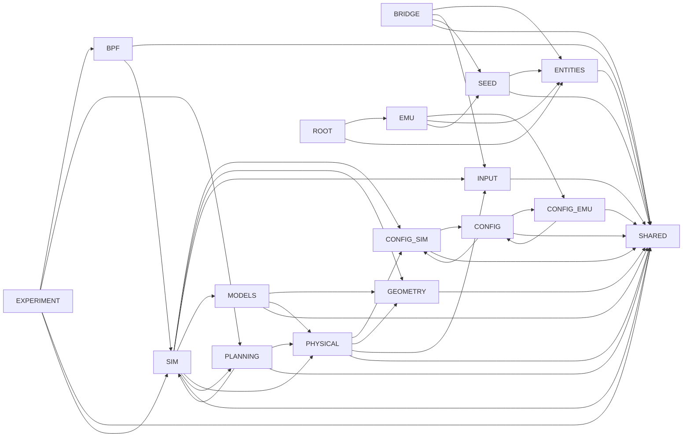

# Repository map

```text
skyseed_v2/
├── src/skyseed_v2/
│   ├── configuration/              immutable input declarations
│   ├── emulator/                   static Emulator construction
│   ├── simulator/
│   │   ├── physical/                 PhysicalWorld, PhysicalFrame, physical-link contracts
│   │   ├── planning/                 Planner, Plan, Models, replay, evidence
│   │   ├── geometry/                 positions and geometric calculations
│   │   ├── models/                   built-in physical Models
│   │   ├── input/                    immutable Simulator inputs
│   │   ├── simulator.py              composition root
│   │   └── timeline.py               formal timestamp authority
│   ├── backend/bpf/               Compiler, compiled realization, Runner
│   ├── experiment/                producer, persisted handoff, generated execution, Traffic
│   ├── compose/                   deployment utility
│   └── shared/                    narrow neutral values and private mechanics
├── tools/                         detached inspection readers/projectors/renderers
├── examples/                      maintained human-review and scenario entry points
├── tests/                         unit, integration, Tool, and architecture contracts
├── docs/                          accepted design, current status, references, guides
└── scripts/                       deterministic repository gates
```

## Planning package

```text
simulator/planning/
├── planner.py       authoritative public Planner
├── values.py        operational state, transitions, Plan, replay, fingerprints
├── models.py        public Protocols and reference Models
├── coordination.py  precedence policy and validation
├── evidence.py      versioned detached codecs
└── README.md        local contract
```

## Physical package

```text
simulator/physical/
├── world.py           PhysicalWorld and static entities
├── physical_frame.py  immutable timestamped positions
├── physical_link.py   request, observation, candidates, Model Protocol
├── position.py        PositionModel Protocol
├── capability.py      ISL capability
├── zone.py            Zone geometry/layout/membership
└── README.md          local contract
```

## Exact collapsed production import graph

Legend: `-->` is one direct production import after modules are collapsed to
their documented owner group. The graph is generated conceptually from parsed
Python imports; every edge is checked for exact equality by the documentation
gate.



## Inspection outputs

Maintained output roots are `inspection/physical-world`, `zone`,
`planner`, `bpf-compiler`, `runner`, `observation`, and
`traffic`. Producer-owned durable inputs live under `domain-history`.

No package directory or output root is retained solely to forward an obsolete
contract.
