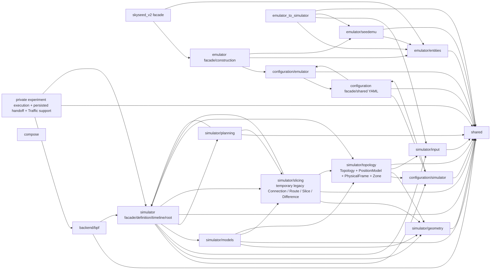

# Production package import map

Legend: every `A --> B` edge means at least one current Python module in
package group A directly imports a module in group B. No ownership, creation,
data flow, or “receives from” meaning is encoded here. Same-group imports are
collapsed. The gate derives this exact graph from production AST imports.

`EXPERIMENT` contains the one private generated-experiment composition, its
persisted immutable-realization handoff, and the deliberately narrow reusable
Traffic plan/execution support. It is not a BPF backend package and introduces
no second runtime authority.
`COMPOSE` has no outgoing production-package
dependency. `BPF` consumes public
Simulator/shared facts and no Compose package object. Simulator and Compose
have no reverse edge into BPF. External
stdlib/dependency imports, including upstream SEED, are outside this internal
graph. Module-level dependency validation remains acyclic even where collapsed
facade groups show edges in both directions.

Forbidden reverse dependencies remain Simulator core → Emulator/SEED,
production → Tools, and SEED integration → Simulator/Tools/Compose/examples.
Repository-level examples, Tools, tests, and scripts may import production;
production does not import them.

For ownership navigation (which the import edges above deliberately do not
encode), `simulator/topology/` is the accepted physical owner: it owns the
`PositionModel`, `Topology.frame_at()`, and immutable `PhysicalFrame` values.
`simulator/slicing/` retains only the current temporary legacy
Connection/Route/Slice/Difference seam. That seam remains visible for existing
Planner/Compiler consumers and is scheduled for deletion; it must not be read
as an alternative to the accepted `Topology / PhysicalFrame → Network
Planner` destination.

Current implementation state is maintained only in
[`CURRENT.md`](../CURRENT.md).
