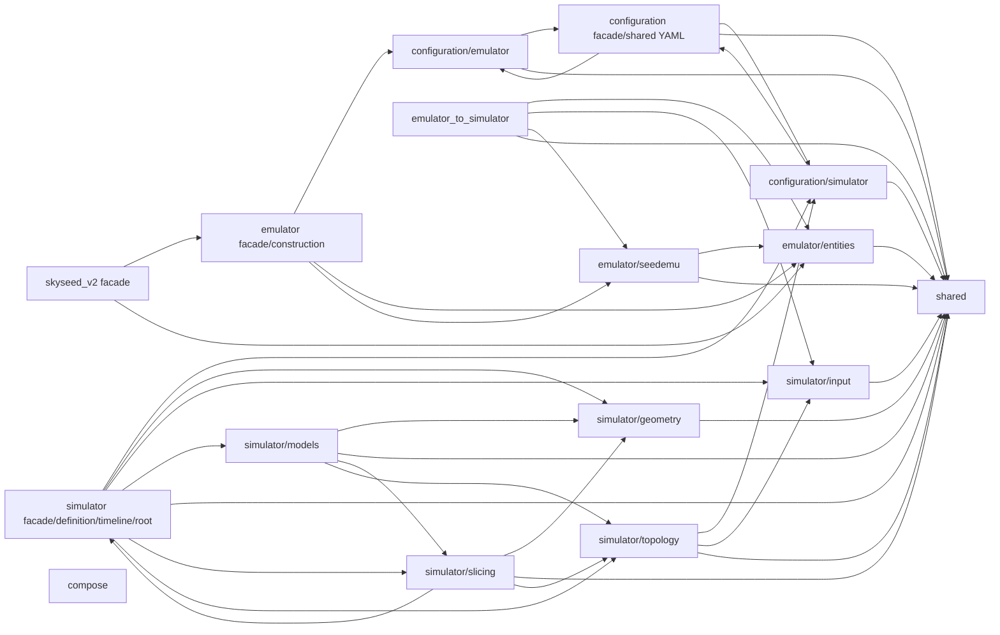

# Production package import map

Legend: every `A --> B` edge means at least one current Python module in
package group A directly imports a module in group B. No ownership, creation,
data flow, or “receives from” meaning is encoded here. Same-group imports are
collapsed. The gate derives this exact graph from production AST imports.

`COMPOSE` is intentionally isolated from other production packages. External
stdlib/dependency imports, including upstream SEED, are outside this internal
graph. Module-level dependency validation remains acyclic even where collapsed
facade groups show edges in both directions.

Forbidden reverse dependencies remain Simulator core → Emulator/SEED,
production → Tools, and SEED integration → Simulator/Tools/Compose/examples.
Repository-level examples, Tools, tests, and scripts may import production;
production does not import them.

Current implementation state is maintained only in
[`CURRENT.md`](../CURRENT.md).
