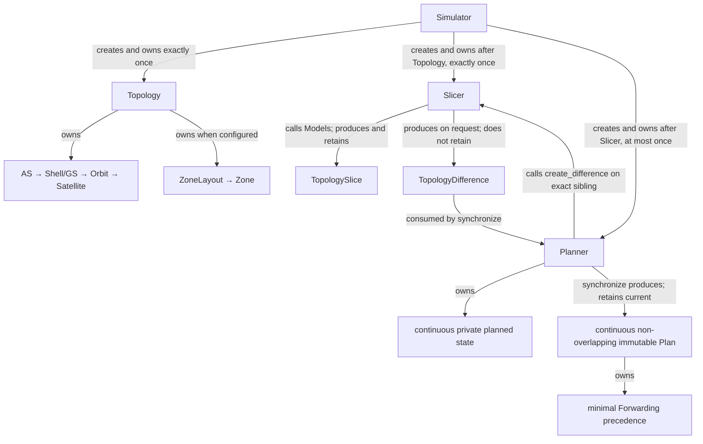
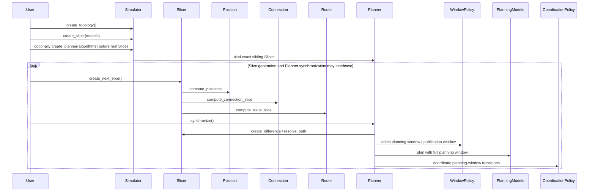

# Simulator, Topology, Slicer, Models, and Planner

Legend: every edge in this diagram carries its exact relationship. Topology, Slicer,
and Planner are peer-level components inside the Simulator domain; `Simulator`
creates and owns each of them. Planner is not a Slicer child, and Difference is
an immutable on-request value rather than a retained component.

Legend: every `A ->> B` message is a direct call from A to B; returns are
omitted. Slicer calls all three independent Model roles in numbered order; no
Model calls another Model.

The strict construction prerequisite is `Topology → Slicer → optional
Planner`. A Planner may therefore exist while the Slicer retains only synthetic
Slice 0; `synchronize()` cannot publish a Plan until at least one real adjacent
Slice Difference is available.

Planner selects a planning window from available Differences and then its
publication window before invoking any planning Model. Models and Coordination
see the unpublished planning-window portion beyond the Plan end;
fixed validation then publishes a continuous non-overlapping `(start, end]`
Plan while private planned state continues across the boundary. Reusable
unpublished overlap is extended rather than replaying settled Differences, and
the baseline never resets to raw Slice state. Planner performs formal Slicer
queries itself; the Forwarding Model receives only immutable route-path facts.
Plan's temporal index is an inspection view, while Plan-owned Forwarding
precedences carry only genuine same-time semantic constraints and are not an
execution schedule.

Code entry: `src/skyseed_v2/simulator/simulator.py`; readable assembly:
`examples/mini_satellite_internet/simu.py`.
Implementation state is recorded only in [`CURRENT.md`](../CURRENT.md).
