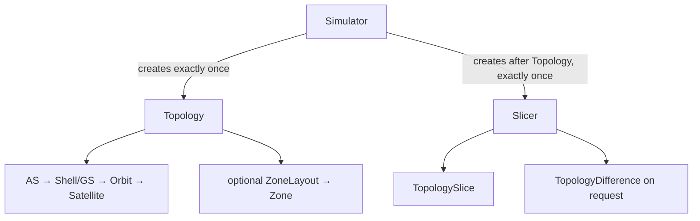
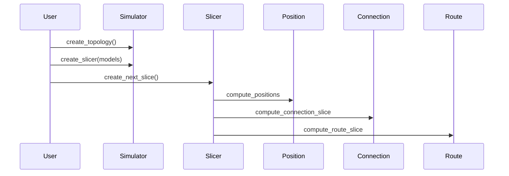

# Simulator, Topology, Slicer, and Models

Legend: `A --> B` means A directly creates B. It does not express a Model
call or retained reference.

Legend: every `A ->> B` message is a direct call from A to B; returns are
omitted. Slicer calls all three independent Model roles in numbered order; no
Model calls another Model.

Code entry: `src/skyseed_v2/simulator/simulator.py`; readable assembly:
`examples/dynamic_slice_network/simu.py`.
Implementation state is recorded only in [`CURRENT.md`](../CURRENT.md).
