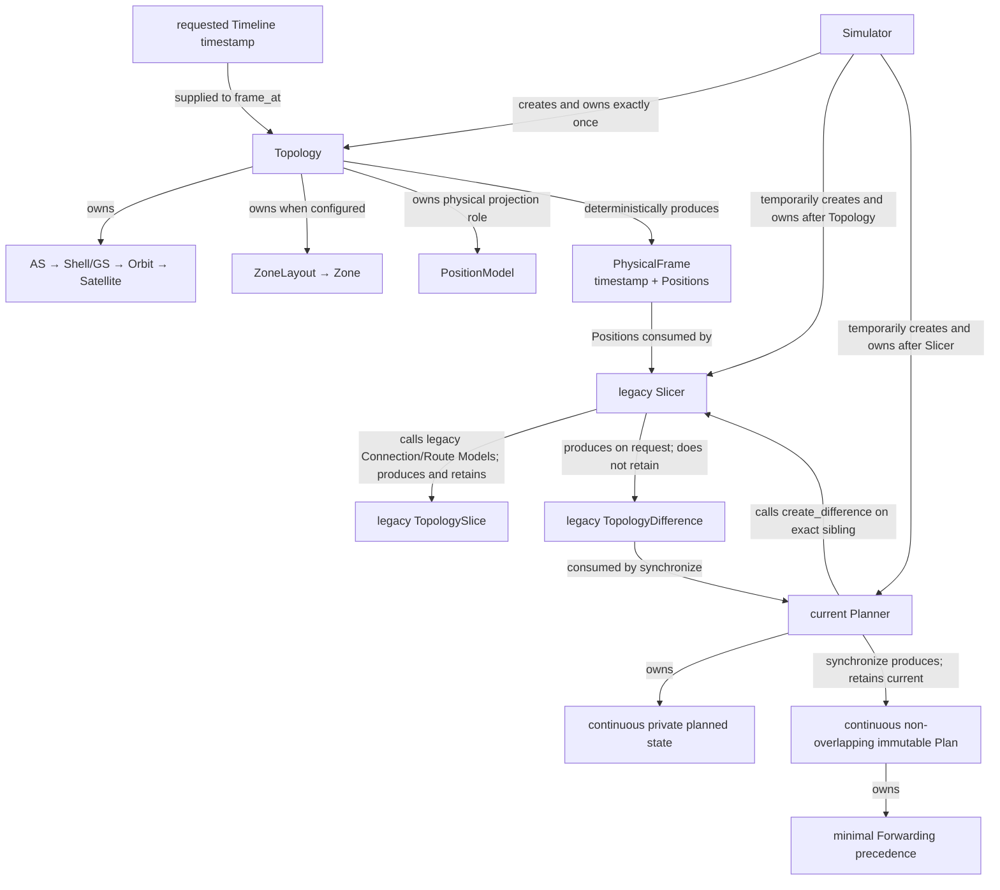
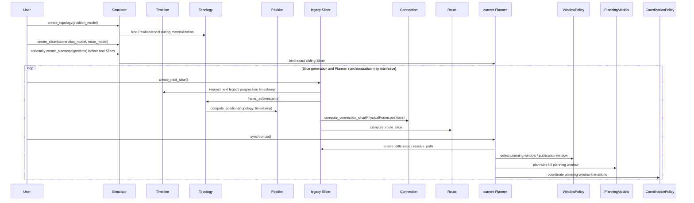

# Simulator physical foundation and temporary operational seam

The accepted destination separates physical, planned-operational, and realized
runtime state:

```text
Topology / PhysicalFrame
→ Network Planner
→ PlannedOperationalState
→ Plan
→ Compiler / Runner
→ RealizedRuntimeState
```

Round 1 establishes only the physical foundation. Legend: every edge in the
diagram carries its exact current relationship. The legacy Slicer and current
Planner remain Simulator-owned peer components only as an explicit temporary
seam. Planner is not a Slicer child, and Difference is an immutable on-request
legacy value rather than a retained component.



Legend: every `A ->> B` message is a direct call from A to B; returns are
omitted. Topology calls the physical PositionModel. The temporary Slicer then
calls only the still-legacy Connection and Route Model roles; no Model calls
another Model.



The strict current construction prerequisite is `Topology(PositionModel) →
legacy Slicer(ConnectionModel, RouteModel) → optional current Planner`.
`Topology.frame_at(timestamp)` is independently callable and does not advance a
time cursor. `PhysicalFrame.timestamp` is its physical domain identity; it has
no Slice/frame sequence ID and contains no Connection, Route, Zone-serving,
Difference, planning, Plan, or runtime state. The Slicer's timeline iterator
and old Slice IDs remain visible migration debt in this round.

A current Planner may exist while the legacy Slicer retains only synthetic
Slice 0; `synchronize()` cannot publish a Plan until at least one real adjacent
legacy Slice Difference is available.

Planner selects a planning window from available Differences and then its
publication window before invoking any planning Model. Models and Coordination
see the unpublished planning-window portion beyond the Plan end;
fixed validation then publishes a continuous non-overlapping `(start, end]`
Plan while private planned state continues across the boundary. Reusable
unpublished overlap is extended rather than replaying settled Differences, and
the baseline never resets to raw Slice state. Planner performs formal Slicer
queries itself; the Forwarding Model receives only immutable route-path facts.
Plan's temporal index is an inspection view, while Plan-owned Forwarding
precedences carry only genuine same-time semantic constraints and are not an
execution schedule.

These Planner semantics are preserved during Round 1; they do not grant the
legacy seam long-term ownership. Connection operational planning, effective
Parameter/resource planning, Route planning, Coordination, and
`PlannedOperationalState` move into the Network Planner in later rounds. Once
that move is complete, Slicer and the old mixed `TopologySlice` /
`TopologyDifference` path are deleted completely.

Code entry: `src/skyseed_v2/simulator/simulator.py`; readable assembly:
`examples/mini_satellite_internet/simu.py`.
Implementation state is recorded only in [`CURRENT.md`](../CURRENT.md).
