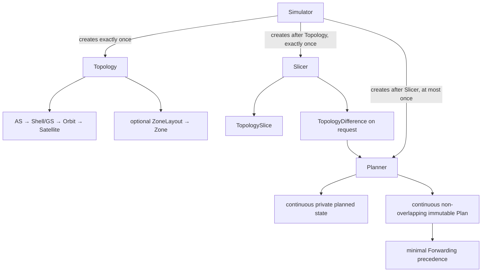
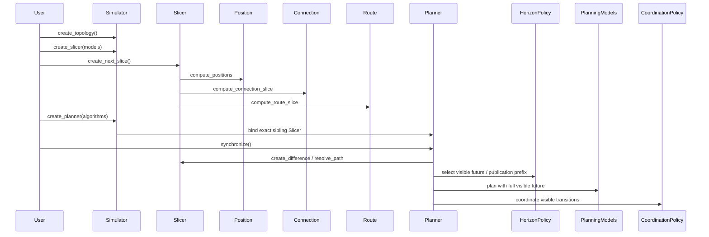

# Simulator, Topology, Slicer, Models, and Planner

Legend: `A --> B` means A directly creates B. It does not express a Model
call or retained reference.

Legend: every `A ->> B` message is a direct call from A to B; returns are
omitted. Slicer calls all three independent Model roles in numbered order; no
Model calls another Model.

Planner selects visible future and its publication prefix before invoking any
planning Model. Models and Coordination see lookahead beyond the Plan end;
fixed validation then publishes a continuous non-overlapping `(start, end]`
Plan while private planned state continues across the boundary. Reusable
unpublished overlap is extended rather than replaying settled Differences, and
the baseline never resets to raw Slice state. Planner performs formal Slicer
queries itself; the Forwarding Model receives only immutable route-path facts.
Plan's temporal index is an inspection view, while Plan-owned Forwarding
precedences carry only genuine same-time semantic constraints and are not an
execution schedule.

Code entry: `src/skyseed_v2/simulator/simulator.py`; readable assembly:
`examples/mini_satellite_internet/simu.py`.
Implementation state is recorded only in [`CURRENT.md`](../CURRENT.md).
