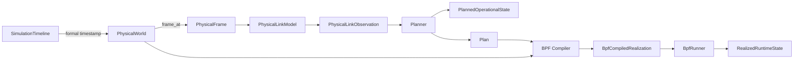
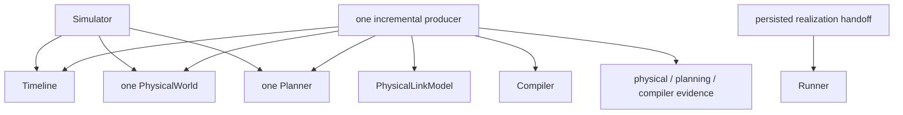

# System overview

Skyseed v2 models physical feasibility, operational intent, compiled intent,
and realized runtime as separate layers.

Legend: `-->` is the forward semantic handoff; labels name the value or action
at a boundary.

## Why the boundaries matter

A physical candidate says that a relationship is feasible at one timestamp.
The Planner decides whether it is selected, acquiring, operational, assigned,
parameterized, and routable. A Plan carries replay-complete changes. Compiler
validates that semantic lineage and lowers it to intended backend operations.
Runner alone observes live realization.

This prevents three common category errors:

- presenting a candidate as an operational Connection;
- treating compiled intention as realized state;
- reconstructing planned-unreachable from a missing forwarding entry.

## Composition

Simulator owns one Timeline, one PhysicalWorld, and one public Planner. The
incremental realization producer sits in experiment orchestration because it
owns the Timeline cursor and crosses from Simulator facts into Compiler output.
Precomputed execution drains this one producer and persists its realizations.

Legend: `-->` is an owned reference or invocation from the composition root;
the producer coordinates but does not absorb the referenced owner's authority.

Runner never synchronously requests heavy semantic progression. Future rolling
work will add a bounded concurrent coordinator around the same producer.

## Canonical S3

The canonical scenario remains 720 Satellites, 355 GroundStations, 732 Zones,
and ten minutes at 5-second resolution. The physical capability limit is 4;
the ISL policy requests 2 same-plane plus 2 cross-plane links from K3 scope and
uses a 20-second acquisition reference.

Planning uses a 50-second lookahead and publishes contiguous prefixes of at most
20 seconds. The 121 formal timestamps therefore remain present across 30 Plans
and 30 compiled realizations.

## Evidence and inspection

The producer writes compact physical-frame, planning, and Compiler JSONL
streams under one terminal hash seal. A separate checksum handoff owns each
complete compiled realization, and generated execution anchors that handoff.
Detached Tools render Physical World, Zone, Planner, BPF Compiler,
Observation, Runner, and Traffic views. Physical World retains exact
`PhysicalFrame` inspection without a separate PhysicalFrame Tool. Tools cannot become a
dependency of compute or runtime handoff.

Full S3 persisted runtime qualification remains a later stage; offline
compilation is not a runtime claim.
