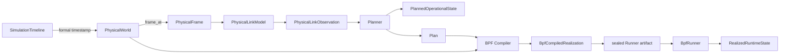
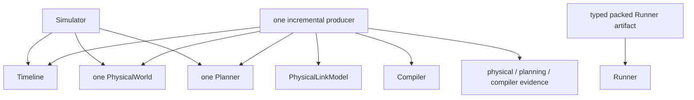

# System overview

Skyseed v2 models physical feasibility, operational intent, compiled intent,
and realized runtime as separate layers.

Legend: `-->` is the forward semantic handoff; labels name the value or action
at a boundary.

## Why the boundaries matter

A physical candidate says that a relationship is feasible at one timestamp and
may carry a proved future contact window. The prediction bound is not a loss event.
The Planner decides whether it is selected, acquiring, operational, assigned,
parameterized, and routable. A Plan carries replay-complete changes. Compiler
validates that semantic lineage and lowers it to intended backend operations.
Runner alone observes live realization.

This prevents three common category errors:

- presenting a candidate as an operational Connection;
- treating compiled intention as realized state;
- reconstructing planned-unreachable from a missing forwarding entry.

## Composition

Simulator owns one Timeline, one PhysicalWorld, and one public Planner. The
incremental realization producer sits in experiment orchestration because it
owns the Timeline cursor and crosses from Simulator facts into Compiler output.
Precomputed execution drains this one producer completely and seals a compact
Runner artifact before live replay begins.

Legend: `-->` is an owned reference or invocation from the composition root;
the producer coordinates but does not absorb the referenced owner's authority.

Runner never requests semantic progression. Each delivered artifact contains finite future knowledge; future live
Connections remain absent until their activation boundary creates them.
Preparation builds and prewrites the first batch and activates boundary 0. Formal Main
starts at boundary 1 and applies only prepared deltas through a retained privileged
channel. Runner/backend Maintenance prepares the next admitted sealed batch
while Main runs and reclaims eligible retired runtime data. At the seam, missing
READY fails the session without waiting past the deadline or shifting the clock.
Cleanup owns final teardown.

Generation publication is a forwarding subphase. A formal boundary becomes
ACTIVE only after its complete Main delta, including withdrawals and joined
physical deletion, succeeds. The retained helper owns its deletion workers and
retirement ledger; it provides no cross-boundary deletion service. Asynchronous
identity writing stays in existing observation facilities. These implementation
details and private logical ports/live bindings add no domain owner or Port entity.

## Canonical S3

The canonical scenario remains 720 Satellites, 355 GroundStations, 732 Zones,
and ten minutes at 5-second resolution. The physical capability limit is 4;
the ISL policy requests 2 same-plane plus 2 cross-plane links from cyclic
predecessor/successor and adjacent-plane K1 scope (wider scopes remain configurable), and
uses 5-second ISL/GS preparation with 180/60-second future useful service.

Planning publishes batches of 32 formal frames without an independent lookahead
wait. All 121 timestamps remain present across four Plans and four realizations.
Physical contact prediction extends only for admission dependencies; preparation
and operational state remain Planner-owned. Delay uses a 10% relative threshold
and a 120-second refresh. Work reviewed the preceding computation round with
no blocking findings within that scope. The current deployment/cadence extension
remains subject to Work review. Explicit S1 and 1-second Example selection keeps
these durations in seconds; 601 boundaries produce 19 Plans. See the
[Framework guide](framework-construction-execution.md) for the actual configuration
and execution flow, and the [performance view](qualification-performance.md) for
the three-condition measurements, work counts and qualification limits.

## Evidence and inspection

The producer writes compact physical-frame, planning, and Compiler streams under
one terminal hash seal. A separate manifest plus typed packed binary owns the
normalized symbolic runtime tables, and generated execution anchors that artifact.
Detached Tools render Physical World, Zone, Planner, BPF Compiler,
Observation, Runner, and Traffic views. Physical World retains exact
`PhysicalFrame` inspection without a separate PhysicalFrame Tool. Tools cannot become a
dependency of compute or runtime execution.

Offline compilation alone is not a runtime claim. The finite Runner milestone's
implementation, full S3 runtime evidence and documentation have passed Work
review, as recorded in [CURRENT](../CURRENT.md); historical evidence remains in
its linked provenance.

Finite generation publishes a material-readiness status after required seals and
runtime controls, before optional Tools finish. Ordered evidence workers and
artifact/Traffic packaging have bounded queues. Their elapsed durations overlap
semantic work; Tool completion and total wall time are reported separately.
These are implementation details of existing owners, not a new scheduling service.
