# System overview

## Mental model

The accepted path can be read as eight questions:

| Component | Mental model |
|---|---|
| Emulator | 实验里有什么、节点里装什么？ |
| Topology / PhysicalFrame | 这个时间戳的物理世界在哪里？ |
| Network Planner | 哪些连接、参数、路径和协调决策应该真的生效，以及什么时候生效？ |
| PlannedOperationalState | Planner 在该时刻选择的完整运行语义是什么？ |
| Plan | Backend-independent formal network intent。 |
| BPF Compiler | 把 formal intent 翻译成 symbolic BPF backend work。 |
| BpfRunner | 按时间忠实、高效地把 work 落到 live Linux network。 |
| Default tc-BPF dataplane / Linux kernel | Packet 最终实际怎么走？ |

Round 1 establishes the physical foundation but deliberately does not perform
the Network Planner migration. The accepted destination is:

```text
Topology / PhysicalFrame
→ Network Planner
→ PlannedOperationalState
→ Plan
→ Compiler / Runner
→ RealizedRuntimeState
```

The current implementation temporarily preserves this visible legacy seam:

```text
Topology / PhysicalFrame
→ legacy Slicer operational remainder
→ current Planner
→ Plan
```

That seam is migration debt, not an alternate architecture. Slicer is
scheduled for complete removal after Connection, effective Parameter/resource,
Route, and Coordination ownership moves into the Network Planner.

## End-to-end relationships

Legend: every edge below carries its own relationship label. Creation/ownership,
calls, value production/consumption, read-only access, persistence, and
post-run reads are deliberately not represented by one generic arrow.

```mermaid
flowchart LR
    CFG["Emulator configuration"] -->|configures call| CON["create_static_emulator"]
    CON -->|creates| EMU["upstream SEED Emulator<br/>Skyseed entity owner tree"]
    EMU -->|projected by| BOUND["create_simulator_static_input"]
    BOUND -->|produces| DTO["immutable SimulatorStaticInput"]
    DTO -->|supplied to| DEF["SimulationDefinition"]
    DEF -->|owns timestamp domain| TIME["SimulationTimeline"]
    DEF -->|constructs| SIM["Simulator"]
    SIM -->|creates and owns, bound to physical Model| TOP["one Topology + PositionModel"]
    TOP -->|frame_at deterministically produces| FRAME["immutable PhysicalFrame<br/>timestamp + Positions"]
    SIM -->|temporarily creates and owns| SLI["one legacy Slicer"]
    SIM -->|temporarily creates and owns after Slicer| PLA["at most one current Planner"]
    SLI -->|temporarily requests next timestamp from| TIME
    SLI -->|supplies requested timestamp to| TOP
    FRAME -->|Positions consumed by| SLI
    SLI -->|calls legacy Connection/Route Models; produces and retains| SLICE["legacy TopologySlice values"]
    PLA -->|calls create_difference on exact sibling| SLI
    SLI -->|produces on request; does not retain| DIFF["legacy TopologyDifference value"]
    DIFF -->|consumed by synchronize| PLA
    PLA -->|synchronize produces; Planner retains current| PLAN["immutable semantic Plan"]
    PLAN -->|semantic input consumed by| BPF["one-shot compile_bpf"]
    SLI -->|read-only get_slice / get_topology access| BPF
    PREVIOUS["optional previous compiled baseline"] -->|explicit input consumed by| BPF
    BPF -->|produces| REAL["immutable symbolic BpfCompiledRealization"]
    REAL -->|supplier delivers; Runner consumes| RUN["BpfRunner"]

    MAIN["canonical main.py"] -->|passes already-produced formal values to| GTOOLS["generation-time formal-object Tools"]
    TOP -->|read by| GTOOLS
    FRAME -->|read by Physical Frame Tool| GTOOLS
    SLI -->|read by| GTOOLS
    PLAN -->|read by| GTOOLS
    REAL -->|read by| GTOOLS

    EMU -->|compiled by| COMP["upstream SEED Docker compiler"]
    COMP -->|produces| PROJECT["generated Compose project"]
    PROJECT -->|started by caller| DEPLOY["live containers"]
    DEPLOY -->|project identity handed to; bindings discovered by| RUN
    RUN -->|prepares, activates, and reclaims| LIVE["live tc-BPF network"]
    RUN -->|produces; owner/caller persists| EVID["detached Runner and traffic evidence"]
    EVID -->|post-run read by| PTOOLS["Runner / Traffic evidence Tools"]
```



The physical/operational path and static deployment path share the Emulator
source but not lifecycle ownership. Topology owns physical projection and its
PositionModel; `PhysicalFrame` is an immutable physical-domain value whose
timestamp is its identity. It contains exactly the Topology node Positions and
no Connection, Route, serving, Difference, planning, Plan, or runtime state.
Generation-time Tools receive already-produced formal objects/results from
`main.py`; post-run Runner/Traffic Tools read detached, persisted evidence. No
Tool owns production progression or lifecycle.
The BPF Compiler is a downstream reader, not a Simulator-owned component; it
does not bind containers or kernel resources. The BPF Runner receives the
Compiler output plus the identity of an already-running Compose project,
independently discovers and freezes its required live bindings, and solely
owns dynamic kernel-resource preparation, active publication, and scoped
Runner teardown through public `cleanup()`. It does not own Compose startup or
Compose teardown. `ComposeProjectLauncher`
remains an optional programmatic deployment utility, not a prerequisite for
Runner attachment. Any future shared container
software remains functional-Layer/SEED deployment work on the lower path.
Implementation state is recorded only in [`CURRENT.md`](../CURRENT.md).

## Host runtime configuration changes

The host operating system retains the following changes for large-scale
Skyseed execution.

### D-Bus

```yaml
max_connections_per_user: 256 → 512
```

During large-scale Docker container startup, UID 0 D-Bus connections reached
the original per-user limit. The higher limit reduces connection exhaustion in
the container-lifecycle control plane, while allowing related processes to
consume more D-Bus control-plane resources before the limit is reached.

### inotify

```yaml
fs.inotify.max_user_instances: 128 → 1024
```

Large-scale container lifecycle activity produced inotify instance exhaustion
and containerd inotify resource warnings. The higher limit provides more
container/runtime monitoring headroom per user, while allowing more kernel
resources to be used before the protection limit is reached.

### Docker cgroup driver

```yaml
cgroup version: v2 (unchanged)
cgroup driver: systemd → cgroupfs
```

During large-scale container startup, Docker's path through systemd to create a
transient `docker-*.scope` for each container produced many timeouts.
Docker/runc now manage Docker container cgroups directly without asking
systemd to create an independent transient scope for every container. Cgroup
v2 remains in use, and CPU, memory, and PID cgroup isolation remain present.
Systemd no longer owns an individual `docker-*.scope` for each Docker
container, so per-container systemd visibility and systemd-level unified
management are reduced.

These changes were introduced after host container-lifecycle control-plane
limits were encountered around the thousand-container scale.

### Rollback

```bash
sudo rm /etc/docker/daemon.json
sudo systemctl restart docker
docker info --format 'Cgroup Driver={{.CgroupDriver}} Cgroup Version={{.CgroupVersion}}'
```

The expected restored Docker state is:

```text
Cgroup Driver=systemd Cgroup Version=2
```

The original limits are:

```text
D-Bus max_connections_per_user = 256
fs.inotify.max_user_instances = 128
```

The rollback has not been executed.

## Responsibility hierarchy

```text
Skyseed
├─ Deployment / Emulation
│  ├─ upstream SEED Emulator
│  ├─ Future functional Layer (unimplemented; API unfrozen)
│  ├─ upstream SEED Docker compiler
│  └─ generated Compose project / caller-started live deployment
├─ Simulator domain (`Simulator` is the composition root)
│  ├─ Topology                         # physical aggregate and projection owner
│  │  ├─ PositionModel                 # physical Model bound at construction
│  │  └─ PhysicalFrame values          # immutable timestamp + Positions
│  ├─ legacy Slicer                    # temporary operational migration seam
│  │  ├─ ConnectionModel / RouteModel
│  │  ├─ retained legacy TopologySlice values
│  │  └─ on-request legacy TopologyDifference values (not retained)
│  ├─ current Planner                  # temporary old Difference consumer
│  │  ├─ PlanningWindowPolicy
│  │  ├─ Connection / Parameter / Forwarding planning Models
│  │  ├─ CoordinationPolicy
│  │  └─ current immutable Plan value
│  └─ SimulationTimeline               # timestamp authority, not a projector
├─ Backend domain
│  └─ BPF backend
│     ├─ BPF Compiler (`compile_bpf`)   # one-shot capability
│     ├─ BpfCompiledRealization        # immutable handoff value
│     └─ BpfRunner                     # sole live BPF lifecycle owner
│        ├─ Preparation                # internal capability
│        ├─ Main                       # internal capability
│        └─ Maintenance                # internal capability
│             ↓
│        private default tc-BPF realization → Linux kernel
├─ Experiment-side support
│  └─ Traffic probe planning/execution       # observes; owns no Runner lifecycle
└─ Repository-local Inspection Tools
   ├─ generation-time formal-object Tools
   └─ post-run Runner / Traffic evidence Tools
```

Preparation, Main, and Maintenance are internal capabilities of one
`BpfRunner`, not separate public lifecycle owners. The default tc-BPF
dataplane is the current private mechanism, not a public plugin contract.

## Component responsibilities

| Component | Responsibility | Change this when... |
|---|---|---|
| Emulator | Own current static experiment composition and entities | The experiment contains different nodes or static composition |
| Future functional Layer (unimplemented; API unfrozen) | Would supply shared software, files, commands, and daemons if separately approved | A future functional Layer is introduced or changed |
| Upstream SEED Docker compiler | Lower the static Emulator composition into a generated Compose deployment | Static container/deployment compilation changes |
| Simulator / SimulationTimeline | Own the simulation composition and timestamp domain, without owning physical projection results | The formal composition or time range changes |
| Topology / PositionModel | Own static physical identity and deterministically project one requested timestamp | Static physical membership or position algorithms change |
| PhysicalFrame | Carry immutable physical timestamp identity and exactly one Position per Topology node | The physical-domain handoff contract changes |
| Legacy Slicer / ConnectionModel / RouteModel / TopologyDifference | Temporary Round-1 operational remainder: consume a PhysicalFrame, retain old mixed Slices, and compare adjacent Slices | Only a mechanically required legacy behavior changes before deletion |
| Current Planner | Preserve existing Difference-based planning semantics until Network Planner migration | Current legacy publication behavior must remain stable during migration |
| Network Planner (accepted target; not implemented in Round 1) | Own Connection, effective Parameter/resource, Route, and Coordination planning and produce planned operational state | The next operational architecture rounds are implemented |
| PlannedOperationalState (accepted target; not implemented in Round 1) | Carry complete selected operational semantics separately from physical and realized runtime state | The Network Planner output contract is introduced |
| PlanningWindowPolicy | Select the planning and publication windows from available Differences | Planner visibility/publication window policy changes |
| Planning models / CoordinationPolicy | Produce and coordinate connection, parameter, forwarding, and ordering decisions | Cross-Difference planning or cross-domain coordination changes |
| Plan | Carry immutable backend-independent formal network intent | A backend-independent transition contract changes |
| BPF Compiler | Deterministically lower Plan plus approved read-only Simulator facts | Symbolic BPF backend work or lowering constraints change |
| BpfCompiledRealization | Carry immutable symbolic BPF work and the next-compile intended baseline | The Compiler-to-Runner symbolic handoff changes |
| BpfRunner | Own live attachment, Preparation, timed Main activation, Maintenance, reclaim, failure evidence, and bounded scoped teardown through `cleanup()` | Live lifecycle, readiness, timing, or runtime ownership changes |
| Runner Inspection Tool | Project detached post-run Runner summary/frozen-binding scalars/events into a static non-authoritative lifecycle view | Human presentation of Runner lifecycle/control-plane evidence changes |
| Default tc-BPF dataplane / Linux kernel | Realize links, qdisc, BPF state, forwarding, and active packet behavior | The concrete Linux packet mechanism changes |

## Where should a new feature go?

| Desired change or observation | Primary owner |
|---|---|
| 改变卫星位置传播算法 | Topology-bound `PositionModel` |
| 改变卫星连接判定 | `ConnectionModel` |
| 短暂连接不值得切 | `ConnectionPlanningModel` / Planner |
| Handover 需要 200 ms interruption | Planner planning/timing |
| 给所有卫星安装程序或 traffic generator | Emulator / SEED Layer-Service |
| 研究另一种 eBPF packet-forwarding algorithm | BPF backend dataplane extension area |
| Future link 提前对用户可用 | Runner/default-dataplane correctness bug |
| Future BPF state 超过 capacity | Runner Preparation / dataplane capacity audit |
| 查看一次 Runner 运行的 Main/Maintenance/timing/teardown 历史 | repository-local Runner Inspection Tool |

## Semantics before optimization

Simulation semantics come first. Runner optimization removes Linux,
container, and BPF preparation overhead from the active boundary. It must not
optimize away connection lifetime, nominal timing, delay, loss, bandwidth, or
active/inactive semantics already decided upstream.

Runner performance is therefore part of simulation correctness relative to
the target profile's nominal semantic transition schedule. PhysicalFrame
resolution, the temporary legacy Slice resolution, current Planner publication
cadence, Plan nominal transition timing, and Runner execution cadence are
distinct; no universal ten-second Runner threshold follows from any one of
them.
