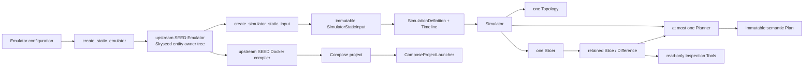

# System overview

Legend: `A --> B` means B is the next system boundary receiving A's formal
output or control handoff. It does not express object ownership.

The upper dynamic path and lower static deployment path share the Emulator
source but not lifecycle ownership. Tools only observe formal objects/results.
Implementation state is recorded only in [`CURRENT.md`](../CURRENT.md).
