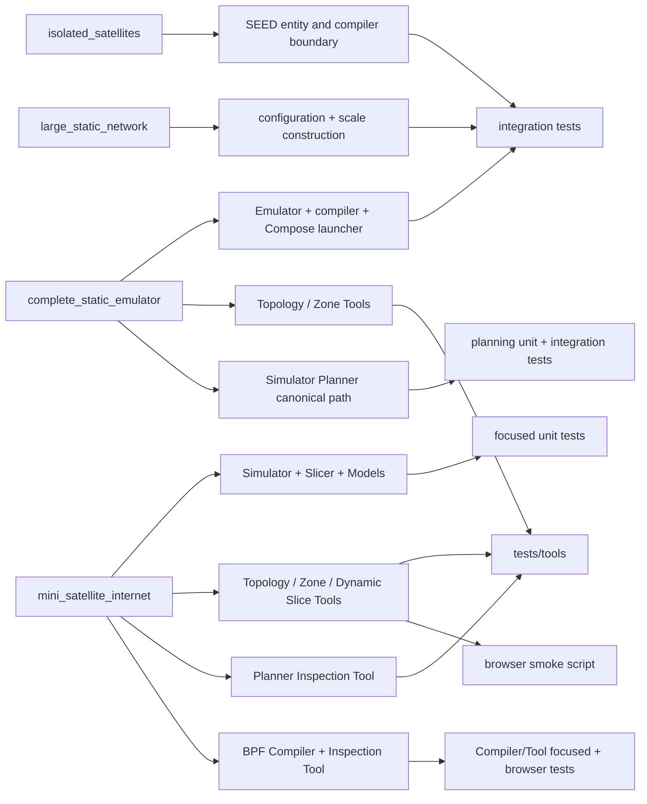

# Examples, Tools, and tests

Legend: `A --> B` means A is directly exercised or represented by B in this
example-to-verification traceability map. It does not express imports or
ownership.

| Change area | Human entry | Primary verification |
|---|---|---|
| Emulator/configuration/SEED | `complete_static_emulator` | entity, construction, compiler integration |
| Simulator/Topology/Zone | `mini_satellite_internet/simu.py` | topology, zone, lifecycle unit tests |
| Slicer/Models/Difference | `mini_satellite_internet` | dynamic main-chain and difference tests |
| Planner/Plan/planning algorithms | `mini_satellite_internet/simu.py` | planning value, algorithm and main-chain tests |
| Planner human inspection | `mini_satellite_internet/main.py` | Planner Tool tests and visual artifact inspection |
| BPF Compiler inspection | `mini_satellite_internet/main.py` | Compiler/Tool focused tests and browser smoke |
| Inspection Tools | both complete and dynamic examples | `tests/tools`, tooling boundaries, browser smoke |
| Compose launcher | complete/large examples | launcher and large-network integration |

Exact file-level maintenance ownership lives only in
`../codex-reference/maintenance-map.md`.
Implementation state is recorded only in [`CURRENT.md`](../CURRENT.md).
