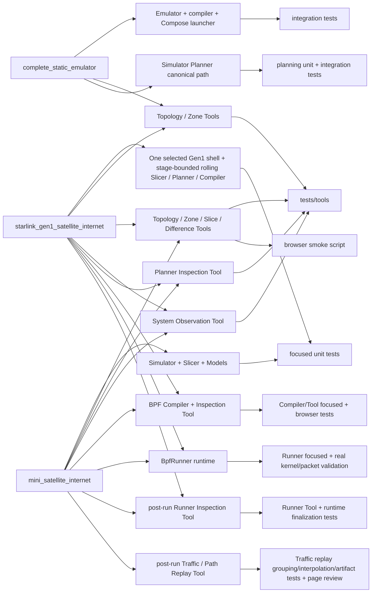

# Examples, Tools, and tests

Legend: `A --> B` means A is directly exercised or represented by B in this
example-to-verification traceability map. It does not express imports or
ownership.

| Change area | Human entry | Primary verification |
|---|---|---|
| Emulator/configuration/SEED | `complete_static_emulator` | entity, construction, compiler integration |
| Simulator/Topology/Zone | `mini_satellite_internet/simu.py` and `starlink_gen1_satellite_internet/simu.py` | topology, zone, lifecycle, shell-selection, and scale-input tests |
| Slicer/Models/Difference | `mini_satellite_internet` and Starlink Gen1 `--through slicer` (Zone-service minimum: 25°) | dynamic main-chain, Starlink Gen1 integration, exhaustive-pruning equivalence, and Difference tests |
| Planner/Plan/planning algorithms | `mini_satellite_internet/simu.py` | planning value, algorithm and main-chain tests |
| Planner human inspection | `mini_satellite_internet/main.py` and Starlink Gen1 `--through planner` | Planner Tool tests, detached-handoff tests, and Firefox visual inspection |
| Slicer/Planner execution observation | `mini_satellite_internet/main.py` and Starlink Gen1 `--through slicer|planner|compiler` | Observation record/aggregation/artifact tests and visual page inspection |
| BPF Compiler inspection | `mini_satellite_internet/main.py` and Starlink Gen1 `--through compiler` | Compiler/Tool focused tests, detached-handoff tests, and browser smoke |
| BPF Runner live lifecycle | generated Mini or Starlink Gen1 `start.sh` followed by `run.sh` (or thin `launch.sh`) → private `experiment.execution` composition → `BpfRunner`; Starlink Gen1 consumes its persisted exact Compiler handoff | Runner contract/main-chain, persisted-handoff, bounded-execution, teardown, and focused real generated-workflow validation |
| BPF Runner human inspection | generated Mini or Starlink Gen1 `run.sh` → `inspection/runner/index.html` | Runner Tool projection/artifact/completeness tests, runtime finalization tests, controlled-interruption page review |
| Traffic/path replay | generated Mini `run.sh` → `inspection/traffic/index.html` | clock/grouping/identity/interpolation/artifact tests plus canonical packet-path page review |
| Inspection Tools | all three maintained examples; Starlink Gen1 adds canonical lazy Slice, Planner, Compiler, and Observation views through bounded detached workers | `tests/tools`, detached process/handoff tests, tooling boundaries, browser smoke |
| Compose launcher | `complete_static_emulator` and canonical Mini | launcher and integration tests |

Exact file-level maintenance ownership lives only in
`../codex-reference/maintenance-map.md`.
Implementation state is recorded only in [`CURRENT.md`](../CURRENT.md).
