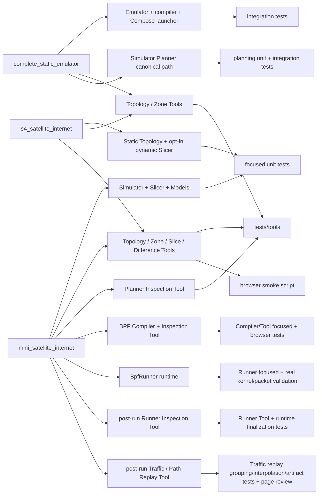

# Examples, Tools, and tests

Legend: `A --> B` means A is directly exercised or represented by B in this
example-to-verification traceability map. It does not express imports or
ownership.

| Change area | Human entry | Primary verification |
|---|---|---|
| Emulator/configuration/SEED | `complete_static_emulator` | entity, construction, compiler integration |
| Simulator/Topology/Zone | `mini_satellite_internet/simu.py` and `s4_satellite_internet/simu.py` | topology, zone, lifecycle, and S4 scale-input tests |
| Slicer/Models/Difference | `mini_satellite_internet` and opt-in dynamic S4 (final S4 Zone-service minimum: 25°) | dynamic main-chain, S4 integration, exhaustive-pruning equivalence, and Difference tests |
| Planner/Plan/planning algorithms | `mini_satellite_internet/simu.py` | planning value, algorithm and main-chain tests |
| Planner human inspection | `mini_satellite_internet/main.py` | Planner Tool tests and visual artifact inspection |
| BPF Compiler inspection | `mini_satellite_internet/main.py` | Compiler/Tool focused tests and browser smoke |
| BPF Runner live lifecycle | generated Mini `start.sh` → `run.sh` → root-private `_generated_bpf_execution` application composition → `BpfRunner` | Runner contract/main-chain tests and focused real generated-workflow validation |
| BPF Runner human inspection | generated Mini `run.sh` → `inspection/runner/index.html` | Runner Tool projection/artifact tests, runtime finalization tests, controlled-interruption page review |
| Traffic/path replay | generated Mini `run.sh` → `inspection/traffic/index.html` | clock/grouping/identity/interpolation/artifact tests plus canonical packet-path page review |
| Inspection Tools | all three maintained examples; dynamic S4 adds the canonical lazy Slice / Difference view | `tests/tools`, tooling boundaries, browser smoke |
| Compose launcher | `complete_static_emulator` and canonical Mini | launcher and integration tests |

Exact file-level maintenance ownership lives only in
`../codex-reference/maintenance-map.md`.
Implementation state is recorded only in [`CURRENT.md`](../CURRENT.md).
