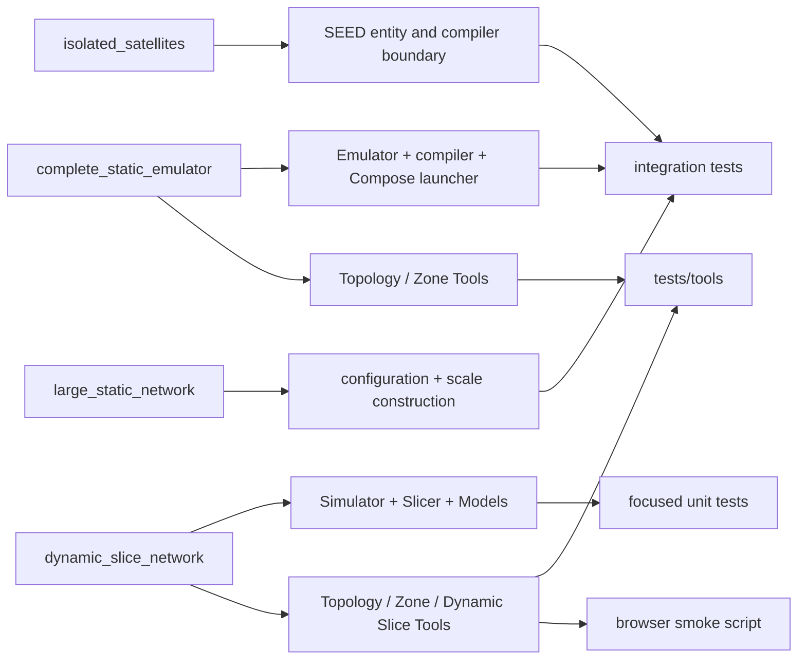

# Examples, Tools, and tests

Legend: `A --> B` means A is directly exercised or represented by B in this
example-to-verification traceability map. It does not express imports or
ownership.

| Change area | Human entry | Primary verification |
|---|---|---|
| Emulator/configuration/SEED | `complete_static_emulator` | entity, construction, compiler integration |
| Simulator/Topology/Zone | `dynamic_slice_network/simu.py` | topology, zone, lifecycle unit tests |
| Slicer/Models/Difference | `dynamic_slice_network` | dynamic main-chain and difference tests |
| Inspection Tools | both complete and dynamic examples | `tests/tools`, tooling boundaries, browser smoke |
| Compose launcher | complete/large examples | launcher and large-network integration |

Exact file-level maintenance ownership lives only in
`../codex-reference/maintenance-map.md`.
Implementation state is recorded only in [`CURRENT.md`](../CURRENT.md).
