# `skyseed_v2` package map

This package-level navigation page shows only top-level package and data
handoff. Owner creation and Model-role details remain in their owner README
files. This page does not replace the exact import graph in
`docs/human-readable/repository-map.md`.

## Local assembly / ownership map

Legend: every edge is labeled with its exact relationship; creation/ownership, calls,
projection, compilation, and immutable-value delivery are not interchangeable.

```mermaid
flowchart LR
    EC["configuration/emulator"] -->|configures call| CONSTRUCT["emulator.create_static_emulator()"]
    CONSTRUCT -->|creates| EMULATOR["upstream Emulator object graph"]
    EMULATOR -->|projected by| BRIDGE["emulator_to_simulator"]
    BRIDGE -->|produces| INPUT["SimulatorStaticInput"]
    INPUT -->|constructs definition for| SIMULATOR["Simulator composition root"]
    ZONES["configuration/simulator"] -->|configures Topology materialization| SIMULATOR
    SIMULATOR -->|creates and owns| TOPOLOGY["Topology peer component"]
    POSITION_MODEL["PositionModel"] -->|bound to and called only by| TOPOLOGY
    TOPOLOGY -->|frame_at timestamp publishes| PHYSICAL_FRAME["PhysicalFrame"]
    SIMULATOR -->|temporarily creates and owns| SLICER["legacy Slicer peer component"]
    PHYSICAL_FRAME -->|physical input consumed by| SLICER
    SIMULATOR -->|creates and owns after Slicer| PLANNER["Planner peer component"]
    PLANNER -->|calls exact sibling for Differences| SLICER
    PLANNER -->|synchronize produces Plan consumed by| BPF["backend/bpf Compiler"]
    SLICER -->|read-only facts accessed by| BPF
    BPF -->|produces| REALIZATION["BpfCompiledRealization"]
    REALIZATION -->|future supplier delivers to| RUNNER["backend/bpf BpfRunner"]
    GENERATED["experiment/execution"] -->|calls rolling Slice progression| SLICER
    GENERATED -->|calls Planner synchronization| PLANNER
    GENERATED -->|calls one-shot compilation| BPF
    GENERATED -->|constructs and drives lifecycle| RUNNER
    EMULATOR -->|compiled by| COMPILER["emulator/seedemu compiler"]
    COMPILER -->|produces| PROJECT["compiled Compose project"]
    PROJECT -->|optionally launched through| COMPOSE["compose"]
```

## Detailed public class/member diagrams

This facade owns no detailed class maintenance source. Root entity re-exports
are detailed only in `emulator/entities/README.md`; every other public class
is detailed in its implementation owner package README.

## Entry points

`emulator_to_simulator.py` is the explicit Emulator → Simulator cross-domain
projection boundary. `experiment/execution.py` is the private generated-
application composition root: it connects the current temporary rolling
Slicer → Planner → BPF Compiler work to `BpfRunner` without making
`backend/bpf` own upstream progression. The accepted target replaces that
legacy seam with Network Planner consumption of `PhysicalFrame`. Other primary
entries are `emulator/construction.py`,
`simulator/simulator.py`, and optional deployment utility
`compose/launcher.py`.

## Dependencies

Production dependency direction is configuration → Emulator construction /
SEED extension → immutable bridge input → Simulator. `backend/bpf` owns the
approved Compiler/Runner contracts but not Simulator/Planner progression; the
private root composition connects them for generated execution. Compose
launching remains an isolated optional consumer of an already-compiled project.

## Examples and tests

Human assembly examples live under `examples/`. Package contracts are checked
by `tests/test_package_import.py`,
`tests/unit/test_architecture_boundaries.py`, and focused owner tests.

## Maintenance checklist

When this package map changes, update the repository/import map, maintenance
map, public-import contract, affected local owner README, and architecture
dependency tests.
