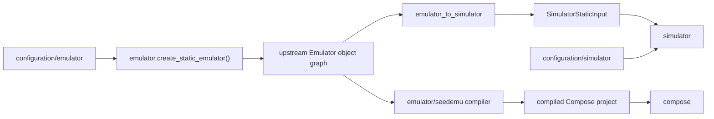

# `skyseed_v2` package map

This package-level navigation page shows only top-level package and data
handoff. Owner creation and Model-role details remain in their owner README
files. This page does not replace the exact import graph in
`docs/human-readable/repository-map.md`.

## Local assembly / ownership map

Legend: `-->` is the ordered data/assembly handoff.

## Detailed public class/member diagrams

This facade owns no detailed class maintenance source. Root entity re-exports
are detailed only in `emulator/entities/README.md`; every other public class
is detailed in its implementation owner package README.

## Entry points

Primary assembly entries are `emulator/construction.py`,
`emulator_to_simulator.py`, `simulator/simulator.py`, and
`compose/launcher.py`.

## Dependencies

Production dependency direction is configuration → Emulator construction /
SEED extension → immutable bridge input → Simulator. Compose launching is an
isolated consumer of an already-compiled project.

## Examples and tests

Human assembly examples live under `examples/`. Package contracts are checked
by `tests/test_package_import.py`,
`tests/unit/test_architecture_boundaries.py`, and focused owner tests.

## Maintenance checklist

When this package map changes, update the repository/import map, maintenance
map, public-import contract, affected local owner README, and architecture
dependency tests.
