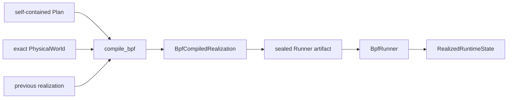
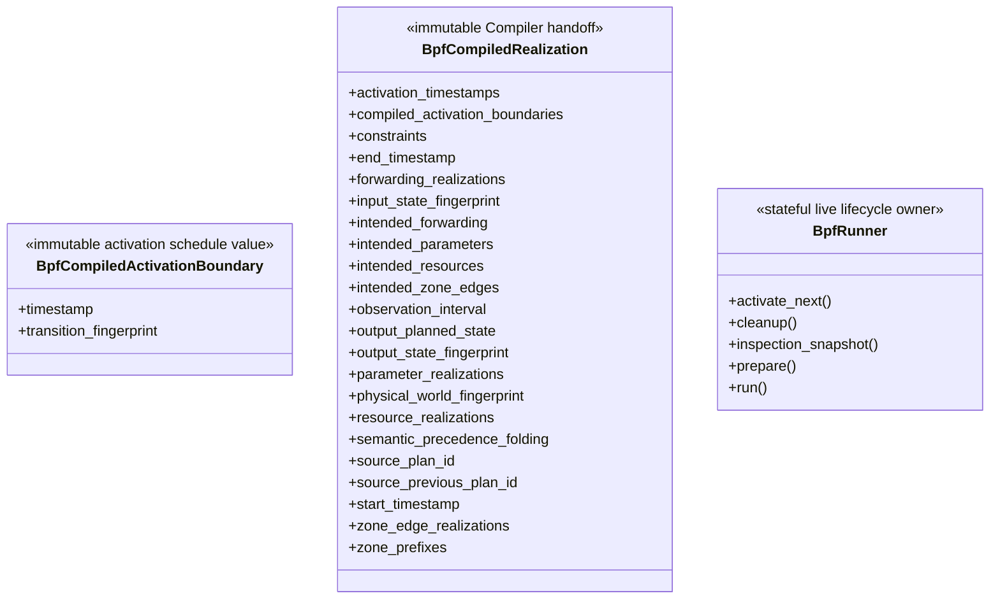

# BPF Compiler and Runner

This package owns one semantic-to-BPF Compiler and one live BPF lifecycle
owner.

## Local assembly / ownership map

Legend: `-->` is the one-way semantic handoff. The final edge names
Runner-owned live truth; it is not a separate public import.



## Compiler

The sole public signature is:

```python
compile_bpf(plan, physical_world, previous_realization)
```

Compiler validates the PhysicalWorld fingerprint, Plan/predecessor lineage,
input state, public transition replay, output fingerprint, and backend
feasibility. It lowers Connection, parameter, Zone, Route, and precedence
semantics without invoking physical or planning Models.

`BpfCompiledRealization` exposes source Plan identities, world/input/output
fingerprints, exact `observation_interval`, output `PlannedOperationalState`,
compact activation boundaries, semantic-precedence folding counts, backend
intentions, and exact fallback constraints. Each transition, including a no-op,
produces one `BpfCompiledActivationBoundary` containing only its timestamp and
canonical transition fingerprint.

Zone backend work orders readiness before forwarding publication and retirement.

## Persistence

Precomputed generation drains the producer, validates the full finite compiled
sequence, incrementally derives its exact mechanical runtime-capacity demand,
and seals deterministic format-v3 typed packed runtime tables. Before
`BpfRunner` construction, generated execution checks source/input identity,
manifest and binary hashes, version/seal and timeline metadata. Predecessor,
state-fingerprint continuity, equal cadence and exact next starts are checked
by the writer during generation. Runner opens the binary read-only with `mmap`
during Preparation and checks its header/index bounds. Although the reader
supports indexed access, Runner decodes every boundary during Preparation,
without reconstructing rich compiled or planned-state objects. No live Planner,
online supplier, or pickle
is loaded.

The compact `domain-history/compiler.jsonl` is separate: it seals lineage,
fingerprints, activation timestamps, and intent counts, while naming the
sealed Runner artifact as semantic payload owner. Its manifest and packed binary
own the normalized symbolic runtime payload; `runtime/execution.json` anchors
their sequence and manifest hashes.

## Runner

The public constructor is:

```text
BpfRunner(*, compose_project_name: str, runtime_artifact: Path)
```

`runtime_artifact` must be a `pathlib.Path` to the sealed finite artifact
manifest. Construction records the inputs; `prepare()` requires the named
deployment to be started and performs the one-shot work below. The former
`future_realization_supplier`, `preparation_lookahead`, and
`preparation_boundary_depth` arguments are removed. After Preparation, choose either
`run()` for automatic execution or `activate_next()` for manual advancement of
the same sequence; those choices are mutually exclusive. `cleanup()` owns
teardown, including after failure. `inspection_snapshot()` exposes detached
Runner facts, including the last completed formal ACTIVE frontier.

`BpfRunner` owns one-shot Preparation, formal Main, cleanup, and realized-state
snapshots. Preparation opens the sealed finite artifact, validates its metadata
and binary structure, decodes every record, and builds the complete sequence of
immutable delta plans and their activation JSON wire representation.
Artifact-local caches reuse decoded identities/timestamps; Preparation reuses
previous route/access state, stable names/slots, and route-by-interface indexes.
It discovers container incarnations once, retains
namespace descriptors and rtnetlink sockets, initializes maps/programs at the
sealed cumulative capacity, and prewrites every generation-semantic entry.
Preparation then physically executes boundary 0, from no network to the initial
network, before returning. The formal clock begins in `run()`, whose first
possible activation is boundary 1. A one-boundary experiment has no formal
network activation.

Main consumes a prepared immutable delta: changed connections, affected nodes,
and normalized operation nodes. Each veth creation includes both deterministic
MACs, one RX/TX queue per endpoint, and its exact future retirement cohort.
Interfaces start down; Main configures qdisc/BPF and readiness, changes
routes/neighbours and live port bindings, then commits
`active_generation`, then withdraws obsolete routes/bindings and deletes
withdrawn UP veths directly. One nonzero-group RTM_DELLINK per namespace cohort
collects devices into kernel grouped unregister, including their implicit peers.
Exactly one endpoint per pair carries the nonzero group. Independent namespace
batches use bounded persistent helper workers initialized in Preparation; one
worker owns each socket and all batches join before Main completes. Cleanup
uses the same owned cohorts, retains uncertain ownership, and closes the workers.
Candidate rollback deletes individual new pairs because their future groups can
also contain previously live pairs. Generation-semantic maps remain immutable throughout formal
runtime. Future veths remain absent until their own boundary.

There is no Maintenance thread, READY producer/wait, deferred generation
completion, or generation reclaim. All finite semantic entries stay resident
until cleanup. Capacity or identity failures stop generation/Preparation;
formal Main handles the return status of actual mutations without full-network
validation or PID/netns rediscovery.

One privileged command stream is established in Preparation. Its long-lived
process uses retained namespace rtnetlink sockets and BPF file descriptors.
Main does not launch Docker, namespace, shell, `ip`, or `tc` subprocesses.
Namespace operations are grouped by affected namespace within pre-publication,
active-generation publication, and post-publication barriers. Candidate rollback
uses the same sockets and syscalls. If a retained resource becomes unusable, its
operation fails; there is no container-restart recovery.

BPF publication is a forwarding subphase. Formal ACTIVE advances only after the
whole transition, including withdrawals and veth deletion, succeeds. Failure
preserves the last completed formal frontier and conservative cleanup ownership.
Before publication, newly allocated candidates may be removed; any remaining
partial live state is reported. After publication, selected-generation resources
are retained for final cleanup. Generation reuse does not invent a publication.

Main records compact boundary/barrier timing and enqueues telemetry template
references with live binding deltas. A background writer expands and serializes
identity records; observation never gates the next boundary. Cleanup owns final
network/BPF teardown, telemetry drain, privileged facility closure, and artifact
handle closure. Automatic deadlines use one fixed monotonic runtime origin plus
each nominal offset. Lateness consumes available idle time; an overrun executes
the next boundary when available and reports actual lag. All transitions remain
sequential and complete, with no skipped boundaries or reset origin. The helper
arrival clock is observational. Manual activation uses the same ordered plans.

Deletion workers and the owned retirement ledger belong to the existing helper;
all current-boundary jobs join before Main completes. There is no cross-boundary
deletion service. Asynchronous identity writing belongs to existing observation
facilities. Artifact packaging/reading in `_runner_artifact.py`, prepared records,
capacity accumulation, and the Linux execution and startup identity helpers
are private implementation details, not public domain components. Their file
responsibilities are described in the [private Runner README](_runner/README.md)
and [repository map](../../../../docs/human-readable/repository-map.md).

The private BPF logical port is a non-zero uint32 allocated by the finite
artifact writer for one node-side connection endpoint. The manifest stores each
connection and both endpoint IDs explicitly; IDs survive withdrawal/recreation
across every generation of that artifact. They are not public domain values or
root exports. Live ifindexes occur only in small per-node binding maps.

| Map | Key | Value |
|---|---|---|
| `active_generation` | `0` | generation |
| per-node `active_links` | `(generation, logical_ingress_port_id)` | `1` |
| per-node `routes` | `(generation, destination_ipv4_u32)` | logical egress port; `0` for local |
| per-node `ingress_bindings` | live ifindex | logical port |
| per-node `egress_bindings` | logical port | live ifindex |

The packet program reads the active generation, translates ingress ifindex,
checks the generation's active logical ingress, resolves the destination, passes
local routes, and translates a non-local logical egress before redirecting.
Missing generation, active link, route, or required live binding drops the
packet. Prewritten future entries remain invisible until generation publication.
Binding capacities use the add-before-withdraw interface high-water; semantic
map capacities use complete finite cumulative demand. No generation is reclaimed
during formal runtime.

Compiler contracts are documented in
`docs/codex-reference/bpf-compiler.md`; producer/runtime persistence in
`docs/codex-reference/producer-runtime-contracts.md`.

## Detailed public class/member diagrams

These blocks and the exact table below are the maintenance source for every
class owned by this public package. Re-exporting facades do not duplicate the
owner detail.

Legend: `<<...>>` states each public class role and `+` lists its
complete direct public member contract. No connector means no ownership
relationship is asserted by this inventory block.



| Diagram class | Public contract | Required public members |
|---|---|---|
| `BpfCompiledActivationBoundary` | `skyseed_v2.backend.bpf.BpfCompiledActivationBoundary` | `timestamp`, `transition_fingerprint` |
| `BpfCompiledRealization` | `skyseed_v2.backend.bpf.BpfCompiledRealization` | `activation_timestamps`, `compiled_activation_boundaries`, `constraints`, `end_timestamp`, `forwarding_realizations`, `input_state_fingerprint`, `intended_forwarding`, `intended_parameters`, `intended_resources`, `intended_zone_edges`, `observation_interval`, `output_planned_state`, `output_state_fingerprint`, `parameter_realizations`, `physical_world_fingerprint`, `resource_realizations`, `semantic_precedence_folding`, `source_plan_id`, `source_previous_plan_id`, `start_timestamp`, `zone_edge_realizations`, `zone_prefixes` |
| `BpfRunner` | `skyseed_v2.backend.bpf.BpfRunner` | `activate_next()`, `cleanup()`, `inspection_snapshot()`, `prepare()`, `run()` |
