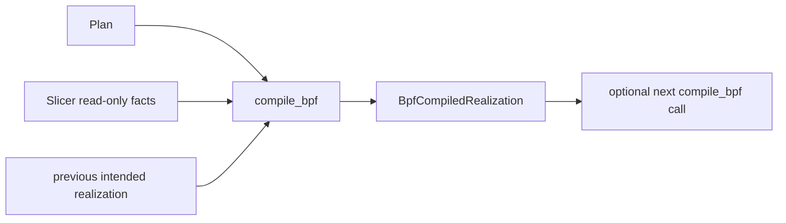
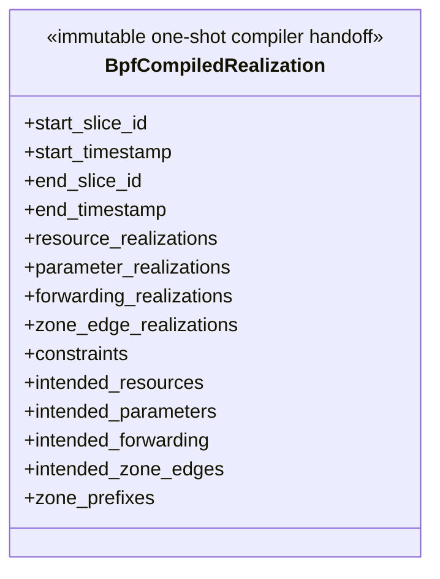

# BPF Compiler owner

This package owns one-shot deterministic lowering from a semantic `Plan` and
retained read-only Simulator facts into an immutable symbolic BPF realization.
It owns neither Simulator semantics nor deployment, live kernel resources, or
runtime progression.

## Local assembly / ownership map

Legend: `-->` is a one-shot value/fact flow. No edge transfers ownership.

`compile_bpf` does not advance `Slicer`, call a Model, synchronize `Planner`,
or resolve PID/netns/ifindex/MAC/veth/bridge/BPF program/map/generation state.
The bootstrap input at Slice 0 is the canonical empty *dynamic* realization;
it says nothing about static deployment contents.

## Detailed public class/member diagrams

Legend: the block is the complete public result contract. The contained
symbolic intent/state record formats remain private BPF implementation detail.

| Diagram class | Public contract | Required public members |
|---|---|---|
| `BpfCompiledRealization` | `skyseed_v2.backend.bpf.BpfCompiledRealization` | `start_slice_id`, `start_timestamp`, `end_slice_id`, `end_timestamp`, `resource_realizations`, `parameter_realizations`, `forwarding_realizations`, `zone_edge_realizations`, `constraints`, `intended_resources`, `intended_parameters`, `intended_forwarding`, `intended_zone_edges`, `zone_prefixes` |

## Entry points

`compile_bpf(plan, *, slicer, previous=None)` is the sole public capability.
`BpfCompiledRealization` cannot be directly constructed; successful
compilation is its only creation path.

## Lowering contract

- Connection lifetimes become directional symbolic attachment/resource demand;
- sparse directional parameters become a fixed Linux tc/qdisc intent policy;
- forwarding resolves `(source, next_hop)` mechanically through the formal
  `ConnectionSlice`, retaining logical Connection and direction only;
- Zone service assignments are projected with stable collision-free private
  `/32` packet identities from `198.18.0.0/15`;
- exact Plan forwarding precedences and mechanical resource/qdisc/use/retire
  constraints are retained, with future Zone forwarding ready before the
  service-edge activation;
- the immutable interval-end intended state is the only accepted baseline for
  a continuous non-bootstrap call.

Planner suppression is respected: planned active Connections may be a proper
subset of a boundary Slice. Zone service-edge changes follow the terminal of
folded planned forwarding when packet-facing route evidence exists; a raw
per-Slice Zone assignment alone does not replace an existing edge without a
planned forwarding change.

## Dependencies

The production dependency is `backend/bpf -> simulator public facts/contracts`
plus neutral shared identity values. Simulator must not import backend. Future
container files, packages, startup commands, and agents remain Emulator →
Skyseed functional Layer → SEED compiler deployment responsibility; this
package installs and modifies nothing in a container.

There is no Runner, runtime binder, preparation/maintenance lifecycle, generic
backend framework, Slot, Generation, Bundle, registry, or v1 adapter here.

## Examples and tests

`test_bpf_compiler_contract.py` covers bootstrap, continuity, lowering,
immutability, determinism, lifecycle constraints, and fail-closed lineage.
`test_bpf_compiler_main_chain.py` compiles consecutive real Plans produced by
the canonical mini Emulator → Simulator → Planner assembly, including Zone and
Plan precedence evidence.

## Maintenance checklist

When this package changes, update `bpf-compiler.md`, public imports, this local
diagram, the maintenance/import/object maps, architecture gates, and focused
Compiler tests together. Runner/runtime work is a separate milestone.
