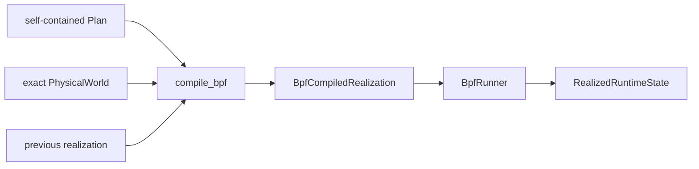
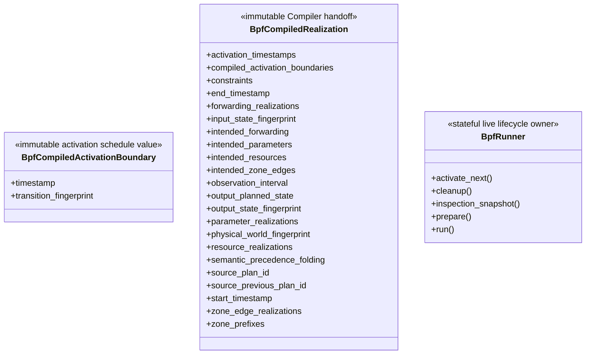

# BPF Compiler and Runner

This package owns one semantic-to-BPF Compiler and one live BPF lifecycle
owner.

## Local assembly / ownership map

Legend: `-->` is the one-way semantic handoff. The final edge names
Runner-owned live truth; it is not a separate public import.



## Compiler

The sole public signature is:

```python
compile_bpf(plan, physical_world, previous_realization)
```

Compiler validates the PhysicalWorld fingerprint, Plan/predecessor lineage,
input state, public transition replay, output fingerprint, and backend
feasibility. It lowers Connection, parameter, Zone, Route, and precedence
semantics without invoking physical or planning Models.

`BpfCompiledRealization` exposes source Plan identities, world/input/output
fingerprints, exact `observation_interval`, output `PlannedOperationalState`,
compact activation boundaries, semantic-precedence folding counts, backend
intentions, and exact fallback constraints. Each transition, including a no-op,
produces one `BpfCompiledActivationBoundary` containing only its timestamp and
canonical transition fingerprint.

Zone backend work orders readiness before forwarding publication and retirement.

## Persistence

Precomputed generation writes a format-version-3 checksum manifest and
`deterministic-gzip-json-v1` realization records. Before `BpfRunner`
construction, the persisted supplier eagerly checks the manifest and every
compressed/uncompressed hash, structurally decodes the complete bounded
sequence, and validates intent references, state fingerprints, lineage, and
exact cadence. It does not reconstruct source Plans or repeat Compiler lowering.
Runner receives the resulting immutable tuple, so every pull is a bounded
lookup. No live Planner object or pickle is loaded, and Runner maintenance
performs no persistence, decoding, planning, or compilation.

The compact `domain-history/compiler.jsonl` is separate: it seals lineage,
fingerprints, activation timestamps, and intent counts, while naming the
canonical realization handoff as semantic payload owner. The handoff's manifest
and `.json.gz` files own the complete intended-state/backend-intent payload;
`runtime/execution.json` anchors their sequence and manifest hashes.

## Runner

`BpfRunner` owns preparation, exact-next activation, bounded future READY
coverage, maintenance/reclaim, cleanup, runtime bindings, telemetry, and
`RealizedRuntimeState`. Compiled intended state is not proof of live state.

Runner consumes every explicit activation boundary in order. It remains
unaware of Planner internals. `inspection_snapshot()` returns detached scalar
evidence without lifecycle side effects; the Runner Tool owns presentation.

Traffic telemetry and Runner control evidence remain separate. Cleanup detaches
producers, drains telemetry, closes durable output, and removes owned runtime
resources in bounded order.

Compiler contracts are documented in
`docs/codex-reference/bpf-compiler.md`; producer/runtime persistence in
`docs/codex-reference/producer-runtime-contracts.md`.

## Detailed public class/member diagrams

These blocks and the exact table below are the maintenance source for every
class owned by this public package. Re-exporting facades do not duplicate the
owner detail.

Legend: `<<...>>` states each public class role and `+` lists its
complete direct public member contract. No connector means no ownership
relationship is asserted by this inventory block.



| Diagram class | Public contract | Required public members |
|---|---|---|
| `BpfCompiledActivationBoundary` | `skyseed_v2.backend.bpf.BpfCompiledActivationBoundary` | `timestamp`, `transition_fingerprint` |
| `BpfCompiledRealization` | `skyseed_v2.backend.bpf.BpfCompiledRealization` | `activation_timestamps`, `compiled_activation_boundaries`, `constraints`, `end_timestamp`, `forwarding_realizations`, `input_state_fingerprint`, `intended_forwarding`, `intended_parameters`, `intended_resources`, `intended_zone_edges`, `observation_interval`, `output_planned_state`, `output_state_fingerprint`, `parameter_realizations`, `physical_world_fingerprint`, `resource_realizations`, `semantic_precedence_folding`, `source_plan_id`, `source_previous_plan_id`, `start_timestamp`, `zone_edge_realizations`, `zone_prefixes` |
| `BpfRunner` | `skyseed_v2.backend.bpf.BpfRunner` | `activate_next()`, `cleanup()`, `inspection_snapshot()`, `prepare()`, `run()` |
