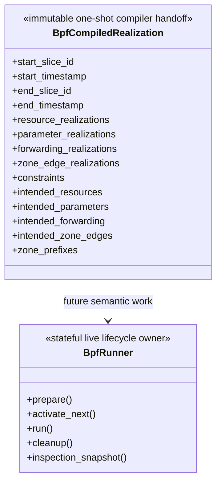

# BPF backend Compiler and Runner owner

This package owns one-shot deterministic lowering from a semantic `Plan` and
retained read-only Simulator facts into an immutable symbolic BPF realization,
and the stateful `BpfRunner` lifecycle that consumes those values against one
already-running Compose project identified by the caller. It owns no Simulator
semantics, Planner/Compiler progression, Compose compilation/startup, or
Compose teardown.

Round 1 leaves one explicit temporary legacy source seam: Compiler still reads
retained `TopologySlice` facts through the exact `Slicer`, and generated
execution still supplies the current Slicer → Planner → Compiler progression.
Those dependencies remain visible and behaviorally unchanged until the
Network Planner owns Connection, effective Parameter, Route, and Coordination
planning. The subsequent source-fact redesign deletes or replaces the old
Slicer/TopologySlice/TopologyDifference and mixed-history path.

## Local assembly / ownership map

Legend: every edge below is labeled with its exact relationship. Input consumption,
internal capability execution, frontier signalling, persistence, and caller
access are not represented by one generic flow.

```mermaid
flowchart LR
    PLAN["Plan"] -->|semantic input consumed by| COMPILE["compile_bpf"]
    SLICER["exact Slicer"] -->|read-only get_slice / get_topology access| COMPILE
    PREVIOUS["optional previous intended realization"] -->|explicit baseline consumed by| COMPILE
    COMPILE -->|produces| RESULT["BpfCompiledRealization"]
    RESULT -->|may be explicit baseline for| NEXT["next compile_bpf call"]
    RESULT -->|future supplier delivers and Runner consumes| RUNNER["BpfRunner: sole live owner"]
    DEPLOY["existing live Compose project identity"] -->|caller supplies and prepare discovers bindings| RUNNER

    RUNNER -->|prepare drives internal capability| PREP["Preparation: foundation + initial READY"]
    RUNNER -->|run or activate_next drives internal capability| MAIN["Main: exact-next activation"]
    RUNNER -->|owns background thread / internal capability| MAINT["Maintenance: future preparation + reclaim"]
    RUNNER -->|cleanup() drives internal capability| CLEAN["bounded scoped teardown"]
    CALLER["runtime caller"] -->|requests teardown with cleanup()| RUNNER
    RESULT -->|normalized by Runner into| BOUNDARY["ordered nominal boundaries + constraint DAGs"]
    BOUNDARY -->|prepared by Preparation or Maintenance| READY["continuous READY frontier"]
    PREP -->|publishes initial prefix| READY
    MAINT -->|extends future prefix| READY
    READY -->|exact next consumed by| MAIN
    MAIN -->|publishes| ACTIVE["ACTIVE frontier / live semantics"]
    MAIN -->|advances frontier and signals condition| MAINT
    MAIN -->|queues retired state for| MAINT
    MAINT -->|performs| RECLAIM["generation / physical reclaim"]

    RUNNER -->|supervises private capability| TELEMETRY["ingress producer + collector + ordinary recorder"]
    TELEMETRY -->|persists| TRAFFIC["traffic-telemetry.jsonl"]
    RUNNER -->|nonblocking bounded enqueue| HISTORY["detached runner-events.jsonl writer"]
    CALLER -->|"after cleanup attempt calls inspection_snapshot() on"| RUNNER
    RUNNER -->|returns detached projection without lifecycle side effect| SNAP["detached summary + binding scalars + recent events"]
    HISTORY -->|post-run read by| TOOL["Runner Inspection Tool"]
    SNAP -->|post-run read by| TOOL
```

`Plan + approved read-only Simulator facts + optional previous baseline` is the
architecture-level Compiler input. The current public API is
`compile_bpf(plan, *, slicer=exact_slicer, previous=...)`: there is no separate
`SlicerFacts` DTO, and the Compiler does not consume Simulator progression. It
uses only the exact Slicer's read-only `get_slice()` / `get_topology()` access.

`compile_bpf` does not advance `Slicer`, call a Model, synchronize `Planner`,
or resolve PID/netns/ifindex/MAC/veth/bridge/BPF program/map/generation state.
The bootstrap input at Slice 0 is the canonical empty *dynamic* realization;
it says nothing about static deployment contents.

`BpfRunner` queries the exact named Compose project, ignores unrelated
auxiliary services, requires the compiled Satellite/GroundStation `NodeId` set
exactly, and freezes each required container/image/PID/netns incarnation. It
consumes future compiled coverage through a pull callable and records private lifecycle,
input/READY/active frontiers, timing, binding, resource, kernel, generation,
reclaim, and failure evidence. It topologically orders every nominal boundary
from explicit constraints; tuple position and realization interval end are not
execution order. Rolling construction requires both a non-negative `timedelta`
nominal-time lookahead and a positive future-boundary depth. Exact-next READY
is mandatory; beyond it the continuous READY prefix stops when either bound is
first satisfied. `None` for both selects bounded finite full-range preparation.
Each realization is normalized incrementally; already-normalized future
boundaries are not rebuilt merely because a new continuous realization arrives.

The private `skyseed_v2.experiment.execution` application composition reads
`runtime/execution.json`,
verifies the recorded output identity, compact SHA256 source-scope
fingerprints, and generated-input fingerprints, calls the named experiment
progression builder, and composes a lazy Slicer → Planner → Compiler supplier
with `BpfRunner`. SHA256 is only a deterministic change detector for source and
generated-output consistency; it is not an adversarial security mechanism. A
mismatch fails before Runner preparation and clearly requires regenerating
output with `main.py`. For S4 qualification the same root can validate and
stream a manifest-backed trusted local gzip/pickle sequence containing the
exact canonical immutable Compiler outputs. This persisted consumption
strategy does not recreate upstream progression and decodes one realization
per supplier call.

`inspection_snapshot()` is the only public read-only evidence handoff. It
deep-copies Runner summary/current-last-known facts, scalar projections of the
frozen runtime bindings, and a bounded recent event window into plain data. It
returns no live binding object, performs no kernel command or lifecycle action,
and remains readable after cleanup. Event classification, timing aggregation,
and current-default-dataplane presentation belong to the repository-local
Tool, not Runner. Standard generated execution sends compact records to a
bounded nonblocking queue whose detached writer owns JSON serialization and
file I/O. Overflow/writer failure is explicit: Runner does not wait for
evidence consumption, while the Tool rejects incomplete bounded qualification
history and does not embed a second complete raw event copy.

The same generated execution enables owner-local append-only histories for Slice /
Difference, published Plan / PlanningDecision, and compiled-realization /
nominal-boundary facts before their owners release obsolete working entries.
Slicer releases old Slice and timestamp indexes only after successful compile;
Planner releases compiled Difference, per-Slice route context, and historical
decision entries while retaining its future baselines and unpublished window.
Compiler remains one-shot. These JSONL streams are Tool inputs, not control
state, and no cross-layer retention manager or backend generation concept is
introduced upstream.

Traffic telemetry is separate from that Runner Inspection projection. When
the canonical runtime enables this private capability, initialization creates
one shared `BPF_MAP_TYPE_RINGBUF` and one bounded per-node loss-counter array;
each node's existing `SCHED_CLS` ingress program embeds its stable run-local
`node_slot` and references those same two map objects. Ring output failure
increments the bounded loss counter when possible and then resumes the already
selected redirect/pass/drop terminal action. It never changes Main or
Maintenance scheduling.

BpfRunner starts one supervised collector command in its owned privileged
helper after the runtime foundation is established. The ordinary Runner
process incrementally writes the schema/foundation and `node_slot` identity
before collection, generation-qualified ifindex/Connection identities before
READY publication, then packet and loss records. Cleanup first detaches the
tc-BPF producers, then requests collector final drain and closes the durable
stream, and only then removes the helper. The current ingress-only hook does
not observe a source node's outbound first hop; the record declares that edge
as inferred from source address plus the first observed ingress. The JSONL is
durable input to the current post-run Traffic / Path Replay Tool, not a public
BPF contract or an in-memory packet history.

One private Main-in-flight guard rejects a concurrent second activation before
active mutation without holding the Runner condition across the legal
transaction. Maintenance restores exact-next dual-bound READY coverage before
trailing cleanup, then alternates generation and physical reclaim so neither
class is permanently hidden behind the other. If the next forward preparation
would exceed private resident-generation capacity, a legal retired-generation
reclaim becomes that preparation's resource prerequisite; this is the sole
priority exception, and physical reclaim does not free a generation slot.
Formal rolling physical reclaim is strict: kernel deletion must succeed before
ownership leaves the inventory; final scoped teardown likewise requires
successful residue evidence before controller inventory is cleared.

Interface ifindex is discovered once per owned interface/container incarnation
with one namespace inventory query per affected node, then carried in the
runtime realization inventory for generation preload and activation. Physical
reclaim invalidates it only after deletion succeeds; PID/netns foundation
validation remains fail closed. Boundary deltas are grouped once by affected
node. Privileged operations preserve dependency phases, batch `ip`/`tc` work
per namespace, and use a bounded hardware-adaptive worker pool only across
independent node batches.

The private default dataplane materializes complete state for each boundary.
It preloads generation-qualified node-local forwarding entries while every tc
program reads one Runner-owned shared active generation. Future physical links
may exist with resolved bindings, qdisc and BPF attachment, but remain DOWN and
have no active route/neighbour or Zone address until Main. Existing-link qdisc
changes are prebuilt as a boundary batch and only applied by Main. Generation
and physical-resource reclaim are independent Maintenance operations. These map
and link details are the default implementation, not public Runner architecture.
For an ACTIVE GroundStation-access resource, Main also realizes direct-peer
reachability on the GroundStation endpoint with a node-local Satellite `/32`
route and permanent neighbour. This state is neither preloaded while the
resource is future/inactive nor added to the generation-keyed forwarding maps;
withdrawal removes it at the same semantic boundary.
In rolling mode, future-boundary depth `D` proves private resident capacity
`K = D + 1`: at most one ACTIVE generation plus `D` READY generations, with
retired-but-not-reclaimed and in-flight reservations sharing the same K slots.
Generation IDs remain monotonic. Preparation sizes each node's fixed versioned
maps from topology-stable per-generation upper bounds times K, never startup
occupancy plus a speculative reserve. Bounded full-range mode instead sizes
from its complete finite demand. Every later generation is audited against
actual resident entries before physical preparation, preload and READY
publication. Capacity shortage fails closed without dropping compiled
routes/resources or changing simulation semantics; audit, headroom,
resident-generation and physical high-water facts are retained as Runner
evidence.

The current default dataplane derives the per-generation bounds only from its
frozen topology and Zone inventory: a GroundStation can have at most one link
per Satellite and routes for self plus all Zones; a Satellite can have at most
one link to every other Satellite/GroundStation and routes for self, every
GroundStation and every Zone. These formulas are private fixed-map sizing, not
Planner/Compiler semantics or a generic Runner generation API.
Node IPv4 addresses remain a backend-private runtime realization derived from
stable `NodeId` ordering, not a Plan, Compiler, or public configuration
identity. Preparation selects the smallest topology-sized prefix within its
private implementation space and audits it against all compiled Zone prefixes
and the live IPv4 address/non-default-route networks of every bound node
namespace before mutation and READY. The capacity evidence records requirement,
usable capacity, headroom, selected range and collision result. Collision fails
closed; successful installation is recorded per node so cleanup deletes only
the `/32` addresses this Runner actually owns.
Simulation semantics take priority over minimizing kernel operations; the hot
path removes preparation overhead, not compiled network transitions.
Runner performance is part of simulation correctness and must keep pace with
the nominal semantic transition schedule required by the target simulation
profile. Simulation sampling resolution, Planner publication cadence, Plan
nominal transitions, and Runner execution cadence are separate; the historical
approximately ten-second initial qualification scale is not a universal
Runner threshold or Tool PASS/FAIL rule.
The private lowering verifies every same-boundary constraint against Main's
resource/qdisc/forwarding-publication/Zone/withdraw phases. Forwarding-to-
forwarding precedences are materialized in dependency order and folded into the
single complete-generation publication barrier; incompatible phase edges fail.

## Detailed public class/member diagrams

Legend: the block is the complete public result contract. The contained
symbolic intent/state record formats remain private BPF implementation detail.



| Diagram class | Public contract | Required public members |
|---|---|---|
| `BpfCompiledRealization` | `skyseed_v2.backend.bpf.BpfCompiledRealization` | `start_slice_id`, `start_timestamp`, `end_slice_id`, `end_timestamp`, `resource_realizations`, `parameter_realizations`, `forwarding_realizations`, `zone_edge_realizations`, `constraints`, `intended_resources`, `intended_parameters`, `intended_forwarding`, `intended_zone_edges`, `zone_prefixes` |
| `BpfRunner` | `skyseed_v2.backend.bpf.BpfRunner` | `prepare()`, `activate_next()`, `run()`, `cleanup()`, `inspection_snapshot()` |

## Entry points

`compile_bpf(plan, *, slicer, previous=None)` is the public stateless Compiler
capability. `BpfRunner` is the sole public live lifecycle owner.
`BpfCompiledRealization` cannot be directly constructed; successful
compilation is its only creation path.

`BpfRunner(*, compose_project_name, future_realization_supplier,
preparation_lookahead=..., preparation_boundary_depth=...)` attaches to an
already-started project. Rolling callers provide both bounds; full-range
callers provide `None` for both. The project name is the only deployment
handoff fact; Runner independently proves its live foundation during
`prepare()`.
Generated BPF output normally enters that unchanged API through private
`skyseed_v2.experiment.execution`: its supplier returns only
`BpfCompiledRealization | None`, and its lifecycle call sequence is
`prepare()` → `run()` → `cleanup()`.
Here `cleanup()` is the public method name for Runner teardown: Maintenance
shutdown is bounded to 30 seconds and privileged failure preserves ownership
inventory for retry instead of falsely claiming clean state. After teardown,
`inspection_snapshot()` returns detached evidence for a
post-run consumer, including the Compose identity, foundation token, node
counts, and per-node scalar container/PID/netns incarnation facts. It does not
expose live bindings/dataplane objects or add a second Runner state machine.

## Lowering contract

- Connection lifetimes become directional symbolic attachment/resource demand;
- sparse directional parameters become a fixed Linux tc/qdisc intent policy;
- forwarding resolves `(source, next_hop)` mechanically through the formal
  `ConnectionSlice`, retaining logical Connection and direction only;
- Zone service assignments are projected with stable collision-free private
  `/32` packet identities from `198.18.0.0/15`;
- exact Plan forwarding precedences and mechanical resource/qdisc/use/retire
  constraints are retained, with future Zone forwarding ready before the
  service-edge activation;
- the immutable interval-end intended state is the only accepted baseline for
  a continuous non-bootstrap call.

The Runner execution schedule is separate: it consumes compiled operations and
explicit constraints. It does not use interval-end `intended_*` as a nominal
boundary schedule.

Planner suppression is respected: planned active Connections may be a proper
subset of a boundary Slice. Zone service-edge changes follow the terminal of
folded planned forwarding when packet-facing route evidence exists; a raw
per-Slice Zone assignment alone does not replace an existing edge without a
planned forwarding change.

## Dependencies

The production dependency is `backend/bpf -> simulator public facts/contracts`
plus neutral shared identity values. Simulator must not import backend. Future
container files, packages, startup commands, and agents remain Emulator →
Skyseed functional Layer → SEED compiler deployment responsibility. Runner
uses the caller-supplied current Compose project identity but no Launcher
history or materialization result, and does not compile, start, or stop that
project. There is no public runtime binder, Preparation/Main/
Maintenance object, generic backend framework, Slot, Generation, Bundle,
registry, dataplane plugin API, or v1 adapter here.

## Examples and tests

`test_bpf_compiler_contract.py` covers bootstrap, continuity, lowering,
immutability, determinism, lifecycle constraints, and fail-closed lineage.
`test_bpf_compiler_main_chain.py` compiles consecutive real Plans produced by
the canonical mini Emulator → Simulator → Planner assembly, including Zone and
Plan precedence evidence.
`test_bpf_runner_contract.py` covers multi-boundary resolution, rolling
time/depth and bounded-full preparation, READY predecessor checks,
manual/automatic exclusion, single-Main activation, deterministic scheduling,
forward/reclaim progress, strict reclaim, topology-bound fixed-map sizing,
resident reservation/pressure failure, deadline failure
and reclaim, including deterministic 300-plus-node address sizing, live
namespace/Zone collision rejection, and partial-install ownership cleanup;
`test_bpf_runner_main_chain.py` proves the canonical first four boundaries
materialize complete state and verifies the public runtime reconstruction and
Runner lifecycle/orchestration/finalization. `test_bpf_traffic_telemetry.py`
covers the fixed event, shared map/node-slot binding, loss-path action
convergence, streaming identities, and final drain;
`test_bpf_traffic_telemetry_runtime.py` performs an opt-in actual privileged
verifier load of the instrumented `SCHED_CLS` program. `test_runner_tool.py` verifies
detached projection, curated stable timeline ordering, invocation outcomes,
offline artifacts, and the absence of live Runner/kernel controller behavior.

## Maintenance checklist

When this package changes, update `bpf-compiler.md`, public imports, this local
diagram, the maintenance/import/object maps, architecture gates, and focused
Compiler and Runner tests together when the shared facade changes.
