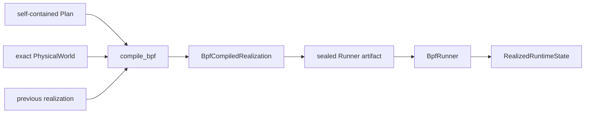
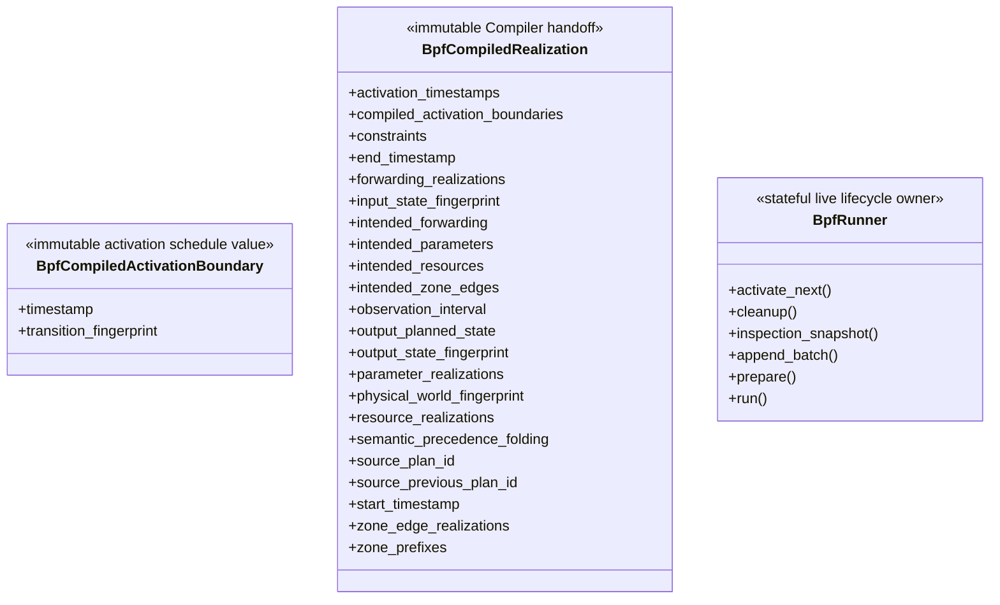

# BPF Compiler and Runner

This package owns one semantic-to-BPF Compiler and one live BPF lifecycle
owner.

## Local assembly / ownership map

Legend: `-->` is the one-way semantic handoff. The final edge names
Runner-owned live truth; it is not a separate public import.



## Compiler

The sole public signature is:

```python
compile_bpf(plan, physical_world, previous_realization)
```

Compiler validates the PhysicalWorld fingerprint, Plan/predecessor lineage,
input state, public transition replay, output fingerprint, and backend
feasibility. It lowers Connection, parameter, Zone, Route, and precedence
semantics without invoking physical or planning Models.

`BpfCompiledRealization` exposes source Plan identities, world/input/output
fingerprints, exact `observation_interval`, output `PlannedOperationalState`,
compact activation boundaries, semantic-precedence folding counts, backend
intentions, and exact fallback constraints. Each transition, including a no-op,
produces one `BpfCompiledActivationBoundary` containing only its timestamp and
canonical transition fingerprint.

Zone backend work orders readiness before forwarding publication and retirement.

## Persistence

Precomputed generation drains the producer, validates the full finite compiled
sequence, incrementally derives its exact mechanical runtime-capacity demand,
and seals deterministic format-v4 typed packed runtime tables. Before
`BpfRunner` construction, generated execution checks source/input identity,
manifest and binary hashes, version/seal and timeline metadata. Predecessor,
state-fingerprint continuity, equal cadence and exact next starts are checked
by the writer during generation. Runner opens the binary read-only with `mmap`
during Preparation and checks its header/index bounds. Although the reader
supports indexed access, Runner decodes every boundary during Preparation,
without reconstructing rich compiled or planned-state objects. No live Planner,
online supplier, or pickle
is loaded.

The compact `domain-history/compiler.jsonl` is separate: it seals lineage,
fingerprints, activation timestamps, and intent counts, while naming the
sealed Runner artifact as semantic payload owner. Its manifest and packed binary
own the normalized symbolic runtime payload; `runtime/execution.json` anchors
their sequence and manifest hashes.

## Runner

The public constructor is:

```text
BpfRunner(*, compose_project_name: str, runtime_artifact: Path,
          batch_lead_fraction: float = 0.75, batch_capacity_factor: int = 2)
```

`runtime_artifact` must be a `pathlib.Path` to the sealed finite artifact
manifest. Construction records the inputs; `prepare()` requires the named
deployment to be started and performs one-time initialization and initial batch work. The former
`future_realization_supplier`, `preparation_lookahead`, and
`preparation_boundary_depth` arguments are removed. After Preparation, choose either
`run()` for automatic execution or `activate_next()` for manual advancement of
the same single-delivery sequence; those choices are mutually exclusive.
Continuation requires automatic `run()`. `append_batch(runtime_artifact: Path)`
registers one next sealed delivery without decoding its binary; online replacement,
node changes and noncontiguous lineage are rejected. `cleanup()` owns
teardown, including after failure. `inspection_snapshot()` exposes detached
Runner facts, including the last completed formal ACTIVE frontier.

`BpfRunner` owns initial Preparation, formal Main, optional continued-batch
Maintenance, cleanup, and realized-state snapshots. Preparation checks sealed metadata and binary structure, then decodes and
constructs one boundary at a time using the same path as successor Maintenance.
All immutable delta plans, activation JSON commands and semantic prewrites must
succeed before READY. Decoded boundary scratch data is released incrementally. Single-delivery execution prepares the whole sequence;
continued execution does not initially decode or prewrite its successor.
Artifact-local caches reuse decoded identities/timestamps; Preparation reuses
previous route/access state, stable names/slots, and route-by-interface indexes.
The v4 reader decodes operation records directly into eager typed intents instead
of first allocating a recursive generic operation tree. Small boundary metadata
retains the generic representation. Per-artifact text and scoped-target reuse is
capped at 16,384 entries each (cached text payloads at most 256 bytes); caches clear
on close. Existing node/connection/timestamp identity reuse remains artifact-local.
File and per-record hashes, canonical field order, bounds, tags and typed-value
checks remain. The sealed bytes, delivery API and complete READY requirement do
not change; no history is retained to avoid future decoding.
It discovers container incarnations once, retains
namespace descriptors and rtnetlink sockets, initializes maps/programs at the
sealed cumulative capacity for one delivery, or fixed resident reservations
based on the first delivery and configured capacity factor for continuation.
Initial IPv4 collision inventory uses those retained sockets for local addresses
and prefixes plus all-table non-default routes. Point-to-point local/peer identity,
complete multipart dumps, kernel errors and namespace incarnation checks remain;
there is no `nsenter`/`ip` inventory fallback or concurrency change. Failure still
returns through the existing initialization ownership/cleanup path.
Continued per-node entry envelopes use first-batch peaks of the same typed
entity kind; they allow peer work migration while retaining fixed limits
and exact sealed-demand accounting. The extra reservation consumes memory.
It prewrites the first delivery's generation semantics. Equal per-node content
shares an immutable node version across generations; unchanged entries are not
written again. The static demand index is built once per admitted batch.
Preparation then physically executes boundary 0, from no network to the initial
network, before returning. The formal clock begins in `run()`, whose first
possible activation is boundary 1. A one-boundary experiment has no formal
network activation.

Main consumes a prepared immutable delta: changed connections, affected nodes,
and normalized operation nodes. Each veth creation includes both deterministic
MACs, one RX/TX queue per endpoint, and its owned retirement group.
Single finite execution groups known future retirement cohorts; continuation
uses stable per-connection groups, preserving ownership across unknown future
withdrawals and re-establishment.
Interfaces start down; Main configures qdisc/BPF and readiness, changes
routes/neighbours and live port bindings, then commits
`active_generation`, then withdraws obsolete routes/bindings and deletes
withdrawn UP veths directly. One nonzero-group RTM_DELLINK per namespace cohort
collects devices into kernel grouped unregister, including their implicit peers.
Exactly one endpoint per pair carries the nonzero group. Independent namespace
batches use bounded persistent helper workers initialized in Preparation; one
worker owns each socket and all batches join before Main completes. Cleanup
uses the same owned cohorts, retains uncertain ownership, and closes the workers.
Candidate rollback deletes individual new pairs because their future groups can
also contain previously live pairs. Published generation content is immutable;
Maintenance writes only future content and reclaims only eligible retired
versions. Future veths remain absent until their own boundary.

Single-delivery execution retains finite semantic entries until Cleanup.
For append-only continuation, Runner/backend Maintenance loads and prewrites the
next sealed batch, then marks it READY. It reclaims eligible older plans and
map versions after actual activation, preserving in-flight readers and retained
references. Main alone executes boundaries, including timely withdrawals and
joined physical deletion. It never waits for READY past the nominal deadline:
missing/late READY or Maintenance failure produces an explicit failed/incomplete
run, without clock shifts, skipped boundaries or a successful fallback.
Capacity and identity failures are fail-closed. Formal Main handles actual
mutation results without full-network validation or PID/netns rediscovery.

One privileged command stream is established in Preparation. Its long-lived
process uses retained namespace rtnetlink sockets and BPF file descriptors.
Main does not launch Docker, namespace, shell, `ip`, or `tc` subprocesses.
Namespace operations are grouped by affected namespace within pre-publication,
active-generation publication, and post-publication barriers. Candidate rollback
uses the same sockets and syscalls. If a retained resource becomes unusable, its
operation fails; there is no container-restart recovery.

BPF publication is a forwarding subphase. Formal ACTIVE advances only after the
whole transition, including withdrawals and veth deletion, succeeds. Failure
preserves the last completed formal frontier and conservative cleanup ownership.
Before publication, newly allocated candidates may be removed; any remaining
partial live state is reported. After publication, selected-generation resources
are retained for final cleanup. Generation reuse does not invent a publication.

Main records compact boundary/barrier timing and enqueues telemetry template
references with live binding deltas. A background writer expands and serializes
identity records; observation never gates the next boundary. Cleanup owns final
network/BPF teardown, telemetry drain, privileged facility closure, and artifact
handle closure. Automatic deadlines use one fixed monotonic runtime origin plus
each nominal offset. Lateness consumes available idle time; an overrun executes
the next boundary when available and reports actual lag. All transitions remain
sequential and complete, with no skipped boundaries or reset origin. The helper
arrival clock is observational. Manual activation uses the same ordered plans.

Deletion workers and the owned retirement ledger belong to the existing helper;
all current-boundary jobs join before Main completes. There is no cross-boundary
deletion service. Asynchronous identity writing belongs to existing observation
facilities. Artifact packaging/reading in `_runner_artifact.py`, prepared records,
capacity accumulation, and the Linux execution and startup identity helpers
are private implementation details, not public domain components. Their file
responsibilities are described in the [private Runner README](_runner/README.md)
and [repository map](../../../../docs/human-readable/repository-map.md).

The private BPF logical port is a non-zero uint32 allocated by the finite
artifact writer for one node-side connection endpoint. The manifest stores each
connection and both endpoint IDs explicitly; IDs survive withdrawal/recreation
across generations and continued artifacts in the same fixed-node session. They are not public domain values or
root exports. Live ifindexes occur only in small per-node binding maps.

| Map | Key | Value |
|---|---|---|
| `active_generation` ARRAY | `0` | generation |
| per-node `generation_versions` | generation | immutable node content version |
| continued-session `generation_readers` | generation | in-flight reader count |
| per-node `active_links` | `(node_version, logical_ingress_port_id)` | `1` |
| per-node `routes` | `(node_version, destination_ipv4_u32)` | logical egress port; `0` for local |
| per-node `ingress_bindings` | live ifindex | logical port |
| per-node `egress_bindings` | logical port | live ifindex |

The packet program reads the active generation and its node content version,
translates ingress ifindex, checks the version’s active logical ingress, resolves
the destination, passes
local routes, and translates a non-local logical egress before redirecting.
Missing generation, active link, route, or required live binding drops the
packet. Prewritten future entries remain invisible until generation publication.
Binding capacities use the add-before-withdraw interface high-water; semantic
map capacities use finite cumulative demand for one delivery or fixed admitted
resident reservations for continuation. Continued generations use bounded
reader accounting and retained version references for safe runtime reclaim;
single-delivery entries remain until Cleanup.

Compiler contracts are documented in
`docs/codex-reference/bpf-compiler.md`; producer/runtime persistence in
`docs/codex-reference/producer-runtime-contracts.md`.

## Detailed public class/member diagrams

These blocks and the exact table below are the maintenance source for every
class owned by this public package. Re-exporting facades do not duplicate the
owner detail.

Legend: `<<...>>` states each public class role and `+` lists its
complete direct public member contract. No connector means no ownership
relationship is asserted by this inventory block.



| Diagram class | Public contract | Required public members |
|---|---|---|
| `BpfCompiledActivationBoundary` | `skyseed_v2.backend.bpf.BpfCompiledActivationBoundary` | `timestamp`, `transition_fingerprint` |
| `BpfCompiledRealization` | `skyseed_v2.backend.bpf.BpfCompiledRealization` | `activation_timestamps`, `compiled_activation_boundaries`, `constraints`, `end_timestamp`, `forwarding_realizations`, `input_state_fingerprint`, `intended_forwarding`, `intended_parameters`, `intended_resources`, `intended_zone_edges`, `observation_interval`, `output_planned_state`, `output_state_fingerprint`, `parameter_realizations`, `physical_world_fingerprint`, `resource_realizations`, `semantic_precedence_folding`, `source_plan_id`, `source_previous_plan_id`, `start_timestamp`, `zone_edge_realizations`, `zone_prefixes` |
| `BpfRunner` | `skyseed_v2.backend.bpf.BpfRunner` | `activate_next()`, `append_batch()`, `cleanup()`, `inspection_snapshot()`, `prepare()`, `run()` |

## Incremental generation work

Compiler applies each Plan transition once while lowering it, validates lineage
and output fingerprints, and reuses immutable backend indexes from the previous
realization. Resource/qdisc/forwarding/route-owner indexes remain private derived
representations; complete public outputs are preserved. Detached/reference
qualification can reconstruct indexes independently. Artifact generation checks
sequence and references, computes capacity from relevant changes, and encodes
without mandatory full decode/comparison. Focused codec and offline checks carry
that obligation. Runner fully decodes the initial delivery in Preparation and successors in
Maintenance; Main consumes prepared deltas only.

Normalization groups operations and same-time constraints once per batch;
cross-boundary counts and reference checks retain their existing meaning.
Private `_BoundaryStateIndexes` in `_runner/runtime_realization.py` applies
resource, qdisc, forwarding and Zone deltas in both capacity accumulation and
finite Preparation. Capacity uses destination reference counts and interface
occupancy, including shared destinations and add-before-withdraw high-water
marks. Preparation freezes the required complete states/deltas while reusing
unchanged immutable parts. Neither index owns a domain object or runtime
lifecycle; Main and the existing helper retain their activation/retirement
responsibilities. Compiler also shares one directed connection index across
route lowering within each transition.

## Scoped service lowering

`BpfCompiledRealization.zone_prefixes` maps `(network_scope, zone_id)` to /32 IPv4
destinations. Sorted scope/Zone identities deterministically allocate distinct
addresses from the existing Zone pool; unscoped ordering retains its addresses.
The bootstrap Plan fixes the complete service identity set. Subsequent Plans and
sealed deliveries must retain it. Zone edge and forwarding indexes retain scope.
One Runner materializes and cleans all shared GS state. Runner artifacts are v4
(`SKYRUN4`, typed packed runtime tables v4); domain-history seals are v3 and
compact compiler streams v3. Previous runtime versions are rejected.


Preparation carries changed forwarding/Zone destinations through reference-counted
route derivation. Only affected node route dictionaries change; equal node content
continues to reuse BPF versions. Interface collision and add-before-withdraw capacity
proofs are maintained from resource deltas. Main phase compatibility, fixed resident
admission, actual kernel results and safe generation reclamation remain mandatory.
Telemetry templates structurally share immutable interface descriptions and unchanged
node route projections, retaining exact generation/time associations. The existing
background evidence writer fsyncs loading, decoding, construction, prewrite and READY
milestones without making observation a Main scheduling gate.
