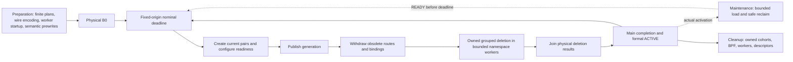

# BpfRunner private implementation

This directory groups private capabilities owned by `../runner.py`. It adds no
public type, independent lifecycle owner or dataplane plugin.

The sibling `../_runner_artifact.py` owns backend artifact packaging and reading.
Each finite batch is fully decoded in initial Preparation or admitted Maintenance;
indexed reader capability does not imply Main decoding.
Prepared/derived records and finite capacity accumulation in these private
files do not constitute new domain components.

| File | Responsibility |
|---|---|
| `runtime_realization.py` | Initialize fixed capacity once, admit/construct finite batches, share/prewrite node versions, reclaim eligible generations, and submit immutable Main deltas. |
| `privileged_runtime_command.py` | Own the persistent privileged command loop, retained namespace sockets/BPF descriptors, publication barriers, raw BPF loader, bounded deletion workers and retirement ledger. |
| `kernel_netlink.py` | Encode Linux rtnetlink UAPI requests for veth, link, qdisc, BPF attachment, route, neighbour and address mutations; require kernel ACKs. |
| `process_incarnation.py` | Capture and validate the complete startup PID/start-time/netns identity set. |
| `event_history.py` | Queue compact events and write them outside Main. |
| `traffic_telemetry.py` | Supervise collection and expand prepared identity templates with binding deltas on a background writer. |
| `traffic_telemetry_collector.py` | Read pinned ring/loss maps and provide final-drain evidence. |
| `traffic_telemetry_abi.py` | Define the existing private packet-event layout shared by producer and collector. |

`BpfRunner` owns initial Preparation, formal Main, optional continued-batch
Maintenance, cleanup, and realized-state snapshots. Preparation opens and fully
decodes the first sealed finite delivery, checks its metadata and binary
structure, and constructs all of that delivery's immutable delta plans and
activation JSON commands. Single-delivery execution prepares the whole sequence;
continued execution does not initially decode or prewrite its successor.
Artifact-local caches reuse decoded identities/timestamps; Preparation reuses
previous route/access state, stable names/slots, and route-by-interface indexes.
It discovers container incarnations once, retains
namespace descriptors and rtnetlink sockets, initializes maps/programs at the
sealed cumulative capacity for one delivery, or fixed resident reservations
based on the first delivery and configured capacity factor for continuation.
Continued per-node entry envelopes use first-batch peaks of the same typed
entity kind; they allow peer work migration while retaining fixed limits
and exact sealed-demand accounting. The extra reservation consumes memory.
It prewrites the first delivery's generation semantics. Equal per-node content
shares an immutable node version across generations; unchanged entries are not
written again. The static demand index is built once per admitted batch.
Preparation then physically executes boundary 0, from no network to the initial
network, before returning. The formal clock begins in `run()`, whose first
possible activation is boundary 1. A one-boundary experiment has no formal
network activation.

Main consumes a prepared immutable delta: changed connections, affected nodes,
and normalized operation nodes. Each veth creation includes both deterministic
MACs, one RX/TX queue per endpoint, and its owned retirement group.
Single finite execution groups known future retirement cohorts; continuation
uses stable per-connection groups, preserving ownership across unknown future
withdrawals and re-establishment.
Interfaces start down; Main configures qdisc/BPF and readiness, changes
routes/neighbours and live port bindings, then commits
`active_generation`, then withdraws obsolete routes/bindings and deletes
withdrawn UP veths directly. One nonzero-group RTM_DELLINK per namespace cohort
collects devices into kernel grouped unregister, including their implicit peers.
Exactly one endpoint per pair carries the nonzero group. Independent namespace
batches use bounded persistent helper workers initialized in Preparation; one
worker owns each socket and all batches join before Main completes. Cleanup
uses the same owned cohorts, retains uncertain ownership, and closes the workers.
Candidate rollback deletes individual new pairs because their future groups can
also contain previously live pairs. Published generation content is immutable;
Maintenance writes only future content and reclaims only eligible retired
versions. Future veths remain absent until their own boundary.

Single-delivery execution retains finite semantic entries until Cleanup.
For append-only continuation, Runner/backend Maintenance loads and prewrites the
next sealed batch, then marks it READY. It reclaims eligible older plans and
map versions after actual activation, preserving in-flight readers and retained
references. Main alone executes boundaries, including timely withdrawals and
joined physical deletion. It never waits for READY past the nominal deadline:
missing/late READY or Maintenance failure produces an explicit failed/incomplete
run, without clock shifts, skipped boundaries or a successful fallback.
Capacity and identity failures are fail-closed. Formal Main handles actual
mutation results without full-network validation or PID/netns rediscovery.

One privileged command stream is established in Preparation. Its long-lived
process uses retained namespace rtnetlink sockets and BPF file descriptors.
Preparation reserves the helper's descriptor allowance from the finite node and
worker counts within its existing hard limit, before retaining namespaces or
mutating the kernel. An insufficient hard limit fails as known-no-mutation.
Main does not launch Docker, namespace, shell, `ip`, or `tc` subprocesses.
Namespace operations are grouped by affected namespace within pre-publication,
active-generation publication, and post-publication barriers. Candidate rollback
uses the same sockets and syscalls. If a retained resource becomes unusable, its
operation fails; there is no container-restart recovery.

BPF publication is a forwarding subphase. Formal ACTIVE advances only after the
whole transition, including withdrawals and veth deletion, succeeds. Failure
preserves the last completed formal frontier and conservative cleanup ownership.
Before publication, newly allocated candidates may be removed; any remaining
partial live state is reported. After publication, selected-generation resources
are retained for final cleanup. Generation reuse does not invent a publication.

Boundary time and generation lifetime are distinct. Every completed nominal
boundary produces one compact `boundary_activation` telemetry record, including
parameter-only and no-op boundaries. The record carries its actual Main start
and completion clocks, selected generation, predecessor, startup marker, and
whether publication occurred. Only a real publication carries generation-switch
start/end timestamps; reuse carries neither switch timestamps nor a fabricated
publication duration. Interface snapshots are emitted once per generation and
are keyed by generation, node slot, and live ifindex with stable logical ports.
A background writer performs snapshot expansion and serialization.
This writer belongs to the existing observation facilities; it is neither
Maintenance nor an independent network lifecycle owner.

Detached Traffic inspection verifies the completed boundary prefix against
formal history and maps each generation to its actual publication boundary.
Packet records preserve the kernel generation, exact interface identity, latest
completed formal boundary, and any in-flight boundary separately from the ideal
clock-derived presentation timestamp. Logical endpoint identity survives
withdrawal and recreation; the new live ifindex has its own generation record.
Startup B0 stays visible in Preparation evidence and is excluded from formal
Main counts, timing distributions, and work views.

Initialization dispatch retains cleanup responsibility before any response is
received. The persistent helper records its owned pin root and node-address
mutations; rejected startup cannot delete conflicting residue. A known absence
of mutation, confirmed cleanup, and uncertain/partial initialization are distinct
outcomes. Lost initialization or cleanup responses retain ownership until
teardown is confirmed; absence of a successful initialization response is never
proof that resources were removed.

Main records compact boundary/barrier timing and fixed operation-family duration
and attempted-call aggregates, and enqueues telemetry template
references with live binding deltas. A background writer expands and serializes
identity records; observation never gates the next boundary. Cleanup owns final
network/BPF teardown, telemetry drain, privileged facility closure, and artifact
handle closure. Automatic deadlines use one fixed monotonic runtime origin plus
each nominal offset. Lateness consumes available idle time; an overrun executes
the next boundary when available and reports actual lag. All transitions remain
sequential and complete, with no skipped boundaries or reset origin. The helper
arrival clock is observational. Manual activation uses the same ordered plans.

Private `detailed_timing_version: 2` evidence also carries parent/helper command
clocks, the observational helper arrival anchor, and post-Main observation spans.
Timers surround existing calls without changing their order; request/BPF counters
use thread-local counters in the syscall paths and aggregate worker deltas after joining. A small accumulator replaces per-call
records. Initialization's concurrent syscall counts remain unavailable. The
additional `activation_observation_end` event uses the existing asynchronous
recorder and does not flush or gate Main. Preparation separates construction
from inclusive semantic-prewrite round trips, with nested activation-wire encoding; Cleanup separates network, address,
pin, descriptor, telemetry and helper closure work. Exact private fields and
inclusive/residual accounting are documented in
[`producer-runtime-contracts.md`](../../../../../docs/codex-reference/producer-runtime-contracts.md).

The finite lifetime group ledger is helper-owned physical cleanup responsibility,
not a future-resource store. Startup checks the reserved group range and existing
Runner interface names before mutation. Future semantic entries are prewritten;
future veths are still created only by their own Main.

Legend: boxes are private execution steps within the existing Runner/helper;
arrows show completion dependencies. The return arrow uses the next fixed nominal
deadline, and Cleanup follows the terminal boundary or failure.

## Logical map representation

The private BPF logical port is a non-zero uint32 allocated by the finite
artifact writer for one node-side connection endpoint. The manifest stores each
connection and both endpoint IDs explicitly; IDs survive withdrawal/recreation
across generations and continued artifacts in the same fixed-node session. They are not public domain values or
root exports. Live ifindexes occur only in small per-node binding maps.

| Map | Key | Value |
|---|---|---|
| `active_generation` ARRAY | `0` | generation |
| per-node `generation_versions` | generation | immutable node content version |
| continued-session `generation_readers` | generation | in-flight reader count |
| per-node `active_links` | `(node_version, logical_ingress_port_id)` | `1` |
| per-node `routes` | `(node_version, destination_ipv4_u32)` | logical egress port; `0` for local |
| per-node `ingress_bindings` | live ifindex | logical port |
| per-node `egress_bindings` | logical port | live ifindex |

The packet program reads the active generation and its node content version,
translates ingress ifindex, checks the version’s active logical ingress, resolves
the destination, passes
local routes, and translates a non-local logical egress before redirecting.
Missing generation, active link, route, or required live binding drops the
packet. Prewritten future entries remain invisible until generation publication.
Binding capacities use the add-before-withdraw interface high-water; semantic
map capacities use finite cumulative demand for one delivery or fixed admitted
resident reservations for continuation. Continued generations use bounded
reader accounting and retained version references for safe runtime reclaim;
single-delivery entries remain until Cleanup.

## Continued-delivery implementation

These same helpers support Runner-owned Maintenance. `runtime_realization.py`
separates one-time foundation initialization from admitted batch construction
and bounded prewrite, reusing equal per-node content. The private command
process retains generation→node-version references and generation reader
counters for safe bounded reclaim. `runner.py` owns the Main-priority channel,
READY deadline and fixed runtime clock. Maintenance never executes a formal
withdrawal, and helper deletion jobs still join inside Main.

Single finite execution retains future retirement cohorts. Continuation assigns
stable per-connection retirement groups at creation, preserving ownership across
unknown future withdrawals. `_runner_artifact.py` (in the parent package)
packages and reads finite sealed batches, carrying continuation identity and
capacity accumulation; these records add no domain component. The observation
writer retains historical identity evidence after runtime versions are reclaimed.
