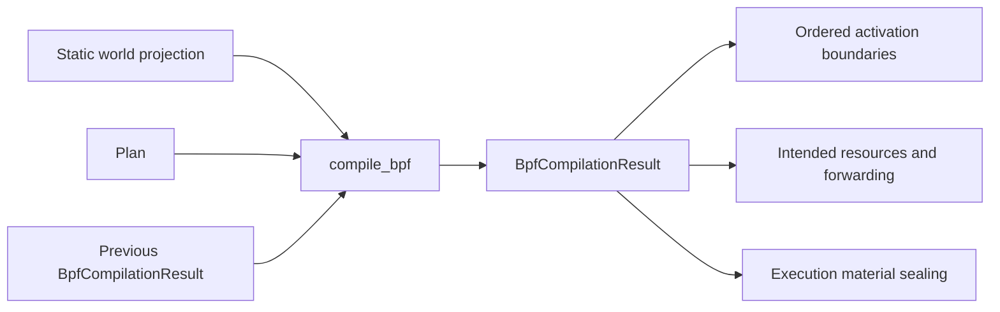

# Compiler

`compile_bpf(plan, physical_world, previous_result)` is a pure translation boundary;
it creates no containers and runs no Models. `Plan` is the sole semantic handoff
from Planner. Static world facts supply identities and capabilities, while the
previous result preserves incremental backend allocation and lineage.

Compilation validates merge-consistent forwarding and resource capacity, emitting
backend-owned intents and ordering. The compact Compiler history supports detached
inspection; sealed execution materials retain the authoritative executable payload.
See [materials](../execution_materials/README.md) and [backend contract](../../../../../docs/development/compiler-and-runner.md).
