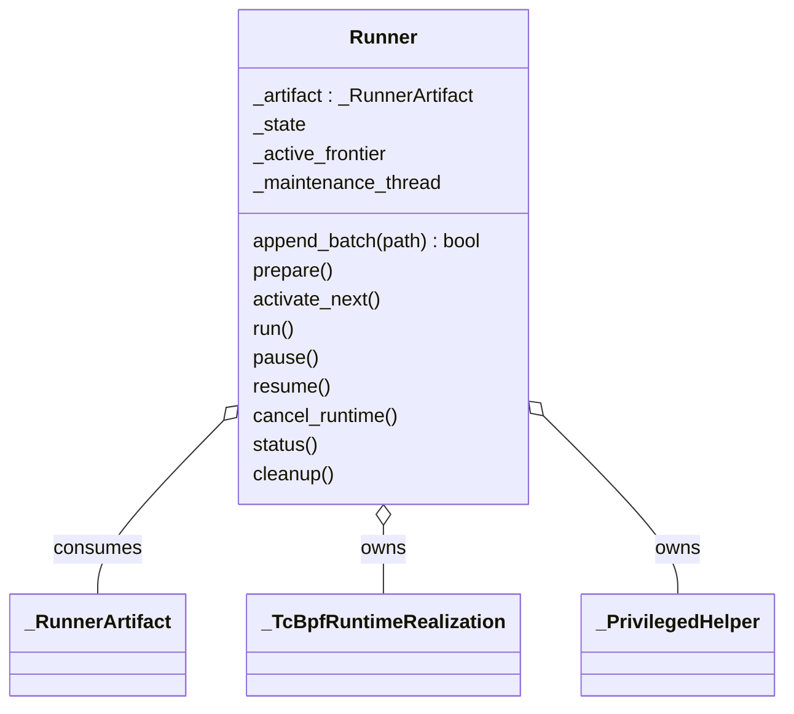

# BPF Runner compatibility and telemetry

The public `Runner` import forwards to the shared [Runner owner](../../runner/README.md).
This package retains BPF Traffic telemetry only; lifecycle, deployment and helper transport
are in `backend/runner`.

`Runner` consumes sealed material paths and deployment metadata. Construction
validates/captures inputs; `prepare()` acquires and initializes runtime resources.
`activate_next()` performs the next prepared activation; `run()` paces this work.
The owned [BPF adapter](../dataplane/README.md) binds/loads prepared ELF through libbpf and prewrites
encoded data; it neither compiles C nor expands Compiler intentions. It owns shared
framework maps and the loaded objects, including their private mutable state.
Private preparation and maintenance workers share explicit ownership and are joined
before cleanup. No worker invokes Simulator or Compiler.

Pause suspends updates after admitted work drains; clocks and applications continue.
Material exhaustion waits in continuing execution. Runtime orchestration owns reset
by creating a new Runner over retained materials, without recalculation or a Compose
rebuild. Runner cleanup removes its DataPlane resources; Deployer owns containers.
[Execution architecture](../../../../../docs/architecture/execution.md) shows lifecycle
and cooperation; [Compiler/Runner reference](../../../../../docs/development/compiler-and-runner.md) is authoritative.
