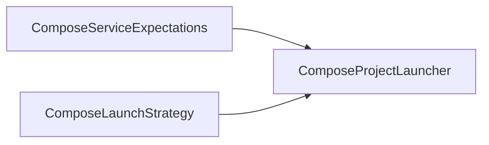
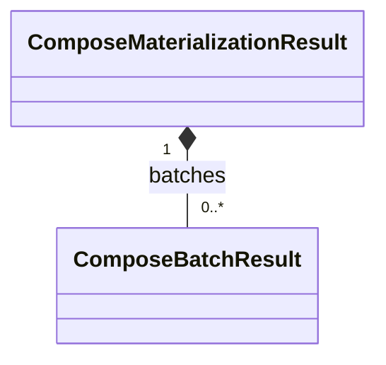
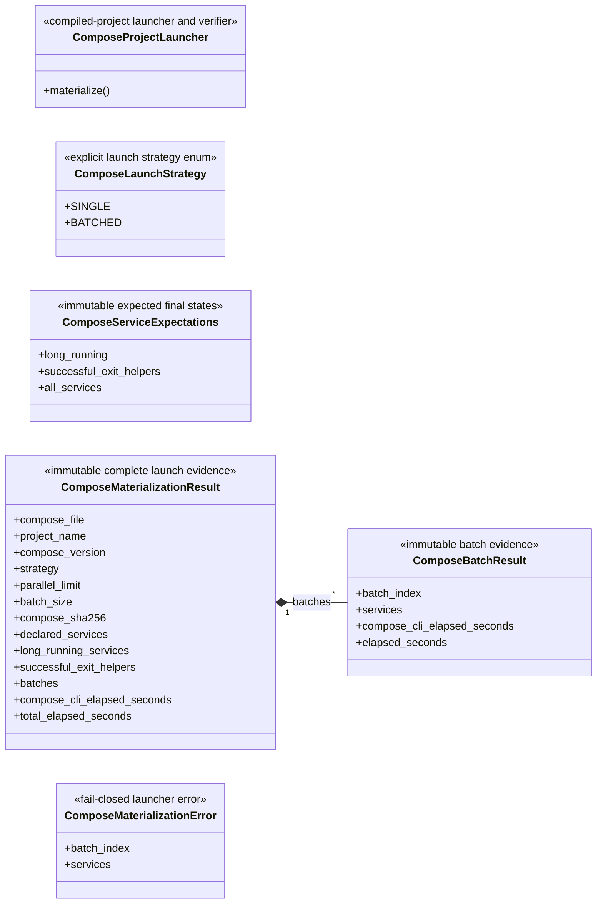

# Compose launcher

This package launches and verifies one already-compiled Docker Compose v2
project. It neither compiles/edits that project nor owns a dynamic-execution
lifecycle.

## Local assembly / ownership map

Legend: `-->` is the ordered compiled-project launch and verification-evidence
flow. This is the current static Compose boundary.

Legend: `-->` is an exact launcher input/reference, not ownership.

Legend: `*--` is retained evidence composition.

Standalone local failure boundary: `ComposeMaterializationError`.

## Detailed public class/member diagrams

Legend: `A *-- B` means immutable launch evidence A is composed of B. Other
class blocks are complete local public contracts; no additional relationship
is implied.

| Diagram class | Public contract | Required public members |
|---|---|---|
| `ComposeProjectLauncher` | `skyseed_v2.compose.ComposeProjectLauncher` | `materialize()` |
| `ComposeLaunchStrategy` | `skyseed_v2.compose.ComposeLaunchStrategy` | `SINGLE`, `BATCHED` |
| `ComposeServiceExpectations` | `skyseed_v2.compose.ComposeServiceExpectations` | `long_running`, `successful_exit_helpers`, `all_services` |
| `ComposeMaterializationResult` | `skyseed_v2.compose.ComposeMaterializationResult` | `compose_file`, `project_name`, `compose_version`, `strategy`, `parallel_limit`, `batch_size`, `compose_sha256`, `declared_services`, `long_running_services`, `successful_exit_helpers`, `batches`, `compose_cli_elapsed_seconds`, `total_elapsed_seconds` |
| `ComposeBatchResult` | `skyseed_v2.compose.ComposeBatchResult` | `batch_index`, `services`, `compose_cli_elapsed_seconds`, `elapsed_seconds` |
| `ComposeMaterializationError` | `skyseed_v2.compose.ComposeMaterializationError` | `batch_index`, `services` |

## Entry points

`launcher.py` owns the public launcher, strategy, expectations, evidence, and
failure contracts; `__init__.py` is their facade.

## Dependencies

The launcher consumes an already-compiled Compose project and invokes the
Docker Compose v2 CLI. It does not import Simulator, Models, Tools, or any
future execution capability.

## Examples and tests

Complete and large examples consume the facade.
`test_compose_project_launcher.py` and large-network integration tests cover
launch, verification, batching, and fail-closed evidence.

## Maintenance checklist

When this package changes, update the local map and detailed diagram,
`compose-launcher.md`/failure contracts, public imports, examples, and focused
launcher tests.
