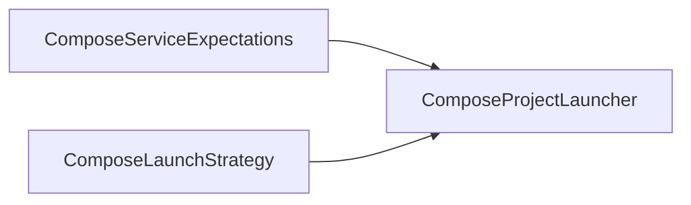
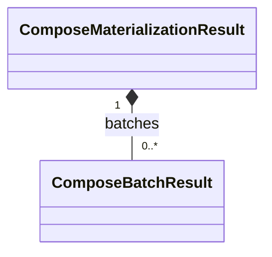
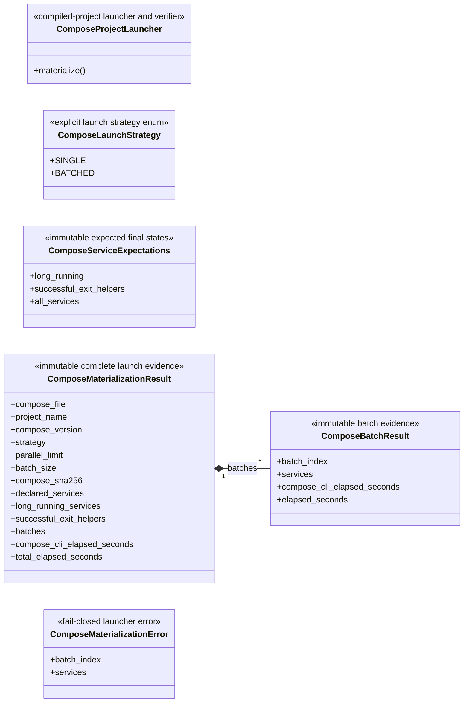

# Compose launcher

The public launcher launches and verifies one already-compiled Docker Compose
v2 project. It neither edits that project nor owns a dynamic-execution lifecycle.
Private generated-control packaging also lives in `launcher.py`: before launch,
it groups identical context content, paths and modes into one project-scoped
image per group, preserving individual service/container configuration. The
representative alone retains its build declaration; startup validates the exact
unique image set and IDs, requires project labels on generated images, and
creates no per-service image aliases. External images may have no project label.

Generated cleanup uses this same deployment utility's private control. Run it
once Runner evidence has drained and the Traffic executor and Runner cleanup have
completed. It snapshots exact project-labelled immutable container IDs, reverses
`depends_on` and namespace dependencies, and removes owned networks afterward.
Generated interface-less Satellite/GroundStation services carry the private
`x-skyseed-disposable-network: true` extension. They use bounded `docker rm
--force`, avoiding the idle PID-1 ten-second grace. Explicit `stop_signal`,
`stop_grace_period`, or `pre_stop` takes precedence and selects graceful
`docker stop` then `docker rm`; unknown/orphan services also remain graceful.
Compose resolves hook interpolation/settings through read-only `config` before
hooks execute against saved container IDs, preserving command, user, workdir,
privilege and environment, before stopping a running container. This does not
make Compose a Runner lifecycle owner. External networks, images and volumes
remain; a failed command stops later dependency removal. Repeated cleanup
inventories only remaining owned resources. Startup-failure rollback also removes
dependents before their declared/namespace dependencies and stops on a cleanup
failure; explicit hooks and stop settings run before force-removing a partially
started service.

Generated controls use private configurable startup bounds and a cleanup count policy:

| Environment ceiling | Default | Meaning |
|---|---:|---|
| `SKYSEED_DEPLOY_BATCH_SIZE` | 64 | services in a Compose startup invocation |
| `SKYSEED_DEPLOY_PARALLEL` | 8 | Compose concurrent requests, independently bounded |
| `SKYSEED_CLEANUP_BATCH_SIZE` | 16 | immutable IDs in one Docker stop/remove command; also its request bound |
| `SKYSEED_DEPLOY_RESIDENT_STEP` | 2000 | cleanup-only remaining owned-container count at which the removal ceiling halves |

Startup remains 64 services / eight concurrent requests at every resident count,
unless explicitly configured. Cleanup uses eight IDs while at/above 2000
remaining, then 16. `SKYSEED_DEPLOY_RESIDENT_STEP` retains its configuration name
for compatibility but affects cleanup only. Resident startup counts are measurements,
not a trigger for changing concurrency.
Shell groups organize progress, not equal-sized resource units. Values are
positive integers; concurrency cannot exceed batch size, and batch ceilings
cannot exceed 64. There are no fixed inter-batch sleeps, CPU-count equality,
pressure admission, pause or abort gates. Namespace dependencies in derived
startup files reference already-verified immutable container IDs.

These are bounded engineering defaults informed by the retained 4765-container
run and teardown traces, not an optimum. The earlier full deployment used
64/eight throughout; the final teardown was manually accelerated. This round
has command/dependency regressions and one isolated nine-service smoke only.
The cleanup count transition and 16-ID setting have **not** been
qualified at five-Shell scale. Docker/Compose hook semantics follow the
[Compose service specification](https://docs.docker.com/reference/compose-file/services/).

## Local assembly / ownership map

Legend: `-->` is the ordered compiled-project launch and verification-evidence
flow. This is the current static Compose boundary.

Legend: `-->` is an exact launcher input/reference, not ownership.

Legend: `*--` is retained evidence composition.

Standalone local failure boundary: `ComposeMaterializationError`.

## Detailed public class/member diagrams

Legend: `A *-- B` means immutable launch evidence A is composed of B. Other
class blocks are complete local public contracts; no additional relationship
is implied.

| Diagram class | Public contract | Required public members |
|---|---|---|
| `ComposeProjectLauncher` | `skyseed_v2.compose.ComposeProjectLauncher` | `materialize()` |
| `ComposeLaunchStrategy` | `skyseed_v2.compose.ComposeLaunchStrategy` | `SINGLE`, `BATCHED` |
| `ComposeServiceExpectations` | `skyseed_v2.compose.ComposeServiceExpectations` | `long_running`, `successful_exit_helpers`, `all_services` |
| `ComposeMaterializationResult` | `skyseed_v2.compose.ComposeMaterializationResult` | `compose_file`, `project_name`, `compose_version`, `strategy`, `parallel_limit`, `batch_size`, `compose_sha256`, `declared_services`, `long_running_services`, `successful_exit_helpers`, `batches`, `compose_cli_elapsed_seconds`, `total_elapsed_seconds` |
| `ComposeBatchResult` | `skyseed_v2.compose.ComposeBatchResult` | `batch_index`, `services`, `compose_cli_elapsed_seconds`, `elapsed_seconds` |
| `ComposeMaterializationError` | `skyseed_v2.compose.ComposeMaterializationError` | `batch_index`, `services` |

## Entry points

`launcher.py` owns the public launcher, strategy, expectations, evidence, and
failure contracts; `__init__.py` is their facade. The same file contains private
SEED Docker adaptation, context grouping and generated start/cleanup controls.
These remain deployment packaging mechanics, outside the public class diagram.

## Dependencies

The launcher consumes an already-compiled Compose project and invokes the
Docker Compose v2 CLI. It does not import Simulator, Models, Tools, or any
future execution capability. Private build-plan packaging uses the existing
PyYAML dependency to update generated Compose image/build declarations.

## Examples and tests

Complete and large examples consume the facade.
`test_compose_project_launcher.py` and large-network integration tests cover
launch, verification, batching, and fail-closed evidence.

## Maintenance checklist

When this package changes, update the local map and detailed diagram,
`compose-launcher.md`/failure contracts, public imports, examples, and focused
launcher tests.
