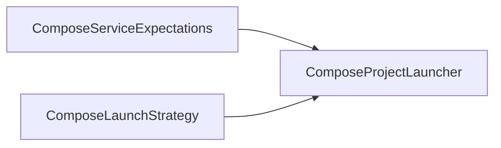
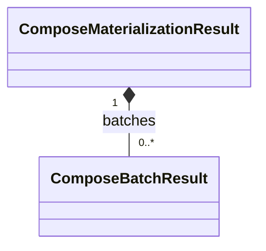
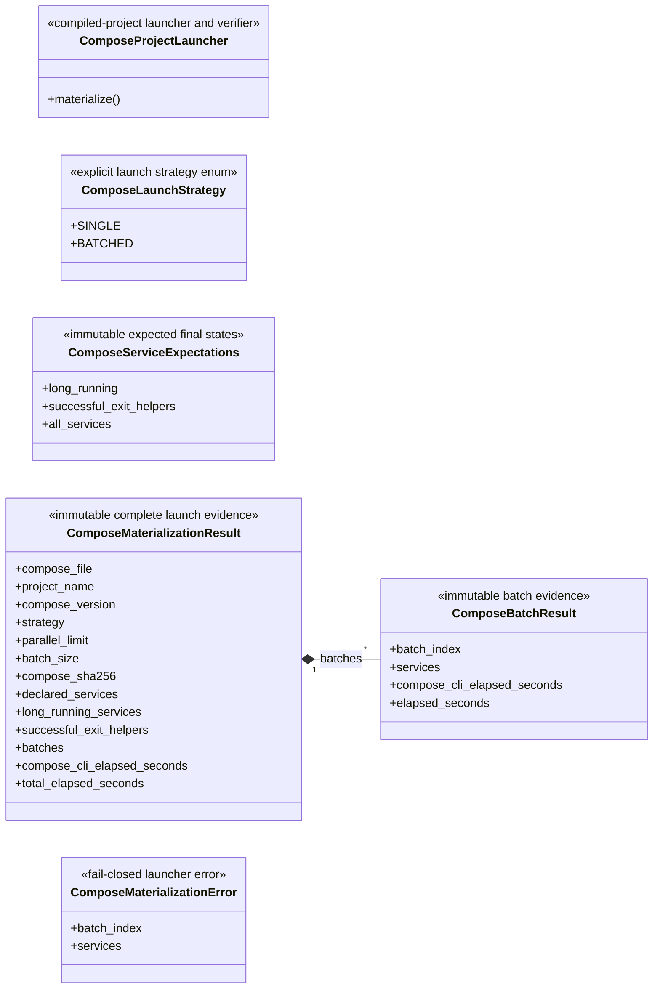

# Compose launcher

The public launcher launches and verifies one already-compiled Docker Compose
v2 project. It neither edits that project nor owns a dynamic-execution lifecycle.
Private generated-control packaging also lives in `launcher.py`: before launch,
it groups identical context content, paths and modes into one project-scoped
image per group, preserving individual service/container configuration. The
representative alone retains its build declaration; startup validates the exact
unique image set and IDs, requires project labels on generated images, and
creates no per-service image aliases. External images may have no project label.

Generated cleanup uses this same deployment utility's private control. Run it
once Runner evidence has drained and the Traffic executor and Runner cleanup have
completed. It snapshots exact project-labelled immutable container IDs, reverses
`depends_on` and namespace dependencies, and removes owned networks afterward.
Generated interface-less Satellite/GroundStation services carry the private
`x-skyseed-disposable-network: true` extension. They use bounded `docker rm
--force`, avoiding the idle PID-1 ten-second grace. Explicit `stop_signal`,
`stop_grace_period`, or `pre_stop` takes precedence and selects graceful
`docker stop` then `docker rm`; unknown/orphan services also remain graceful.
Compose resolves hook interpolation/settings through read-only `config` before
hooks execute against saved container IDs, preserving command, user, workdir,
privilege and environment, before stopping a running container. This does not
make Compose a Runner lifecycle owner. External networks, images and volumes
remain; a failed command stops later dependency removal. Repeated cleanup
inventories only remaining owned resources. A startup failure preserves confirmed
successful groups, records the failing group's observed container state and stops
admission. Explicit retry checks service configuration digests, immutable image IDs
and container ownership, then starts only missing or unsuccessful services.
Before replacing owners, retry compares retained `network_mode`, `ipc` and `pid`
bindings with the current owner container IDs across the entire project. Missing,
unsuccessful or replaced owners invalidate transitive namespace consumers even
in later groups. Affected consumers stop/remove before their owners, honoring
hooks and grace settings; startup then follows the normal dependency/group order.
Unrelated healthy containers remain. Unverifiable retained namespace bindings
are recreated instead of being accepted from an unchanged service digest.

Generated startup submits one whole metadata-defined group at a time. The five-Shell
Example orders shared GS/auxiliaries, S1, S2, S3, S4, S5; actual dependencies take
precedence over preferred group order. Internal service/namespace dependencies stay
in Compose; earlier group dependencies are checked and external namespace references
use confirmed container IDs. This is not restricted to five particular Shell names.
`SKYSEED_DEPLOY_PARALLEL` defaults to 8 (configurable 1–64) throughout startup.
The former service-count controls and resident-count curve are removed from these
controls. Group configuration is constructed once per group invocation.

Cleanup reverses the groups and any actual within-group dependencies, then removes
owned networks. One whole removal group is passed to `docker rm` at a time; Docker
CLI 29.6.2's native `parallelOperation` queue caps concurrent operations at 50.
No second dispatcher or overlapping group commands are introduced. Explicit graceful
settings/hooks still complete before removal. The CLI queue is distinct from Compose
stop/down and is not governed by Compose's startup parallel flag.

Startup has one 3600-second stage budget, carried from generated startup into all
group commands; cleanup has one 1800-second budget. A timed-out client does not prove
that daemon work has stopped: admission stops and evidence records uncertainty.
There are no artificial inter-group sleeps or pressure-based execution gates.
`deployment-measurements.jsonl` and `teardown-measurements.jsonl` preserve append-only
group progress and lightweight host checkpoints. Historical 64/8 and 128/8 evidence
remains a comparison, not qualification of the new strategy. Current results are in
[CURRENT](../../../docs/CURRENT.md).

## Local assembly / ownership map

Legend: `-->` is the ordered compiled-project launch and verification-evidence
flow. This is the current static Compose boundary.

Legend: `-->` is an exact launcher input/reference, not ownership.

Legend: `*--` is retained evidence composition.

Standalone local failure boundary: `ComposeMaterializationError`.

## Detailed public class/member diagrams

Legend: `A *-- B` means immutable launch evidence A is composed of B. Other
class blocks are complete local public contracts; no additional relationship
is implied.

| Diagram class | Public contract | Required public members |
|---|---|---|
| `ComposeProjectLauncher` | `skyseed_v2.compose.ComposeProjectLauncher` | `materialize()` |
| `ComposeLaunchStrategy` | `skyseed_v2.compose.ComposeLaunchStrategy` | `SINGLE`, `BATCHED` |
| `ComposeServiceExpectations` | `skyseed_v2.compose.ComposeServiceExpectations` | `long_running`, `successful_exit_helpers`, `all_services` |
| `ComposeMaterializationResult` | `skyseed_v2.compose.ComposeMaterializationResult` | `compose_file`, `project_name`, `compose_version`, `strategy`, `parallel_limit`, `batch_size`, `compose_sha256`, `declared_services`, `long_running_services`, `successful_exit_helpers`, `batches`, `compose_cli_elapsed_seconds`, `total_elapsed_seconds` |
| `ComposeBatchResult` | `skyseed_v2.compose.ComposeBatchResult` | `batch_index`, `services`, `compose_cli_elapsed_seconds`, `elapsed_seconds` |
| `ComposeMaterializationError` | `skyseed_v2.compose.ComposeMaterializationError` | `batch_index`, `services` |

## Entry points

`launcher.py` owns the public launcher, strategy, expectations, evidence, and
failure contracts; `__init__.py` is their facade. The same file contains private
SEED Docker adaptation, context grouping and generated start/cleanup controls.
These remain deployment packaging mechanics, outside the public class diagram.

## Dependencies

The launcher consumes an already-compiled Compose project and invokes the
Docker Compose v2 CLI. It does not import Simulator, Models, Tools, or any
future execution capability. Private build-plan packaging uses the existing
PyYAML dependency to update generated Compose image/build declarations.

## Examples and tests

Complete and large examples consume the facade.
`test_compose_project_launcher.py` and large-network integration tests cover
launch, verification, batching, and fail-closed evidence.

## Maintenance checklist

When this package changes, update the local map and detailed diagram,
`compose-launcher.md`/failure contracts, public imports, examples, and focused
launcher tests.

Generated controlled startup derives `runtime/skyseed-image-compose.yml` from
the canonical full Compose source for unique-image inspection and representative
builds. It contains image/build inputs, with no runtime admission. Each bounded
startup invocation still passes the full admitted service definitions to Compose;
existing metadata/dependency ordering and project-label cleanup remain authoritative.
This avoids feeding thousands of runtime services into Compose's single-document
parser during image preparation, without raising parser or host protection limits.
The derived image file is replaceable deployment scratch, like the existing startup
group file; it is not an additional deployment owner or source of domain identity.
