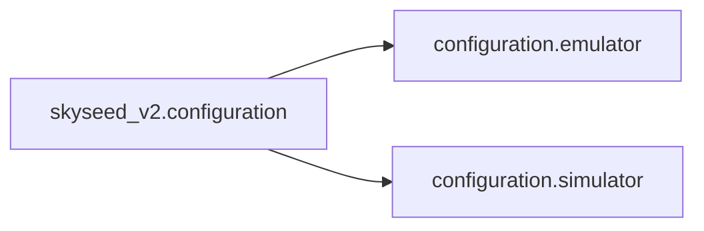

# Configuration

This package is the public namespace boundary between immutable Emulator
declarations and immutable Simulator Zone declarations. It owns no runtime
Emulator, PhysicalWorld, or operational runtime object.

## Local assembly / ownership map

Legend: `A --> B` means B consumes the declaration value produced by A.

## Detailed public class/member diagrams

This namespace exports the `emulator` and `simulator` package facades. It owns
no public class/member contract; detailed declarations are maintained in the
two child README files.

## Entry points

Start with `emulator/__init__.py` or `simulator/__init__.py`.

## Dependencies

`configuration/emulator/` owns static Emulator declarations and their YAML
loading. `configuration/simulator/` owns Zone layout declarations and their
YAML loading. `_yaml.py` contains private parsing primitives shared by those
two receivers; configuration never owns Emulator or Simulator runtime objects.

## Examples and tests

See the configuration fixtures in `tests/fixtures/` and tests named
`test_static_configuration.py`, `test_static_emulator_config_yaml.py`, and
`test_zone.py`.

## Maintenance checklist

When declarations, YAML keys, or failure behavior change, update the relevant
user guide, `docs/codex-reference/invariants-failures.md`, public-import
mapping, fixtures, and owner tests.
