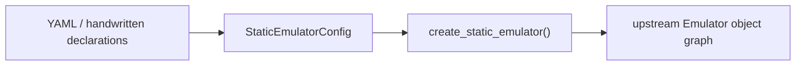
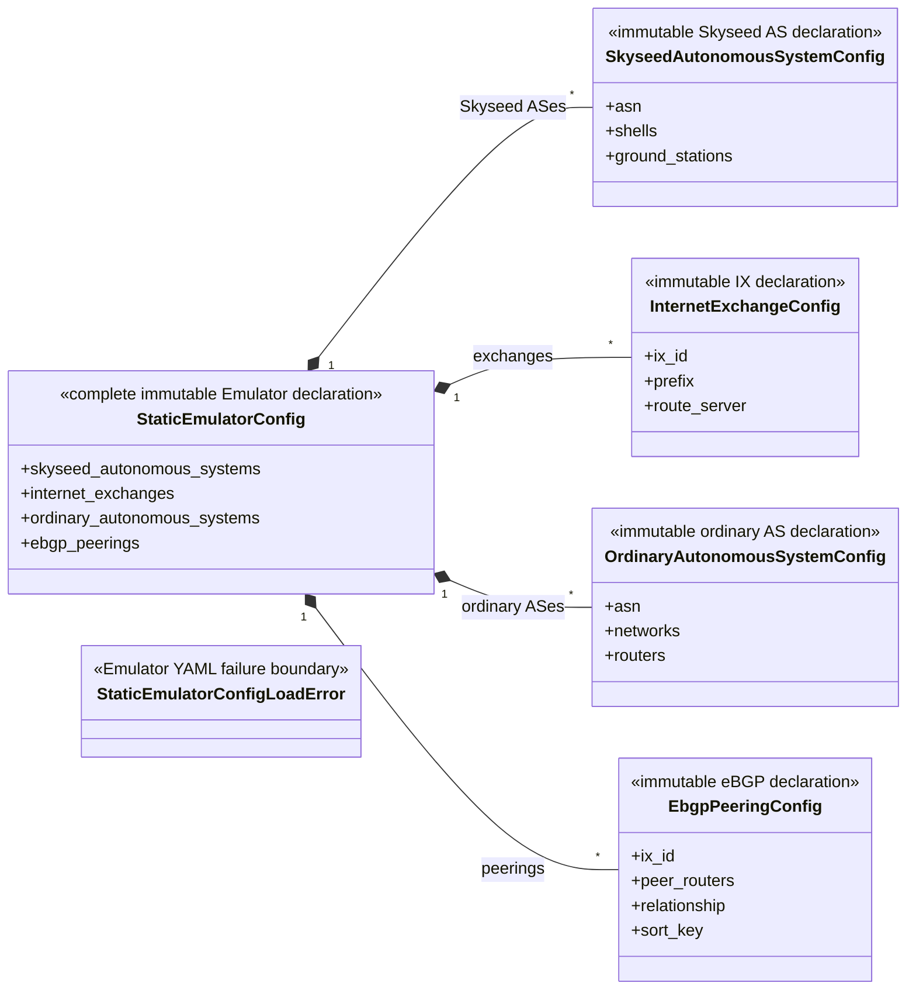
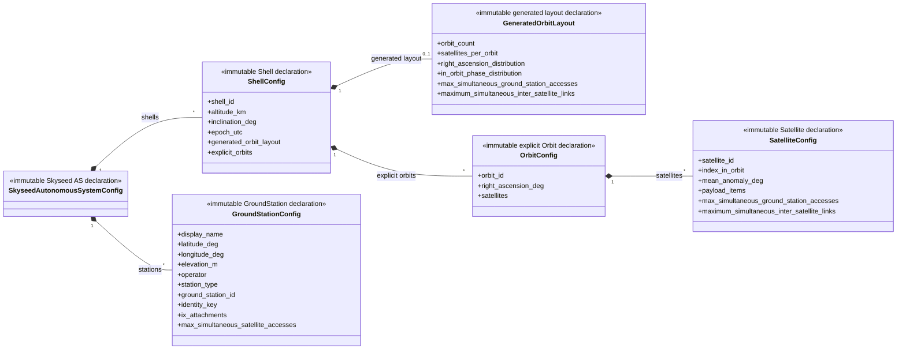
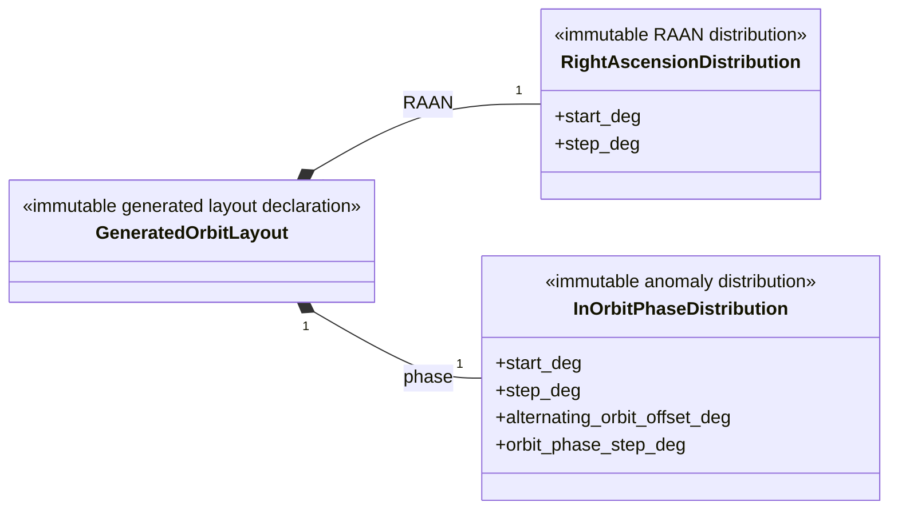
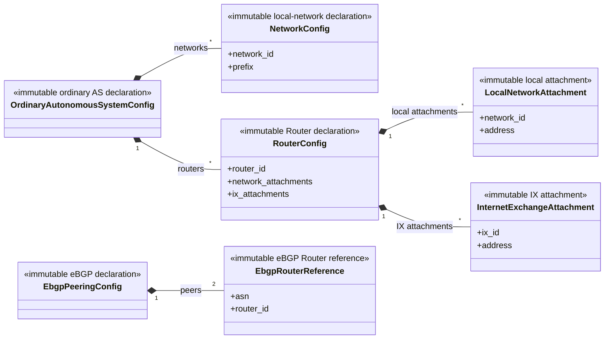

# Emulator configuration

This package owns every immutable Emulator declaration, schema constant, YAML
loader, and `StaticEmulatorConfigLoadError`. It creates no runtime entity and
contains no Simulator configuration.

## Local assembly / ownership map

Legend: `-->` is the ordered declaration-loading and construction handoff; it
does not make configuration the owner of the resulting Emulator graph.

The other public declaration values expanded below are standalone inputs or
children of this aggregate: `EbgpPeeringConfig`, `EbgpRouterReference`,
`GeneratedOrbitLayout`, `GroundStationConfig`, `InOrbitPhaseDistribution`,
`InternetExchangeAttachment`, `InternetExchangeConfig`,
`LocalNetworkAttachment`, `NetworkConfig`, `OrbitConfig`,
`OrdinaryAutonomousSystemConfig`, `RightAscensionDistribution`,
`RouterConfig`, `SatelliteConfig`, `ShellConfig`,
`SkyseedAutonomousSystemConfig`, and `StaticEmulatorConfigLoadError`.

## Detailed public class/member diagrams

Legend: `A *-- B` means declaration A is composed of B declarations. Every
simple dataclass block lists all public fields.

Legend: `A *-- B` means Satellite declaration A contains B.

Legend: `A *-- B` means generated layout A contains the complete distribution
values B.

`InOrbitPhaseDistribution.step_deg` is the mean-anomaly increment between
successive Satellites in one Orbit. Generated YAML selects exactly one
inter-Orbit policy: `alternating_orbit_offset_deg` applies the existing parity
offset, while `orbit_phase_step_deg` advances the Orbit start anomaly linearly
with Orbit index. The two policies are not combined.

Legend: `A *-- B` means ground-network declaration A contains B.

| Diagram class | Public contract | Required public members |
|---|---|---|
| `EbgpPeeringConfig` | `skyseed_v2.configuration.emulator.EbgpPeeringConfig` | `ix_id`, `peer_routers`, `relationship`, `sort_key` |
| `EbgpRouterReference` | `skyseed_v2.configuration.emulator.EbgpRouterReference` | `asn`, `router_id` |
| `GeneratedOrbitLayout` | `skyseed_v2.configuration.emulator.GeneratedOrbitLayout` | `orbit_count`, `satellites_per_orbit`, `right_ascension_distribution`, `in_orbit_phase_distribution`, `max_simultaneous_ground_station_accesses`, `maximum_simultaneous_inter_satellite_links` |
| `GroundStationConfig` | `skyseed_v2.configuration.emulator.GroundStationConfig` | `display_name`, `latitude_deg`, `longitude_deg`, `elevation_m`, `operator`, `station_type`, `ground_station_id`, `identity_key`, `ix_attachments`, `max_simultaneous_satellite_accesses` |
| `InOrbitPhaseDistribution` | `skyseed_v2.configuration.emulator.InOrbitPhaseDistribution` | `start_deg`, `step_deg`, `alternating_orbit_offset_deg`, `orbit_phase_step_deg` |
| `InternetExchangeAttachment` | `skyseed_v2.configuration.emulator.InternetExchangeAttachment` | `ix_id`, `address` |
| `InternetExchangeConfig` | `skyseed_v2.configuration.emulator.InternetExchangeConfig` | `ix_id`, `prefix`, `route_server` |
| `LocalNetworkAttachment` | `skyseed_v2.configuration.emulator.LocalNetworkAttachment` | `network_id`, `address` |
| `OrbitConfig` | `skyseed_v2.configuration.emulator.OrbitConfig` | `orbit_id`, `right_ascension_deg`, `satellites` |
| `OrdinaryAutonomousSystemConfig` | `skyseed_v2.configuration.emulator.OrdinaryAutonomousSystemConfig` | `asn`, `networks`, `routers` |
| `NetworkConfig` | `skyseed_v2.configuration.emulator.NetworkConfig` | `network_id`, `prefix` |
| `RouterConfig` | `skyseed_v2.configuration.emulator.RouterConfig` | `router_id`, `network_attachments`, `ix_attachments` |
| `RightAscensionDistribution` | `skyseed_v2.configuration.emulator.RightAscensionDistribution` | `start_deg`, `step_deg` |
| `SatelliteConfig` | `skyseed_v2.configuration.emulator.SatelliteConfig` | `satellite_id`, `index_in_orbit`, `mean_anomaly_deg`, `payload_items`, `max_simultaneous_ground_station_accesses`, `maximum_simultaneous_inter_satellite_links` |
| `ShellConfig` | `skyseed_v2.configuration.emulator.ShellConfig` | `shell_id`, `altitude_km`, `inclination_deg`, `epoch_utc`, `generated_orbit_layout`, `explicit_orbits` |
| `SkyseedAutonomousSystemConfig` | `skyseed_v2.configuration.emulator.SkyseedAutonomousSystemConfig` | `asn`, `shells`, `ground_stations` |
| `StaticEmulatorConfig` | `skyseed_v2.configuration.emulator.StaticEmulatorConfig` | `skyseed_autonomous_systems`, `internet_exchanges`, `ordinary_autonomous_systems`, `ebgp_peerings` |
| `StaticEmulatorConfigLoadError` | `skyseed_v2.configuration.emulator.StaticEmulatorConfigLoadError` | — |

`GroundStationConfig.operator` is an explicit `str | None` metadata field.
YAML must contain the `operator` key: a non-empty string records a known
operator, while `null` records that the experiment input does not know it.
Omitting the key remains an error.

`max_simultaneous_satellite_accesses` is an optional positive-integer
simulation capability of the declared GroundStation site. YAML may omit it or
use `null` for no specified site cap. It is not a physical antenna-count field.

`max_simultaneous_ground_station_accesses` is the corresponding optional
positive-integer Satellite capability for GroundStation-access Connections.
Generated layouts apply one value to every generated Satellite; explicit
Satellite declarations may set it individually. YAML omission or `null` means
no explicit cap. It is not total degree, ISL capacity, UT capacity, or antenna
count.

`maximum_simultaneous_inter_satellite_links` is the separate optional positive
integer copied through each Emulator Satellite and Simulator input into the
PhysicalWorld-owned `InterSatelliteLinkCapability.maximum_simultaneous_links`.
Generated layouts apply one value to every generated Satellite; explicit
Satellite declarations set it individually. YAML omission or `null` means the
capability is unavailable, never unlimited. This scalar states only a maximum
simultaneous ISL count: it defines no terminal identities, front/back/left/right
directions, steering envelope, candidate-search scope, or same/cross-plane
allocation. Canonical S3 explicitly declares `4` as a scenario assumption,
not as proven Starlink hardware; the Network Planner's desired `2 + 2` split
is injected policy outside this configuration value.

## Entry points

Public declarations and `load_static_emulator_config()` are exported by
`__init__.py`; `yaml.py` owns YAML loading and
`StaticEmulatorConfigLoadError`.

## Dependencies

This package depends on validation/YAML primitives and neutral values. Emulator
construction consumes its declarations; it imports neither Simulator runtime
objects nor SEED integration state.

## Examples and tests

Complete, dynamic, and large examples use these declarations. Static
configuration/YAML, construction-equivalence, and negative loader tests cover
the package.

## Maintenance checklist

When declarations, YAML keys, or failures change, update these local maps and
detailed diagrams, configuration/construction/failure contracts, public
imports, fixtures, and focused tests.
