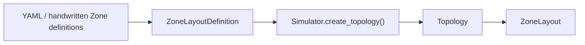
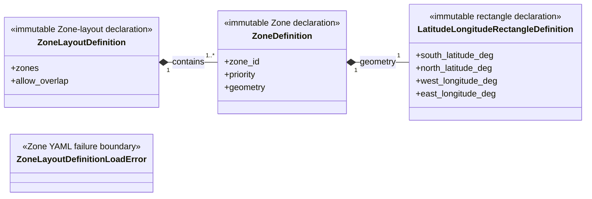

# Simulator configuration

This package owns immutable Zone-layout declarations, their YAML loader, and
the Simulator-specific `ZoneLayoutDefinitionLoadError`. It owns no runtime
`Zone`/`ZoneLayout` and does not import Emulator configuration.

## Local assembly / ownership map

Legend: `-->` is the ordered configuration and creation handoff. Only
`Simulator.create_topology()` materializes the runtime `Topology` and its
optional `ZoneLayout`.

Standalone public values expanded below are `ZoneDefinition`,
`LatitudeLongitudeRectangleDefinition`, and
`ZoneLayoutDefinitionLoadError`.

## Detailed public class/member diagrams

Legend: `A *-- B` means immutable declaration A is composed of B. The error is
shown as a standalone public boundary.

| Diagram class | Public contract | Required public members |
|---|---|---|
| `LatitudeLongitudeRectangleDefinition` | `skyseed_v2.configuration.simulator.LatitudeLongitudeRectangleDefinition` | `south_latitude_deg`, `north_latitude_deg`, `west_longitude_deg`, `east_longitude_deg` |
| `ZoneDefinition` | `skyseed_v2.configuration.simulator.ZoneDefinition` | `zone_id`, `priority`, `geometry` |
| `ZoneLayoutDefinition` | `skyseed_v2.configuration.simulator.ZoneLayoutDefinition` | `zones`, `allow_overlap` |
| `ZoneLayoutDefinitionLoadError` | `skyseed_v2.configuration.simulator.ZoneLayoutDefinitionLoadError` | — |

## Entry points

`zone.py` owns the declarations; `yaml.py` owns
`load_zone_layout_definition()` and the Simulator-specific load error.

## Dependencies

This package depends on configuration parsing primitives only. `Simulator`
consumes its declarations while creating `Topology`; it does not depend on
Emulator configuration.

## Examples and tests

The dynamic example supplies a Zone layout. `test_zone.py` covers declaration,
YAML, creation, membership, and failure behavior.

## Maintenance checklist

When this package changes, update the local map and detailed diagram,
Topology/Zone and failure contracts, public imports, YAML fixtures, and Zone
tests.
