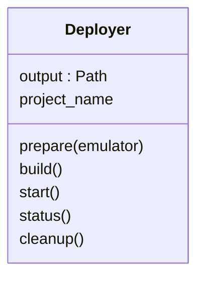

# Deployer and SEED

`Deployer(output)` captures one output location; construction performs no work.
`prepare(emulator, ...)` renders/compiles through the local SEED adapter and writes
`deployment/` build contexts, Compose and service metadata. It starts no network.
`build()`, `start()`, `status()` and `cleanup()` operate on this prepared output
without a Simulator or a persistent Controller. Generated `deploy.sh` and
`cleanup.sh` call this same owner.

`seed.py` contains SEED integration, including zero-interface cases; `metadata.py`
deduplicates build inputs; `deployer.py` owns grouped startup and cleanup. Startup
parallelism defaults to eight and is configurable. Retry reconciles failed namespace
owners and dependents while preserving unrelated healthy containers.

Small operation journals distinguish unresolved daemon work from settled command
failure. Cancellation joins owned client operations; a lost client is not daemon
completion. Cleanup respects hooks/dependencies and preserves external networks,
volumes and images. There is no elapsed-time kill or host-wide prune. Measurement
files under `deployment/` are evidence, not admission authority.

Experiment claims prevent independent deployment mutation during an active Runner.
Use runtime cancellation or coordinated shutdown before cleanup. [Execution
architecture](../../../docs/architecture/execution.md) and [experiment reference](../../../docs/development/experiment-control.md)
explain ownership and shutdown handoff.
