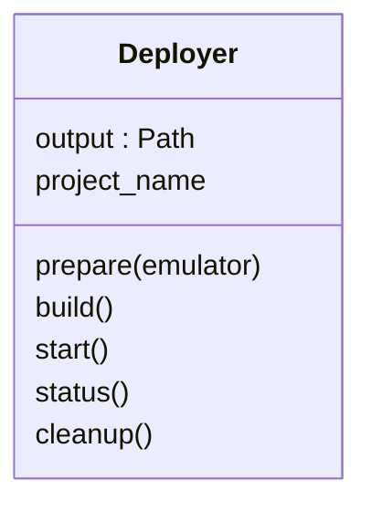

# Deployer and SEED

`Deployer(output)` captures one output location; construction performs no work.
`prepare(emulator, ...)` renders/compiles through the local SEED adapter and writes
`deployment/` build contexts, Compose and service metadata. It starts no network.
`build()`, `start()`, `status()` and `cleanup()` operate on this prepared output
without a Simulator or a persistent Controller. Generated `deploy.sh` and
`cleanup.sh` call this same owner.

`seed.py` contains SEED integration, including zero-interface cases; `metadata.py`
deduplicates build inputs; `deployer.py` owns grouped startup and cleanup. Image
preparation remains private to that owner. Build/start parallelism defaults
to eight and uses the existing `SKYSEED_DEPLOY_PARALLEL` / `--deploy-parallel` control. Retry reconciles failed namespace
owners and dependents while preserving unrelated healthy containers.

Small operation journals distinguish unresolved daemon work from settled command
failure. Cancellation joins owned client operations; a lost client is not daemon
completion. Cleanup respects hooks/dependencies and preserves external networks,
volumes and images. There is no elapsed-time kill or host-wide prune. Measurement
files under `deployment/` are evidence, not admission authority.
Build/pull/start commands inherit stdout/stderr so Docker retains native output and terminal
progress when supported; structured inspections remain captured for parsing. `_mutation`
still drains the admitted client after cancellation and retains lost-client uncertainty.
Concise stderr messages identify image reuse, startup groups, cleanup stage counts and elapsed
times. Startup success follows service settlement; cleanup success follows verified resource
absence. Ordinary/shared/ground services retain graceful stopping and pre-stop hooks.

Experiment claims prevent independent deployment mutation during an active Runner.
Use runtime cancellation or coordinated shutdown before cleanup. [Execution
architecture](../../../docs/architecture/execution.md) and [experiment reference](../../../docs/development/experiment-control.md)
explain ownership and shutdown handoff.

## Image preparation and reuse

Prerequisites complete before node/Map groups. Independent groups enter Compose
in batches no larger than the parallel limit, with Compose's own `--parallel`
limit controlling builds. No Python build worker pool or cache service is added.
An accepted Compose batch drains before failure returns; completed images survive
retry. A version-2 private pending-build journal records the whole accepted batch;
legacy single-build journals remain readable. Lost-client ambiguity is retained,
not treated as completion. [Compose parallelism](https://docs.docker.com/reference/cli/docker/compose/)
is the execution mechanism.

The reuse key covers local context names/bytes/modes, resolved Compose build options,
Dockerfile, platform and actual external/prerequisite image IDs. Docker stores the
key as `org.skyseed.build.key` and the image as `skyseed-build:<key>`. Each deployment
keeps its own image aliases, containers and networks. Reuse tags an immutable image
ID into the new project's alias, avoiding a build invocation entirely. A changed
prerequisite invalidates dependents; an isolated Map change leaves node images
reusable. The image may retain its creator's Compose label; container admission
still checks the current project and exact image identity.

Only generated local SEED/Map build inputs are supported. SEED's FROM-only
prerequisites get a minimal context, so an unrelated output change cannot invalidate
them. Literal external bases are pinned with Compose
[additional contexts](https://docs.docker.com/reference/compose-file/build/#additional_contexts).
Dependency discovery reads actual FROM, leading COPY `--from` and leading RUN
`--mount` declarations. Shell arguments and heredoc bodies are data. When an image
expression or other input cannot be safely fingerprinted (including secret/SSH or
additional contexts), that group takes the ordinary Docker build path on each
invocation. It still waits for generated prerequisites and uses bounded batches;
Docker retains its normal layer cache. No cross-output reuse key is claimed for
that group. Measurements mark `cacheable=false`. Existing local
base tags are the default inputs; `docker pull` refreshes them. A build `pull` option
refreshes external inputs before keying; `no_cache` forces its group to build.
Old images without a verifiable key enter the build path once and may benefit
from Docker's layer cache. That first build is different from later zero-invocation
reuse. No global prune is performed; Docker's normal image management owns storage.

`deployment-measurements.jsonl` records each group's decision (`build`,
`shared-image`, `project-image`) and accepted commands. Count actual Compose `build`
commands to measure invocation avoidance; elapsed time alone does not prove reuse.
