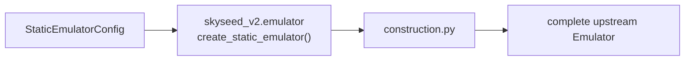
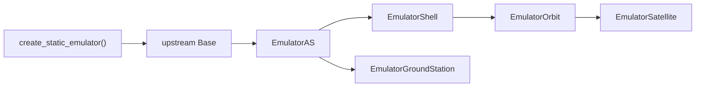

# Emulator facade and construction

`skyseed_v2.emulator.create_static_emulator` is the user-facing facade.
`construction.py` owns the function implementation; entity members and SEED
extension members are maintained only in `entities/README.md` and
`seedemu/README.md`.

## Local assembly / ownership map

Legend: `A --> B` means B consumes A's value/output in the construction flow.
It does not express entity ownership.

Legend: `A --> B` means construction calls the next formal owner creation API.
The full entity member list remains in the entity owner README.

## Detailed public class/member diagrams

This facade owns the public `create_static_emulator()` entry rather than a
class/member contract. Detailed entity and SEED-extension class diagrams live
only in `entities/README.md` and `seedemu/README.md`.

Construction creates Internet Exchanges, ordinary Autonomous Systems,
Skyseed AS → Shell/Orbit/Satellite and AS → GroundStation trees, then attaches
the configured SEED routing layers. It performs no Simulator projection,
Docker compilation, Compose launch, Tool read, or dynamic execution.

## Entry points

Code entry: `construction.py`; public facade: `__init__.py`.

## Dependencies

Construction consumes Emulator configuration, entity owners, and the
`seedemu/` extension boundary. It does not import Simulator, Compose launcher,
or Tools.

## Examples and tests

Examples:
`complete_static_emulator`, `mini_satellite_internet`, and
`large_static_network`. Tests: static construction, path equivalence, entity
ownership, and SEED integration tests.

## Maintenance checklist

When the facade or construction chain changes, update this diagram, the
Emulator construction contract, global Emulator chain, public imports,
examples, and construction/equivalence tests. Do not duplicate entity or SEED
member lists here.
