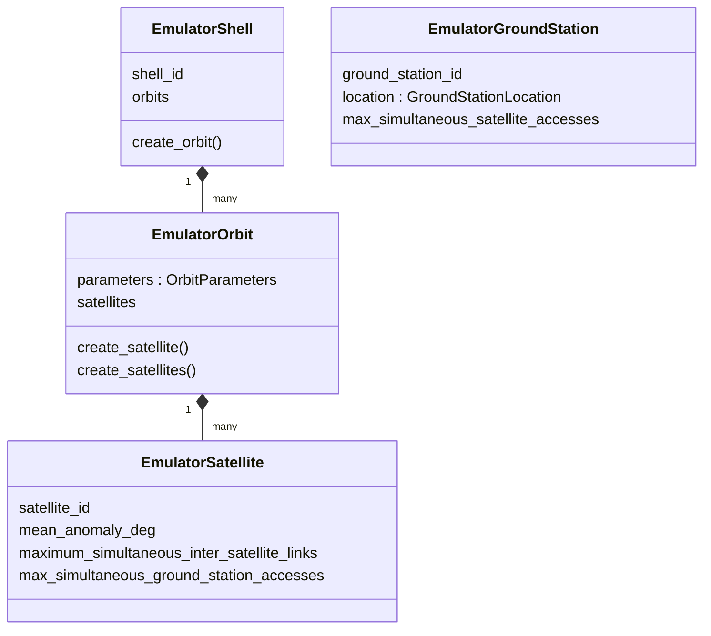

# Authored entities

`EmulatorShell` holds Orbits; each `EmulatorOrbit` holds immutable `OrbitParameters`
and Satellites. Orbit epoch/phase are independent of the simulation Timeline.
`EmulatorSatellite` is a SEED ExtensionNode; `EmulatorGroundStation` is a Router
with location and optional access capacity. Shell and Orbit group authored entities;
they do not represent processes or resource lifecycles.

The AS factory in [seedemu](../seedemu/README.md) enforces identity uniqueness.
[Independent inputs](../../../../docs/user-guides/inputs-and-scenes.md) shows both
Satellite and GroundStation construction; [developer reference](../../../../docs/development/component-boundaries.md)
defines identity/capability semantics.
