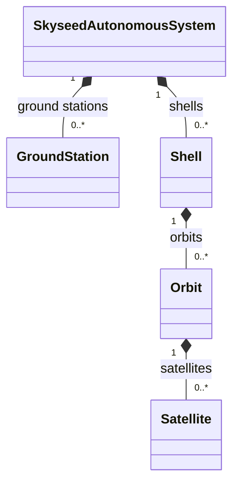
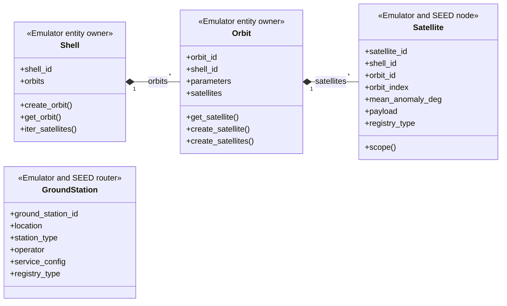
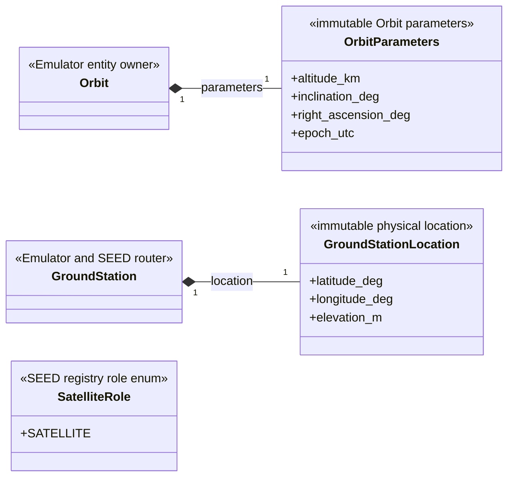

# Emulator entities

This package owns Skyseed Shell/Orbit/Satellite/GroundStation objects and
their bound immutable values. It owns no Simulator object, YAML loader,
compiler lifecycle, or cross-layer projection. Broad inherited upstream SEED
methods are intentionally omitted.

## Local assembly / ownership map

`SkyseedAutonomousSystem` is formally defined in the sibling `seedemu`
integration package; this map references that real public owner rather than
inventing a local AS role.

Legend: `*--` is Emulator entity ownership/composition.

Standalone local values/helpers expanded below: `GroundStationLocation`,
`OrbitParameters`, and `SatelliteRole`.

## Detailed public class/member diagrams

Legend: `A *-- B` means A owns B in the Emulator entity tree.

Legend: `A *-- B` means entity A contains the complete immutable value B.

| Diagram class | Public contract | Required public members |
|---|---|---|
| `Shell` | `skyseed_v2.emulator.entities.Shell` | `shell_id`, `orbits`, `create_orbit()`, `get_orbit()`, `iter_satellites()` |
| `Orbit` | `skyseed_v2.emulator.entities.Orbit` | `orbit_id`, `shell_id`, `parameters`, `satellites`, `get_satellite()`, `create_satellite()`, `create_satellites()` |
| `Satellite` | `skyseed_v2.emulator.entities.Satellite` | `satellite_id`, `shell_id`, `orbit_id`, `orbit_index`, `mean_anomaly_deg`, `payload`, `registry_type`, `scope()` |
| `GroundStation` | `skyseed_v2.emulator.entities.GroundStation` | `ground_station_id`, `location`, `station_type`, `operator`, `service_config`, `registry_type` |
| `GroundStationLocation` | `skyseed_v2.emulator.entities.GroundStationLocation` | `latitude_deg`, `longitude_deg`, `elevation_m` |
| `OrbitParameters` | `skyseed_v2.emulator.entities.OrbitParameters` | `altitude_km`, `inclination_deg`, `right_ascension_deg`, `epoch_utc` |
| `SatelliteRole` | `skyseed_v2.emulator.entities.SatelliteRole` | `SATELLITE` |

## Entry points

Code entries are `shell.py`, `orbit.py`, `satellite.py`, and
`ground_station.py`.

## Dependencies

The entity package depends on neutral shared validation/identity values and
upstream SEED node bases. Emulator construction and `seedemu/` own creation;
`emulator_to_simulator.py` reads the completed tree.

## Examples and tests

All Emulator examples consume these entities. Entity/identity unit tests plus
SEED/compiler integration tests cover the tree.

## Maintenance checklist

When these owners or values change, update the local map and detailed
diagrams, global object model when cross-package relations change,
ownership/boundary contracts, public imports, projector, and focused tests.
