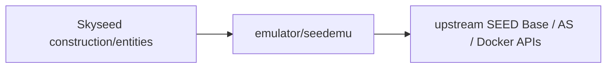
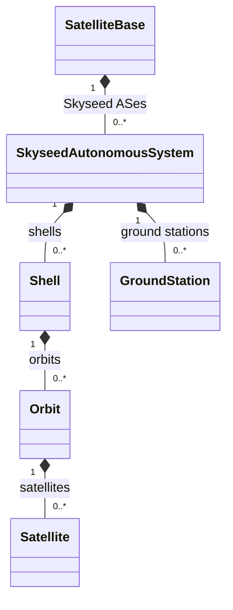
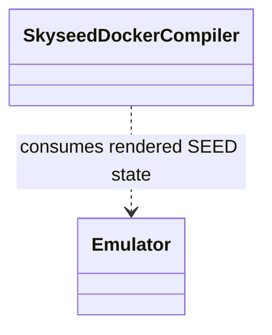
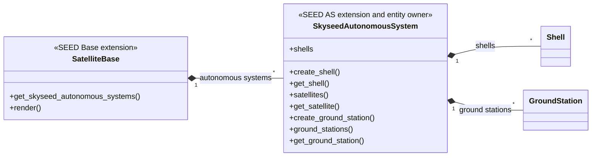
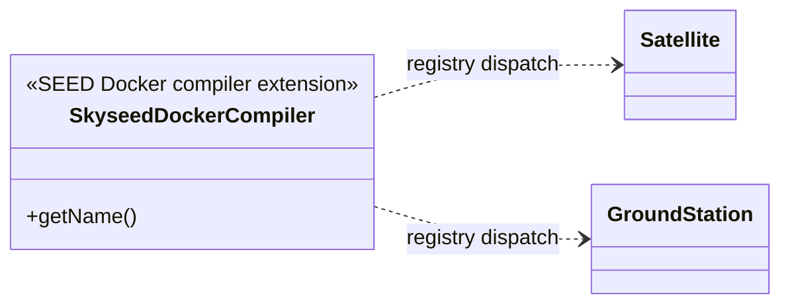

# SEED integration boundary

This package is the extractable upstream SEED extension boundary. It contains
the Base/AS subclasses, Docker compiler hook, metadata, and package asset; it
contains no Simulator, Dynamic Slice, Tool, Compose-launcher, generic
configuration, orchestration, or example-specific logic.

## Local assembly / ownership map

Legend: `A --> B` means A directly depends on B across the extraction
boundary.

Legend: `*--` is SEED-extension/entity ownership using the real public class
names.

Legend: `..>` means the compiler consumes the rendered upstream `Emulator`
state; it does not own that state.

This whole package is the future upstream-extraction boundary; Skyseed
construction, entities, configuration, projection, Simulator, Tools, and
Compose lifecycle remain outside it.

## Detailed public class/member diagrams

Legend: `A *-- B` means the SEED extension owner A owns Skyseed entity B.
Only Skyseed-specific public members are expanded; broad inherited SEED APIs
are omitted.

Legend: `Compiler ..> Entity` means compiler dispatch depends on the entity's
Skyseed registry type; it is not ownership.

| Diagram class | Public contract | Required public members |
|---|---|---|
| `SatelliteBase` | `skyseed_v2.emulator.seedemu.SatelliteBase` | `get_skyseed_autonomous_systems()`, `render()` |
| `SkyseedAutonomousSystem` | `skyseed_v2.emulator.seedemu.SkyseedAutonomousSystem` | `shells`, `create_shell()`, `get_shell()`, `satellites()`, `get_satellite()`, `create_ground_station()`, `ground_stations()`, `get_ground_station()` |
| `SkyseedDockerCompiler` | `skyseed_v2.emulator.seedemu.SkyseedDockerCompiler` | `getName()` |

## Entry points

Code entries are `satellite_base.py`, `skyseed_autonomous_system.py`,
`skyseed_docker_compiler.py`, `metadata.py`, and
`assets/internet_map_none_network_patch.sh`.

## Dependencies

This boundary directly depends on upstream SEED APIs, Skyseed Emulator
entities, shared identifier validation, and its package resource. It has no
Simulator, Tool, Compose, configuration, bridge, or example dependency.

`Satellite`/`GroundStation` dual-role inheritance and compiler type checks are
the concrete upstream-extraction coupling; construction and
`emulator_to_simulator.py` remain Skyseed-owned.

## Examples and tests

Complete, isolated, dynamic, and large examples use the extension. Architecture,
SEED, compiler, and wheel/resource tests cover extraction constraints.

## Maintenance checklist

When this boundary changes, update the local map and detailed diagrams,
extension/boundary contracts, package-data configuration, public imports,
extraction evidence, and focused integration tests.
