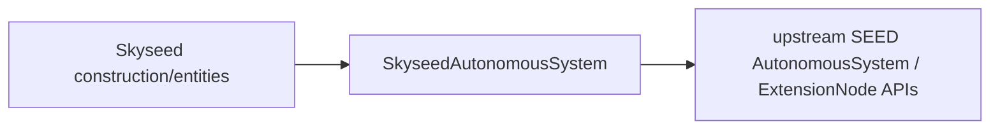
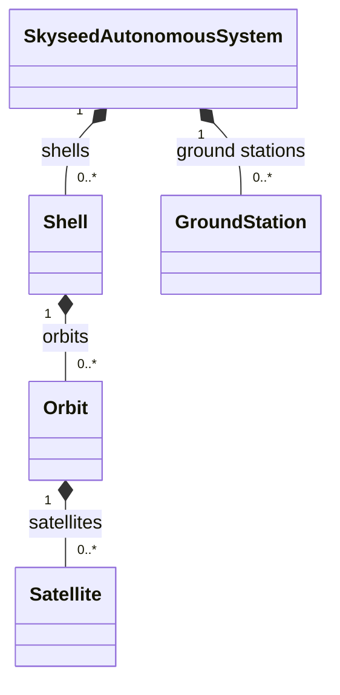
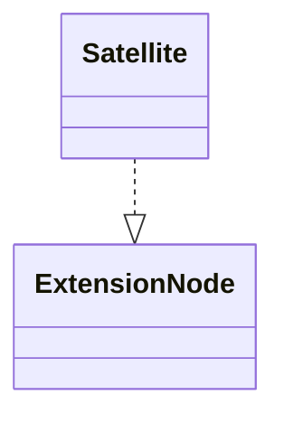
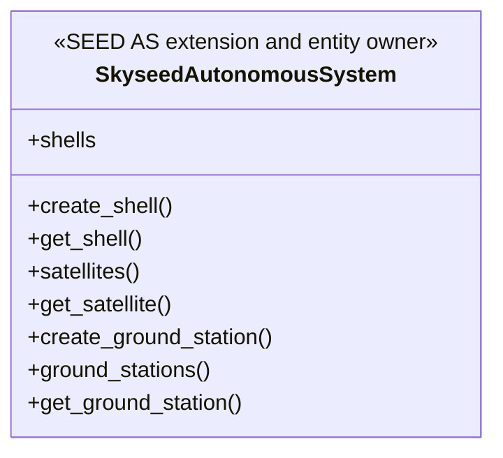

# SEED integration boundary

This package contains the single Skyseed-specific SEED integration owner:
`SkyseedAutonomousSystem`. Generic extension-node lifecycle, rendering,
metadata, zero-interface compilation, and InternetMap compatibility belong to
upstream SEED.

## Local assembly / ownership map

Legend: `A --> B` means A depends on B across the package boundary.

Legend: `*--` is domain ownership.

Legend: `..|>` is realization of the upstream extension-node contract.

## Detailed public class/member diagrams

Legend: this class diagram lists the public Skyseed-specific AS members; it
contains no relationship edge.

| Diagram class | Public contract | Required public members |
|---|---|---|
| `SkyseedAutonomousSystem` | `skyseed_v2.emulator.seedemu.SkyseedAutonomousSystem` | `shells`, `create_shell()`, `get_shell()`, `satellites()`, `get_satellite()`, `create_ground_station()`, `ground_stations()`, `get_ground_station()` |

The package also exports
`get_skyseed_autonomous_systems(base)`, a read-only Base query. It does not
register, configure, or own any object.

## Entry points

Code entry: `skyseed_autonomous_system.py`.

## Dependencies

This boundary depends on upstream SEED `AutonomousSystem` APIs, Skyseed
entities, and shared identifier validation. It has no custom Base, compiler,
metadata serializer, InternetMap asset, Simulator, Tool, Compose, or example
dependency.

## Lifecycle contract

SkyseedAutonomousSystem keeps the GroundStations it constructs and projects
them into the standard SEED rnode/brdnode registry and Router configuration
path; this does not require a new upstream Router-registration API. Satellites
remain owned by their Orbit and the same object reference is also inserted
into the AS extension-node lifecycle inventory at creation time. Standard
SEED performs their register, configure, Base render, and Docker compilation.
Skyseed sets only the Base `sysctl_netipv4_conf_rp_filter` default that the
current upstream Docker compiler reads; legacy Global/AS generic options are
not inherited by extnodes.

A future functional Layer may apply shared software, files, commands, and
daemons. No such Layer exists in this package today; its name, number, and API
remain unfrozen, and it will not take over entity creation, Registry, static
identity projection, or compiler serialization.

## Examples and tests

All static Emulator examples use upstream `Base` and `Docker`. Entity,
lifecycle, construction-path, standard compiler, and architecture tests cover
this boundary.

## Maintenance checklist

When this boundary changes, update the AS/entity ownership diagrams, public
imports, lifecycle tests, and extraction evidence.
