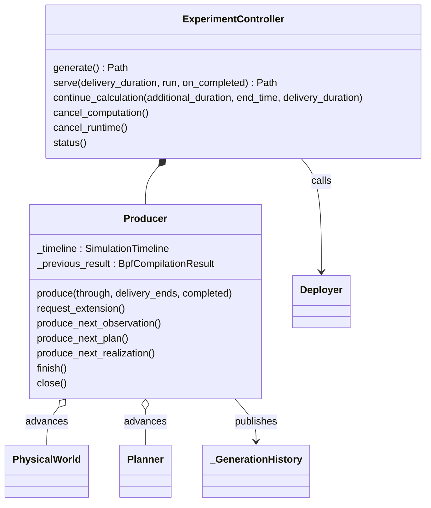

# Experiment orchestration

`Producer` is the sole chronological calculation cursor. It holds the original
Timeline, physical Models and Planner plus the necessary compiler predecessor.
`ExperimentController` integrates it with input capture, optional presentation,
material publication and separately owned deployment/runtime operations.

`generate()` drains a finite request. `serve()` waits efficiently after each completed
range; continuation extends only its suffix. The Controller's optional presentation
worker coalesces completed requests independently of Producer/Runner progress.
[Output records](output/README.md) provide the detached read boundary.

`execution.py` owns invocation claims, Runner/Traffic startup, reset and shutdown.
`run_generated_experiment()` remains explicit finite deployment/execution automation.
Generated `experiment_control.py` is a client to live owners, not restart recovery.
[Experiment reference](../../../docs/development/experiment-control.md) defines command ownership;
[controls guide](../../../docs/user-guides/computation-and-controls.md) gives operations.
