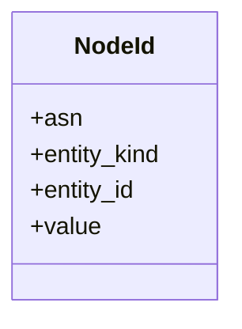
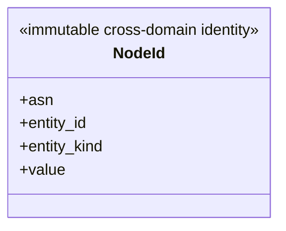

# Shared values and private mechanics

`skyseed_v2.shared` owns narrow cross-domain primitives only. `NodeId` is the
public immutable structural identity:

## Local assembly / ownership map

Legend: the class block is the one shared public identity value; `+` marks its
public immutable fields and derived value property.

`identifier.py` and `time.py` provide private validation/UTC normalization.
`_durable_evidence.py` provides authority-free deterministic JSONL mechanics.
`_execution_observation.py` buffers optional diagnostic component/stage/scope/
duration/work/resource records.

Each physical, planning, Compiler, Runner, or Traffic owner still defines its
own record schema, write timing, retention frontier, and meaning. Shared helpers
do not create a cross-domain history or lifecycle owner.

This package has no entity lookup, Model, operational state, planning,
compilation, runtime control, or Tool rendering responsibility.

## Detailed public class/member diagrams

These blocks and the exact table below are the maintenance source for every
class owned by this public package. Re-exporting facades do not duplicate the
owner detail.

Legend: `<<...>>` states each public class role and `+` lists its
complete direct public member contract. No connector means no ownership
relationship is asserted by this inventory block.

| Diagram class | Public contract | Required public members |
|---|---|---|
| `NodeId` | `skyseed_v2.shared.NodeId` | `asn`, `entity_id`, `entity_kind`, `value` |
