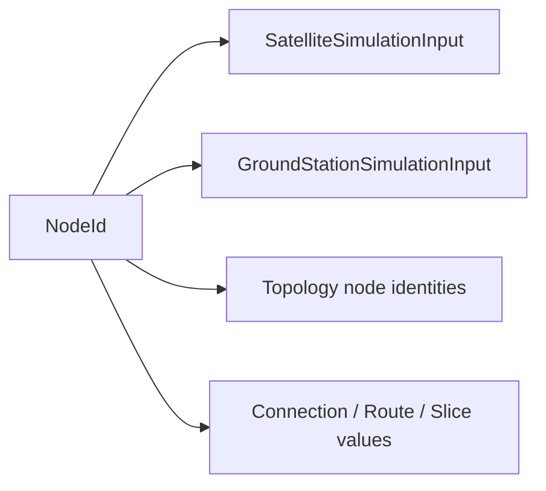
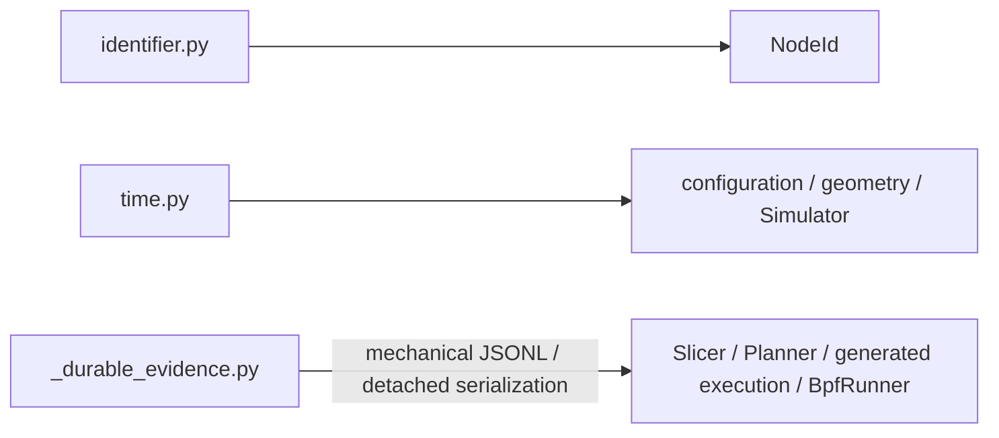
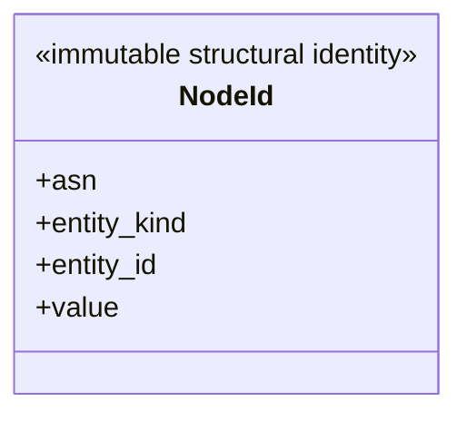

# Shared values

This package owns narrow cross-production primitives. `NodeId` is the only
public class; `identifier.py`, `time.py`, and `_durable_evidence.py` remain
internal mechanical boundaries and own no lookup, domain history, retention,
or lifecycle.

## Local assembly / ownership map

`shared` is not a destination for unrelated helpers: a value belongs here only
when multiple production boundaries need the same neutral contract and no
domain owner can own it.

Legend: `-->` means the named production boundary consumes the neutral shared
value or normalization capability; it is not ownership.

Legend: `-->` means an internal validation/normalization primitive supplies
the public/shared consumer; it creates no public owner.

## Detailed public class/member diagrams

Legend: the class block is the complete local public member contract; no
relationship is implied.

| Diagram class | Public contract | Required public members |
|---|---|---|
| `NodeId` | `skyseed_v2.shared.NodeId` | `asn`, `entity_kind`, `entity_id`, `value` |

## Entry points

`node_id.py` owns the public `NodeId`; `identifier.py` and `time.py` remain
private validation/normalization boundaries. `_durable_evidence.py` provides
only authority-free `_reset_jsonl`, `_append_jsonl`, `_read_jsonl`, and
deterministic `_semantic_value` mechanics. Each fact-producing owner still
defines its own record schema, write timing, retention frontier, and history
meaning; this helper does not create a shared history subsystem.

## Dependencies

This package depends only on standard-library value types. Configuration,
Simulator input/topology/slicing/planning, generated application composition,
and the BPF Runner consume its narrow primitives.

## Examples and tests

All Simulator examples carry `NodeId` through the boundary.
`test_simulation_node_identity.py`, static-input tests, Timeline tests, and
architecture-boundary tests cover it. Continuous-progression and Runner tests
cover the private durable-evidence mechanics through their fact-producing
owners.

## Maintenance checklist

Update the global object model only if `NodeId`'s system role changes; update
the local map and detailed diagram, public imports, identity/time contracts,
and owner tests when its public members change. Durable-evidence changes must
also preserve owner-local authority and must not introduce a cross-domain
history lifecycle.
