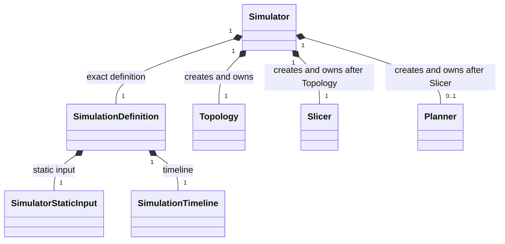
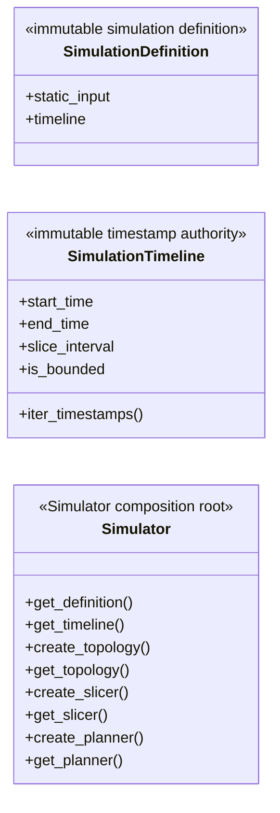

# Simulator composition root

This README owns only `SimulationDefinition`, `SimulationTimeline`, and
`Simulator`. Topology, input, geometry, slicing, planning, and built-in Model
members are maintained in their respective package README files.

## Local assembly / ownership map

Legend: `*--` is exact ownership/composition. The labels distinguish values
supplied in the definition from objects created by the Simulator lifecycle.

## Detailed public class/member diagrams

Legend: `A *-- B` means A owns or is composed of the exact B value/object.

| Diagram class | Public contract | Required public members |
|---|---|---|
| `SimulationDefinition` | `skyseed_v2.simulator.SimulationDefinition` | `static_input`, `timeline` |
| `SimulationTimeline` | `skyseed_v2.simulator.SimulationTimeline` | `start_time`, `end_time`, `slice_interval`, `is_bounded`, `iter_timestamps()` |
| `Simulator` | `skyseed_v2.simulator.Simulator` | `get_definition()`, `get_timeline()`, `create_topology()`, `get_topology()`, `create_slicer()`, `get_slicer()`, `create_planner()`, `get_planner()` |

## Entry points

Code entries are `definition.py`, `timeline.py`, and `simulator.py`.

## Dependencies

The definition consumes `input/`; `Simulator` consumes Simulator Zone
configuration, creates `topology/`, binds `slicing/` to the exact
Topology/Timeline and supplied Model Protocol roles, then binds `planning/` to
that exact sibling Slicer and supplied planning algorithm roles.

## Examples and tests

Assembly is shown in `examples/mini_satellite_internet/simu.py`. Simulator
lifecycle, Timeline, Topology, dynamic main-chain, Difference, and Zone tests
cover the composition root.

## Maintenance checklist

When this lifecycle changes, update the local maps, global object model,
ownership/lifecycle contracts, public imports, assembly examples, and focused
tests.
