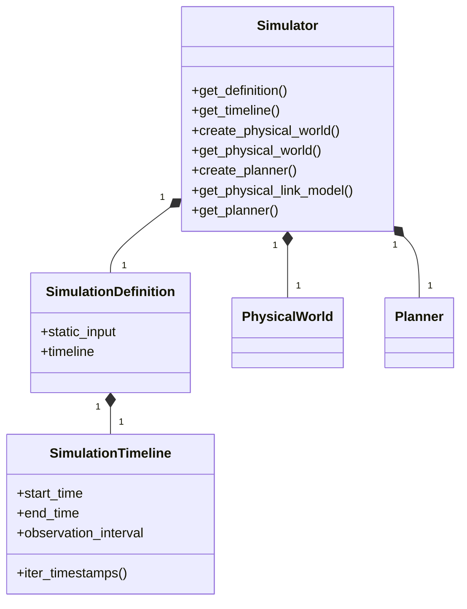
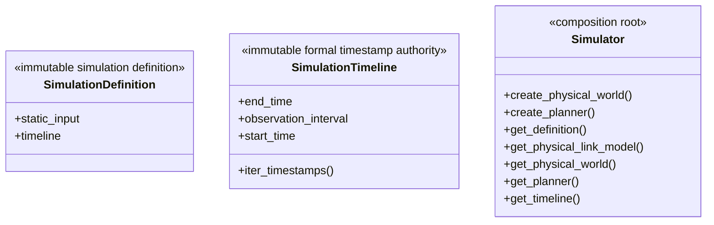

# Simulator composition root

This package owns `SimulationDefinition`, `SimulationTimeline`, `Simulator`,
and the public facade for physical and planning contracts.

## Local assembly / ownership map

Legend: `*--` is lifecycle composition. PhysicalWorld and Planner are sibling
owners created once by Simulator; no edge transfers their semantic authority.

`create_physical_world` binds one PositionModel and optional Zone layout.
`create_planner` requires the physical-link Model plus all planning
Models/policies and creates exactly one public Planner. Every role is a distinct
injected instance. Access before creation or duplicate creation fails.

PhysicalWorld projects exact requested frames. Planner accepts externally
computed matching physical-link observations and publishes timestamped Plans.
The private experiment producer owns progression and Compiler calls; Simulator
does not own backend execution.

Local owners:

- `input/`: immutable receiver-owned DTOs;
- `geometry/`: Earth-fixed values and calculations;
- `physical/`: PhysicalWorld, frames, capabilities, candidates, Zones;
- `models/`: built-in Position and physical-link Models;
- `planning/`: public Planner, Plan, operational Models/values/replay/evidence.

Tests: Timeline, one-owner lifecycle, public imports, architecture boundaries,
physical contracts, planning contracts, and maintained example integration.

## Detailed public class/member diagrams

These blocks and the exact table below are the maintenance source for every
class owned by this public package. Re-exporting facades do not duplicate the
owner detail.

Legend: `<<...>>` states each public class role and `+` lists its
complete direct public member contract. No connector means no ownership
relationship is asserted by this inventory block.

| Diagram class | Public contract | Required public members |
|---|---|---|
| `SimulationDefinition` | `skyseed_v2.simulator.SimulationDefinition` | `static_input`, `timeline` |
| `SimulationTimeline` | `skyseed_v2.simulator.SimulationTimeline` | `end_time`, `iter_timestamps()`, `observation_interval`, `start_time` |
| `Simulator` | `skyseed_v2.simulator.Simulator` | `create_physical_world()`, `create_planner()`, `get_definition()`, `get_physical_link_model()`, `get_physical_world()`, `get_planner()`, `get_timeline()` |
