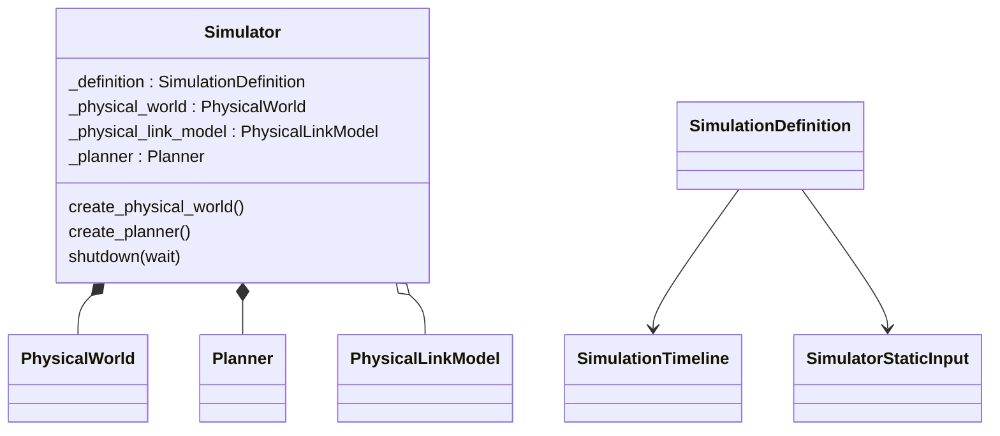

# Simulator assembly

`SimulationDefinition` pairs pure static input with a `SimulationTimeline`.
`create_default_simulator(..., forwarding_backend="bpf")` assembles defaults
concisely and accepts replacement Models. An omitted RouteModel uses gateway routes
for BPF and empty routes for Linux. Supplied Models pass through unchanged. This
choice is used only during assembly; it is not stored in Simulator or its definition. `Simulator` holds PhysicalWorld, PhysicalLinkModel and Planner; it owns no
Producer, Compiler or Runner. Construction and chronological advancement are distinct.

[Input values](input/README.md), [physical facts and queries](physical/README.md),
[Planner](planner/README.md) and [geometry](geometry/README.md) have local details.
The [Model role table](../../../docs/development/model-interfaces.md) locates minimum contracts,
templates, defaults and examples. [Calculation architecture](../../../docs/architecture/calculation.md)
shows how Producer advances the assembled objects.
