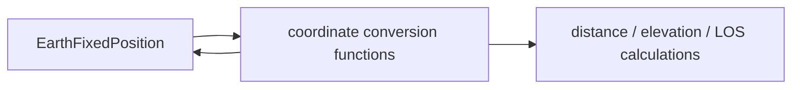
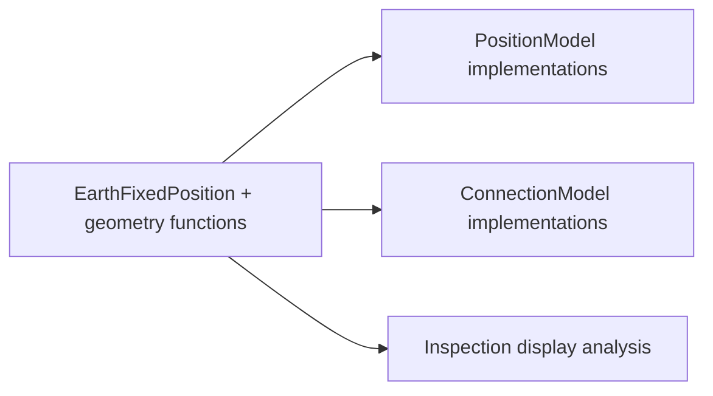
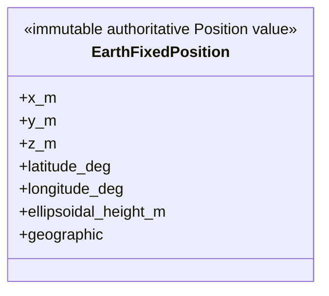

# Simulator geometry

This package owns the Earth-fixed Position value and deterministic
geodetic/ECEF, distance, elevation, and line-of-sight capability. It owns no
Topology, time propagation, Connection selection, or second coordinate state.

## Local assembly / ownership map

Legend: `-->` is value conversion or a calculation supplied by this package.
The two conversion arrows express inverse coordinate representations, not
ownership.

Legend: `-->` means the named consumer uses geometry capability. Geometry owns
none of these consumers and does not own a Slice.

## Detailed public class/member diagrams

Legend: the class block is the complete local public value/property contract;
no relationship is implied.

Public functions: `geodetic_to_ecef`, `ecef_to_geodetic`,
`ecef_distance_m`, `elevation_deg`, and `has_earth_line_of_sight`.

| Diagram class | Public contract | Required public members |
|---|---|---|
| `EarthFixedPosition` | `skyseed_v2.simulator.geometry.EarthFixedPosition` | `x_m`, `y_m`, `z_m`, `latitude_deg`, `longitude_deg`, `ellipsoidal_height_m`, `geographic` |

## Entry points

`position.py` owns `EarthFixedPosition` and `ecef_to_geodetic`;
`coordinates.py` owns the remaining public conversions and calculations.

## Dependencies

Geometry uses neutral numeric/time primitives. Position and Connection Model
implementations plus non-authoritative Inspection display analysis consume it;
geometry owns no Topology, Slice, or Tool artifact.

## Examples and tests

Dynamic slicing and Inspection examples exercise these values. Coordinate,
main-chain Model, Zone, Tool-boundary, and SCC tests cover the package.

## Maintenance checklist

Update the local map and detailed diagram, Position/Connection contracts,
public imports, and geometry tests when the public value/capability changes.
