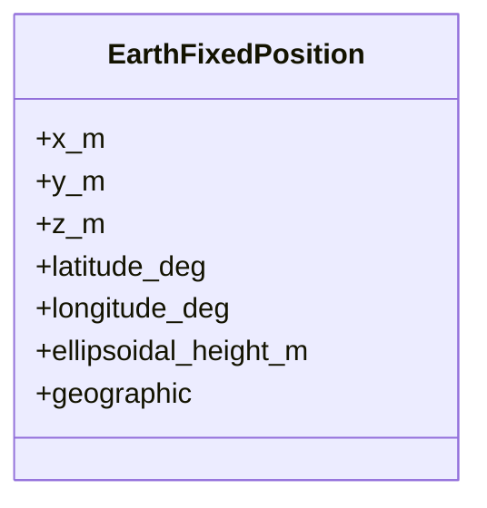
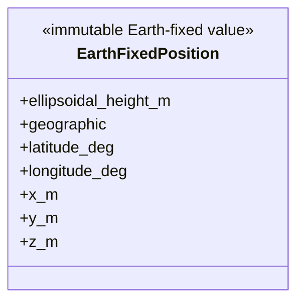

# Simulator geometry

This package owns immutable `EarthFixedPosition` and deterministic
geodetic/ECEF conversion, distance, elevation, and Earth line-of-sight
calculations.

## Local assembly / ownership map

Legend: the class block is the geometry-owned immutable value; public
calculation functions remain standalone helpers rather than fictional owners.

Public functions are `geodetic_to_ecef`, `ecef_to_geodetic`,
`ecef_distance_m`, `elevation_deg`, and `has_earth_line_of_sight`.

`_elevation.py` contains the single authoritative elevation primitive used by
the public helper and optimized physical-link calculation. It handles degree
units, clamping, coincident-position failure, and precomputed local-up inputs.

Geometry owns no PhysicalWorld, PhysicalFrame progression, candidate selection,
operational state, or Tool artifact. PhysicalWorld inspection copies elevation
from authoritative physical-link observations rather than recalculating it.

Focused tests cover conversion, antimeridian and horizon cases, non-zero
observer altitude, numerical clamping, coincidence, and optimized/public
equivalence.

## Detailed public class/member diagrams

These blocks and the exact table below are the maintenance source for every
class owned by this public package. Re-exporting facades do not duplicate the
owner detail.

Legend: `<<...>>` states each public class role and `+` lists its
complete direct public member contract. No connector means no ownership
relationship is asserted by this inventory block.

| Diagram class | Public contract | Required public members |
|---|---|---|
| `EarthFixedPosition` | `skyseed_v2.simulator.geometry.EarthFixedPosition` | `ellipsoidal_height_m`, `geographic`, `latitude_deg`, `longitude_deg`, `x_m`, `y_m`, `z_m` |
