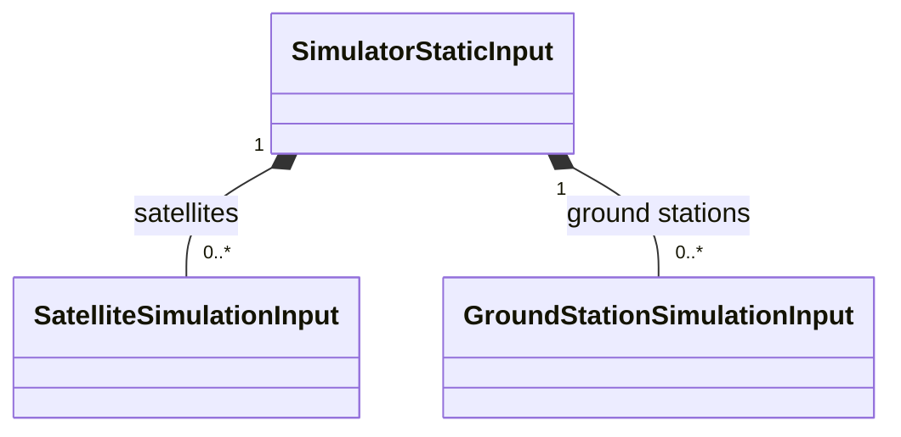
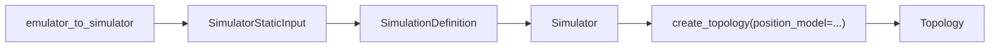
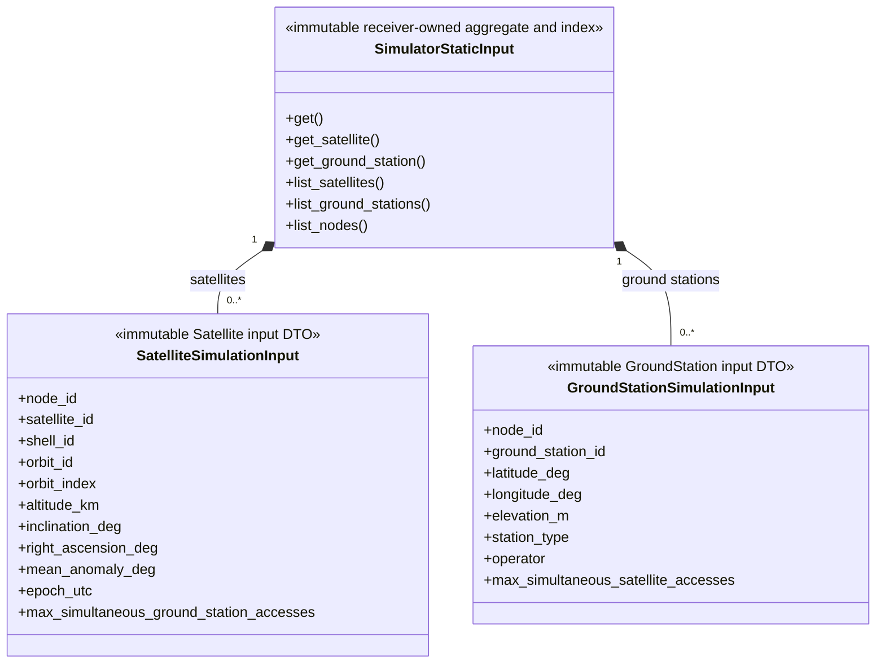

# Simulator static input

This package owns immutable receiver-side DTOs and their aggregate/index.
They contain neutral values, retain no Emulator/SEED reference, and are not
the long-lived Topology owner tree.

## Local assembly / ownership map

Legend: `*--` is immutable DTO composition.

Legend: `-->` is the ordered assembly/lifecycle handoff. Only
`Simulator.create_topology(position_model=...)` creates `Topology`; the
PositionModel is a required physical-side input, not part of these static DTOs.

## Detailed public class/member diagrams

Legend: `*--` is immutable DTO composition. Every simple DTO lists all public
fields.

| Diagram class | Public contract | Required public members |
|---|---|---|
| `SimulatorStaticInput` | `skyseed_v2.simulator.input.SimulatorStaticInput` | `get()`, `get_satellite()`, `get_ground_station()`, `list_satellites()`, `list_ground_stations()`, `list_nodes()` |
| `SatelliteSimulationInput` | `skyseed_v2.simulator.input.SatelliteSimulationInput` | `node_id`, `satellite_id`, `shell_id`, `orbit_id`, `orbit_index`, `altitude_km`, `inclination_deg`, `right_ascension_deg`, `mean_anomaly_deg`, `epoch_utc`, `max_simultaneous_ground_station_accesses` |
| `GroundStationSimulationInput` | `skyseed_v2.simulator.input.GroundStationSimulationInput` | `node_id`, `ground_station_id`, `latitude_deg`, `longitude_deg`, `elevation_m`, `station_type`, `operator`, `max_simultaneous_satellite_accesses` |

`GroundStationSimulationInput.operator` remains an explicit field and is
`str | None`: `None` preserves the absence of known operator metadata without
inventing a sentinel value.
`max_simultaneous_satellite_accesses` is `int | None` and copies the optional
site-level simulation capability without interpreting it as antenna count.
`SatelliteSimulationInput.max_simultaneous_ground_station_accesses` is the
independent `int | None` Satellite-side cap for GroundStation-access
Connections; it does not limit ISLs or total degree.

## Entry points

Code entries are `static_input.py`, `satellite.py`, and `ground_station.py`.
The sole Emulator projection entry is
`skyseed_v2.emulator_to_simulator.create_simulator_static_input`.

## Dependencies

DTOs depend only on neutral shared identity/time values and their own package
types. `SimulationDefinition` consumes the aggregate; `Simulator` later uses
it to create `Topology`.

## Examples and tests

Consumers include every Simulator assembly example. Static-input
construction/isolation, Topology projection, public-import, architecture, and
wheel tests cover this boundary.

## Maintenance checklist

When a DTO or aggregate query changes, update this README, the
Emulator–Simulator boundary contract, global object model if the cross-package
chain changes, public imports, bridge projection, and focused input tests.
