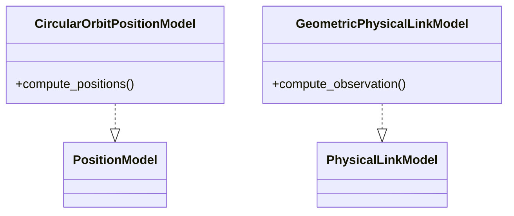
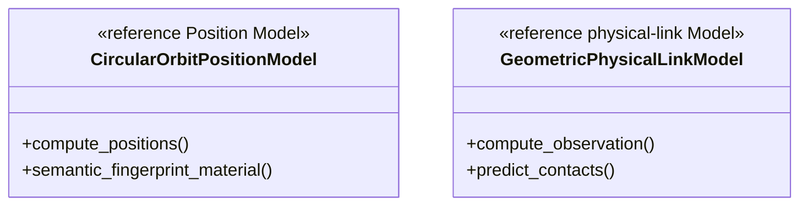

# Built-in physical Models

This package exports two built-in implementations:

## Local assembly / ownership map

Legend: `..|>` is Protocol realization. Each built-in Model implements exactly
one physical-domain role and acquires no planning authority.

`CircularOrbitPositionModel` computes complete deterministic positions for the
exact requested timestamp and expected node set. It is owned and called only by
PhysicalWorld.

`GeometricPhysicalLinkModel` consumes one exact PhysicalWorld, PhysicalFrame,
and bounded PhysicalLinkRequest. It evaluates range, Earth-clear LOS, distance,
propagation delay, GroundStation/Zone elevation, and deterministic work counts.
Only feasible candidate facts are returned.

The Model does not choose candidate scope, select operational relationships,
advance acquisition, assign Zone service, plan parameters, compute Routes, or
own history. Canonical K3 and 2+2 are injected planning policy; maximum 4 is a
PhysicalWorld capability.

`_geometric_physical.py` is a private shared optimized calculation core. It
uses the single geometry-owned elevation primitive and static indexes. It owns
no operational state.

Operational reference Models live in `../planning/models.py` because Planner
owns their contracts.

## Detailed public class/member diagrams

These blocks and the exact table below are the maintenance source for every
class owned by this public package. Re-exporting facades do not duplicate the
owner detail.

Legend: `<<...>>` states each public class role and `+` lists its
complete direct public member contract. No connector means no ownership
relationship is asserted by this inventory block.

| Diagram class | Public contract | Required public members |
|---|---|---|
| `CircularOrbitPositionModel` | `skyseed_v2.simulator.models.CircularOrbitPositionModel` | `compute_positions()`, `semantic_fingerprint_material()` |
| `GeometricPhysicalLinkModel` | `skyseed_v2.simulator.models.GeometricPhysicalLinkModel` | `compute_observation()`, `predict_contacts()` |

## Finite prediction and reuse

`GeometricPhysicalLinkModel.predict_contacts(...)` receives finite bounds and
per-kind admission tails from Producer and prepares physical proofs. Circular
all-phase separation/LOS bounds identify stable ISLs; conservative motion bounds
certify other complete sample cells. Unproved cells stay unknown. Other Position
Models need their own physical proof; sampled points alone do not imply future
continuity. No future Planner, routing or Compiler is invoked for prediction.

`_contact_prediction.py` stores compact contact intervals and all-future proofs;
`_batched_geometry.py` uses bounded 720-satellite surface tiles and shared exact
geometry after safe distance pruning. Only current feasible observations become
rich candidates. The geometric producer freezes those facts from already
validated identities and array results; public value constructors still validate
caller inputs. Surface identities are sorted once, and the request already
orders unique ISL pairs. The tile size reduces Python/native handoffs in the
measured threaded pipeline; it is a bounded engineering choice, not a universal
optimum. Static circular elements, fixed station coordinates, Zone
coordinates and local-up vectors are reused. `semantic_fingerprint_material()`
keeps derived Position caches out of world identity. The scalar restricted-query
path remains an exhaustive reference for equivalent geometry, not an alternate
generation path or policy.
