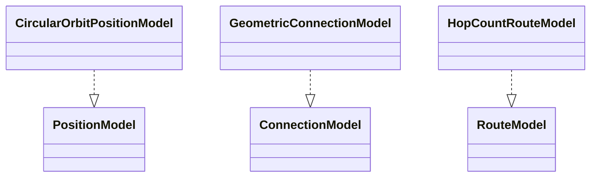
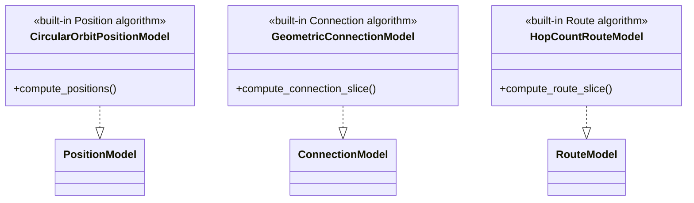

# Built-in Simulator Models

This package owns exactly the three built-in algorithm implementations.
Protocol contracts, Slicer ownership, and formal call order remain owned by
`../slicing/README.md`.

## Local assembly / ownership map

Legend: `Implementation ..|> Protocol` is UML Protocol realization. No edge
expresses Slicer ownership or call order.

## Detailed public class/member diagrams

Legend: `Implementation ..|> Protocol` is UML Protocol realization with the
implementation's public algorithm entry expanded.

| Diagram class | Public contract | Required public members |
|---|---|---|
| `CircularOrbitPositionModel` | `skyseed_v2.simulator.models.CircularOrbitPositionModel` | `compute_positions()` |
| `GeometricConnectionModel` | `skyseed_v2.simulator.models.GeometricConnectionModel` | `compute_connection_slice()` |
| `HopCountRouteModel` | `skyseed_v2.simulator.models.HopCountRouteModel` | `compute_route_slice()` |

## Entry points

Code entries are `circular_orbit.py`, `geometric_connection.py`, and
`hop_count_route.py`.

## Dependencies

Implementations depend on the matching Protocol and values owned by
`../slicing/`, static objects from `../topology/`, geometry capabilities, and
neutral shared values. They do not call one another.

## Examples and tests

Assembly is in `examples/mini_satellite_internet/simu.py`. Dynamic main-chain,
routing, reference-output, and Model lifecycle tests cover these
implementations.

## Maintenance checklist

When a built-in algorithm boundary changes, update this realization map,
Model/routing contracts, public imports, the dynamic example, canonical
output, and focused tests. Formal Slicer call order changes only in the
slicing owner README and its contracts.
