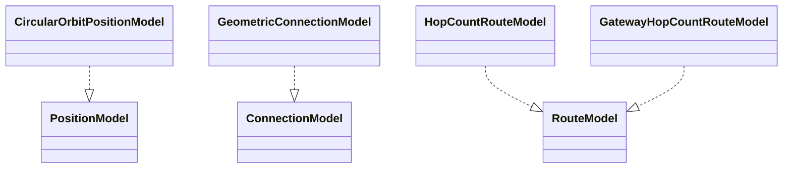
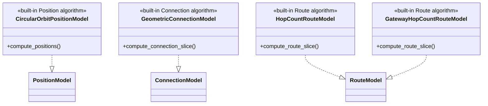

# Built-in Simulator Models

This package owns the four built-in algorithm implementations. The
`PositionModel` Protocol, its Topology ownership, and its formal call boundary
are owned by `../topology/README.md`. The temporary legacy Slicer's
Connection/Route Protocol ownership and call order remain owned by
`../slicing/README.md`.

## Local assembly / ownership map

Legend: `Implementation ..|> Protocol` is UML Protocol realization. No edge
expresses runtime ownership or call order.

## Detailed public class/member diagrams

Legend: `Implementation ..|> Protocol` is UML Protocol realization with the
implementation's public algorithm entry expanded.

| Diagram class | Public contract | Required public members |
|---|---|---|
| `CircularOrbitPositionModel` | `skyseed_v2.simulator.models.CircularOrbitPositionModel` | `compute_positions()` |
| `GeometricConnectionModel` | `skyseed_v2.simulator.models.GeometricConnectionModel` | `compute_connection_slice()` |
| `HopCountRouteModel` | `skyseed_v2.simulator.models.HopCountRouteModel` | `compute_route_slice()` |
| `GatewayHopCountRouteModel` | `skyseed_v2.simulator.models.GatewayHopCountRouteModel` | `compute_route_slice()` |

## Entry points

Code entries are `circular_orbit.py`, `geometric_connection.py`,
`hop_count_route.py`, and `gateway_hop_count_route.py`.

## Dependencies

`CircularOrbitPositionModel` depends on the PositionModel Protocol owned by
`../topology/`, static Topology objects, geometry capabilities, and neutral
values. Connection and Route implementations depend on their temporary legacy
Protocols in `../slicing/`, physical positions supplied through a
`PhysicalFrame`, static Topology objects, geometry capabilities, and neutral
shared values. The implementations do not call one another.

`GeometricConnectionModel` keeps its global GroundStation access-count policy.
For each site, it uses that value when the site's
`max_simultaneous_satellite_accesses` capability is `None`, otherwise the
smaller of the two. When any Satellite has an explicit
`max_simultaneous_ground_station_accesses` capability, the model uses a
deterministic two-phase capacitated matching over the same geometric
candidates. It first maximizes primary GroundStation coverage and, among
maximum-cardinality primary matchings, minimizes aggregate candidate rank
(higher elevation, then stable Satellite identity). Those primaries are
frozen before residual capacity is used to maximize redundant access links;
redundancy cannot move or degrade a frozen primary. This is a simple Skyseed
baseline policy, not a claim about an operational constellation scheduler.
The temporary legacy Slicer independently enforces every explicit site and
Satellite access cap on all ConnectionModel output before Slice publication.

The implementation uses private conservative spatial indexes to prune
GroundStation and Zone candidate checks before applying the unchanged exact
ECEF/LOS/elevation/distance predicates. Focused exhaustive-reference tests
verify that pruning does not alter published Connections or Zone assignments.

`HopCountRouteModel` is the full-reachability baseline for small/reference
scenarios. `GatewayHopCountRouteModel` is the satellite-Internet default: it
selects each Zone's ordered candidate GroundStations once from static
geographic distance and materializes only the current two-way candidate
demands over deterministic, demand-bounded hop-count traversals.

## Examples and tests

Assembly is in `examples/mini_satellite_internet/simu.py`. Dynamic main-chain,
routing, reference-output, and Model lifecycle tests cover these
implementations.

## Maintenance checklist

When a built-in algorithm boundary changes, update this realization map,
Model/routing contracts, public imports, the dynamic example, canonical
output, and focused tests. Position call order changes only in the Topology
owner README and its contracts; Connection/Route call order changes only in
the temporary slicing owner README and its contracts.
